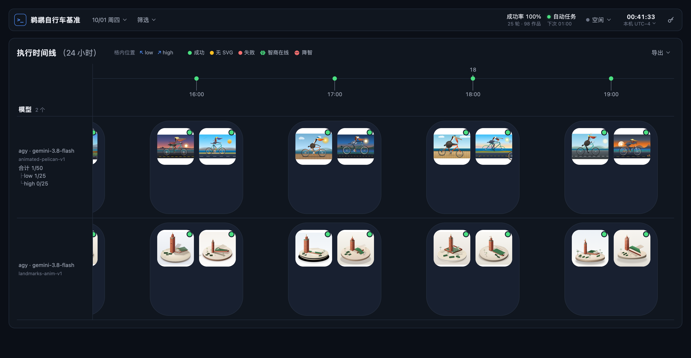
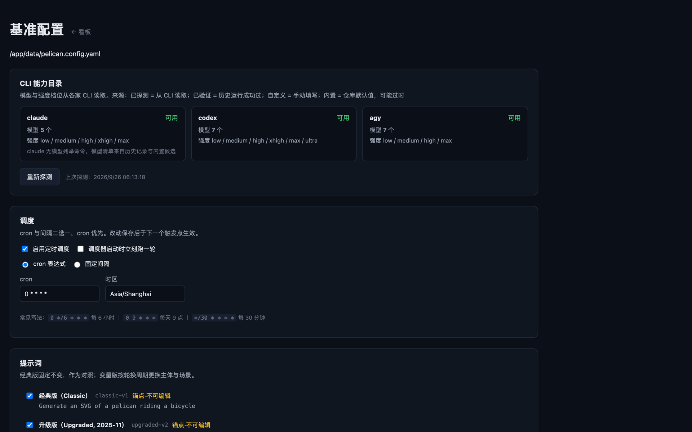

# LLM IQ Dashboard · Pelican Bicycle Benchmark

> **English** | [简体中文](README.zh-CN.md)

Scheduled benchmark runner and visual observability dashboard that drives `agy`, `codex`, and `claude` command-line agents across models and reasoning efforts on the **Pelican on a Bicycle** SVG benchmark (and 170+ extended physics, engineering, and spatial cognition prompts), presenting results on a 24-hour timeline.




## Attribution

The classic benchmark prompt uses Simon Willison's exact wording verbatim:

```
Generate an SVG of a pelican riding a bicycle
```

- Original repository: <https://github.com/simonw/pelican-bicycle>
- Blog tag: <https://simonwillison.net/tags/pelican-riding-a-bicycle/>

Full provenance, prompt variants, ground truth equations, and evaluation criteria are documented in [`docs/benchmark-provenance.md`](docs/benchmark-provenance.md).

This repository is an independent automated execution and observability layer and is neither affiliated with nor endorsed by the original author.

## Quick Start

Requires Node 22+ (see `.nvmrc`) and pnpm 10+.

```bash
pnpm install
pnpm preflight
```

`pnpm install` automatically syncs the pinned pricing catalog release (see [Cost (API-Equivalent)](#cost-api-equivalent)); if offline, it prints a warning and you can run `pnpm pricing:sync` later. On first load, `config/pelican.config.yaml` is generated from the starter template [`config/pelican.example.yaml`](config/pelican.example.yaml): one lightweight model per CLI at `low` effort across six prompts (classic + five frontier visual prompts), 18 calls per round, with per-round and daily USD caps configured.

`pnpm preflight` checks Node version, configuration, installation and login status of all three CLIs, pricing catalog availability, and estimated cost per round based on historical usage. If a CLI used by your config is missing or signed out, it prints the exact install/login command and exits non-zero.
`pnpm onboard` interactively walks through logging in each CLI and re-verifies readiness immediately afterward. Remove unused CLIs from `targets` in your configuration. Clicking “Dismiss” on the dashboard banner only hides the banner in the current browser without changing configuration.

Run a single round to verify the execution pipeline on your machine:

```bash
pnpm run:once
```

Start the production dashboard (<http://localhost:3000>, suited for long-running display):

```bash
pnpm dashboard:prod
```

`dashboard:prod` checks out the committed `HEAD` into a sibling directory `../llm_iq_dashboard-deploy`, installs dependencies, builds, and runs `next start` while sharing this repository's `data/` and `config/`. Uncommitted working-tree edits do not affect the production server; commit and re-run to update. The dashboard has two views: visitors can browse results read-only; configuration (`/config`), manual runs (“Run Once”), and the auto-run toggle require pairing an owner browser—run `pnpm pair` on the host machine and enter the one-time code at `/pair`. By default the server binds to `127.0.0.1`; for public exposure see [`docs/security/public-exposure-design.md`](docs/security/public-exposure-design.md).

When developing dashboard UI changes, run the dev server on a separate port:

```bash
pnpm dev --port 3001
```

Start the background scheduler (independent process, decoupled from the web server):

```bash
pnpm scheduler
```

Auto-run is **off** by default: when a scheduled tick arrives, the scheduler reads `data/auto-run.json` and skips execution unless enabled. Toggle “Auto-Run” on the dashboard toolbar to activate it (the web server spawns a background scheduler if none is running, logging to `data/scheduler.log`). Turning it off only blocks future triggers; an in-flight round finishes normally. Only one round runs at a time: manual triggers while a round is active are rejected (`409`), while scheduled triggers queue at most one pending round (coalescing subsequent ticks).

## Docker Deployment

```bash
docker compose up -d --build
docker exec -it llm-iq-runner pnpm onboard
docker exec -it llm-iq-runner pnpm pair
```

Two containers share one image: `llm-iq-web` serves the dashboard and exposes port `3000` (mounting only the data volume); `llm-iq-runner` installs the three CLIs, mounts credential volumes, exposes no ports, and executes scheduled and manual rounds requested via `data/requests/`. See [`docs/deploy-docker.md`](docs/deploy-docker.md) for volumes, upgrades, and data-repo sync.

## Public Read-Only Showcase Deployment

To deploy the dashboard to a serverless platform (such as Vercel) as a public read-only showcase, set:

- `PELICAN_DATA_SOURCE=remote`: fetches historical runs and sanitized SVGs on demand from a public GitHub data repository and implies read-only mode.
- `PELICAN_DATA_REPO_URL`: raw root URL of the public data repository (defaults to `https://raw.githubusercontent.com/meomeo-dev/llm-iq-data/main`).
- `PELICAN_READONLY=1`: enforces read-only protection at the server boundary (`403` on write endpoints, `404` on `/pair`).

Run `pnpm showcase:smoke` locally before deploying. See [`docs/deploy-public-showcase.md`](docs/deploy-public-showcase.md) for details.

## Configuration

Both methods edit the same file (`config/pelican.config.yaml`):



- **Web Console** <http://localhost:3000/config>: select CLI / model / reasoning effort, schedule cadence, prompts and rotation, timeouts, harness guard, artwork judging, and data repository sync. Saving mutates the YAML AST in place to preserve comments and atomically replaces the file after validation.
- **Direct file editing**: edit `config/pelican.config.yaml` directly (gitignored; bootstrapped from [`config/pelican.example.yaml`](config/pelican.example.yaml)).

| Field | Description |
| --- | --- |
| `schedule.cron` | Cron expression (takes precedence over `intervalMinutes`; starter default `0 9 * * *`) |
| `schedule.intervalMinutes` | Fixed interval in minutes |
| `schedule.timezone` | Time zone for cron evaluation (defaults to host time zone) |
| `schedule.runOnStart` | Whether to trigger an immediate round when the scheduler starts |
| `run.promptIds` | Prompt IDs executed in each round (run in parallel across models) |
| `run.concurrency` | Maximum number of model lanes running concurrently |
| `run.defaultTimeoutMs` | Global default timeout per attempt (default 300s) |
| `run.timeoutByCli` | Per-CLI timeout overrides, e.g. `codex: 600000` |
| `run.timeoutByEffort` | Per-effort timeout overrides, e.g. `max: 2700000` (45m) |
| `run.harnessGuard` | Direct-output guard (off by default): appends instructions requiring direct SVG output without web search, code execution, or self-screenshots; recorded in `run.json` |
| `judge` | Automated & AI artwork judging (off by default): `judge.enabled` enables 30pt code layer, `judge.ai.enabled` enables 70pt cross-vendor AI judge layer |
| `profiles` | Third-party upstream endpoints and cost multipliers per CLI |
| `budget.perRoundUsd` | Per-round API-equivalent USD cap |
| `budget.perDayUsd` | Rolling 24-hour API-equivalent USD cap |
| `retention.days` | Days to retain local run directories (only prunes runs confirmed `published` in the data repo) |
| `targets[]` | Matrix of `CLI × model × effort`; `enabled: false` targets are excluded from scheduled runs |
| `prompts[]` | Custom user-defined prompts and variables |
| `customModels` | Manually registered model IDs grouped by CLI |

Timeout precedence: `targets[].timeoutMs` > `run.timeoutByEffort[effort]` > `run.timeoutByCli[cli]` > `run.defaultTimeoutMs`.
Concurrency is organized by **model lanes**: different models run in parallel up to `run.concurrency`, while efforts (`low` → `max`) and prompts for the same model execute serially within its lane.

Override paths via `PELICAN_CONFIG` and `PELICAN_DATA_DIR`.

## Prompts & Rotation

| Prompt ID | Summary |
| --- | --- |
| `classic-v1` | Simon Willison's verbatim `Generate an SVG of a pelican riding a bicycle` (locked & immutable) |
| `upgraded-v2` | Simon Willison's 2025-11-18 upgraded prompt (California brown pelican, spokes, frame, pouch, pedaling) |
| `animated-pelican-v1` | Animated pelican on a bicycle using pure inline SMIL / CSS keyframes; eligible for automated + AI judging |
| `animated-armadillo-fishnet-mars-v1` / `animated-lemur-scooter-front-v1` | Extended classic dynamic benchmarks: Armadillo on Mars & Ring-tailed Lemur on a Scooter |
| `animated-iso-vintage-pc-v1` + 7 more | `2026-09` spatial & isometric hardware group (Vintage PC, Amber CRT, 10s Server Rack, Camera Exploded View, Kinetic Hand, Fish-Cloud Amodal, Island Chest, Tree Reader) |
| `clock-v1` / `penrose-v1` / `ice-water-v1` | Spatial geometry & physics commonsense: Clock at 3:45, Penrose Triangle, Floating Ice in Water |
| `four-stroke-engine-v1` + 6 more | Frontier engineering: Four-Stroke Engine, Möbius Strip, Cart-Pole, Isometric Cyber-Cube, Synthwave Drive, Cyber HUD, Black Hole Lensing |
| `jwst-deployment-v1` + 6 more | Frontier visual science: Quantum Double-Slit, Ferrofluid Spikes, JWST Deployment, Tokamak Plasma, 2nm GAA Nanosheet, CRISPR-Cas9, Pulsar Jet |
| `fe-*-v1` / `vfx-*-v1` (14 suites) | 140 frontier engineering (AI, Semi, Quantum, Bio, Energy, Aero, Meta, Neuro) & visual effects (Sim, Optics, Geom, SciVis, Motion, Sys) prompts, 10 candidates per suite |
| `landmarks-v1` / `landmarks-anim-v1` | 40 miniature world city landmarks (static & animated candidate sets) |
| `shuihu-v1` / `xiyou-v1` / `sanguo-v1` / `honglou-v1` (+ `-anim-v1`) | Four Classic Chinese Novels (10 iconic chapters each, static & animated candidate sets) |

Candidate-set prompts shuffle and draw one candidate per rotation period (`day` or `run`) without replacement until the deck is exhausted. Full provenance is in [`docs/benchmark-provenance.md`](docs/benchmark-provenance.md).

## Dashboard & Visual Exports

- **24-Hour Timeline & Folder Tiles**: Each row represents `cli · model` (with pass-rate tree beneath). Each cell is a 2×2 folder tile showing `low`, `medium`, `high`, and `max` efforts at fixed corners.
- **Language Switcher (`EN` / `中文`)**: Toggle UI, prompt metadata, judge rubrics, and exported images between English and Simplified Chinese at any time.
- **Comparison Modal & Full Viewer (`/view/<runId>/<svgFile>`)**: Side-by-side effort and upstream profile comparison, collapsible Ground Truth & Evaluation Criteria, raw sandboxed SVG link, and Judge Drawer with 8-frame contact sheets.
- **Export (PNG / SVG / GIF)**: Export the full 24h landscape timeline, transposed portrait timeline, or per-model comparison cards (including animated GIFs that preserve per-element animation phase).

## Artwork Judging

Disabled by default; enable in `/config` under “Artwork Judging”. For prompts with an automated rubric (`animated-pelican-v1`):
1. **Code Layer (30 pts)**: Static AST analysis via `jsdom` + 8-frame browser capture via `playwright-core` / Chromium measuring wheel rotation, crank linkage, loop continuity, and pedal tracking.
2. **AI Semantic Layer (70 pts)**: Artworks passing hard gates are evaluated after round completion by the first configured cross-vendor judge CLI (`judge.ai.judges`) in an isolated read-only workspace containing only contact sheets (blind description → part bounding-box location → C5–C9 scoring). Scores ≥ 78 pass (`online`).

## Cost (API-Equivalent)

Token usage is parsed from raw CLI event streams and priced against first-party API rates (`anthropic-api`, `openai-api`, `gemini-api`) from [meomeo-dev/llm-pricing-catalog](https://github.com/meomeo-dev/llm-pricing-catalog) pinned in `config/pricing-catalog.lock.json`.

```bash
pnpm pricing:sync            # Download & verify locked release (run automatically on postinstall)
pnpm pricing:sync --latest   # Upgrade lockfile to latest release
```

## Public Data Repo Sync

Sanitize and export completed rounds to a public data repository (`meomeo-dev/llm-iq-data`), stripping raw transcripts (`.txt`), redacting local paths, scanning against CLI credential fingerprints, and guarding local retention so unpublished rounds are never auto-deleted.

```bash
pnpm sync:data --repo ../llm-iq-data --dry-run
pnpm sync:data --repo ../llm-iq-data --confirm-published
pnpm sync:data --repo ../llm-iq-data --run 20260927T021708Z --push
```

See [`docs/data-sync-architecture.md`](docs/data-sync-architecture.md) for the full hot/cold tiering and security architecture.

## Design Notes & Development

- Core architectural trade-offs (capability probing, effort folding, house rules vs. prompt purity, per-call scratch directories, SVG sanitization & Shadow DOM isolation): [`docs/design-notes.md`](docs/design-notes.md)
- Directory layout, data artifacts, HTTP API reference, adding a new CLI adapter, and test suite: [`docs/development.md`](docs/development.md)

```bash
pnpm lint               # tsc --noEmit (includes test/)
pnpm test               # node:test unit tests (isolated from host data/ and CLIs)
pnpm validate:prompts   # Prompt registry & standard schema validation
pnpm check:length       # File and function length gate (config/code-length-policy.yaml)
pnpm check:secrets      # Tracked file secret scan (config/secret-scan-policy.yaml)
```

## License

[MIT](LICENSE)
