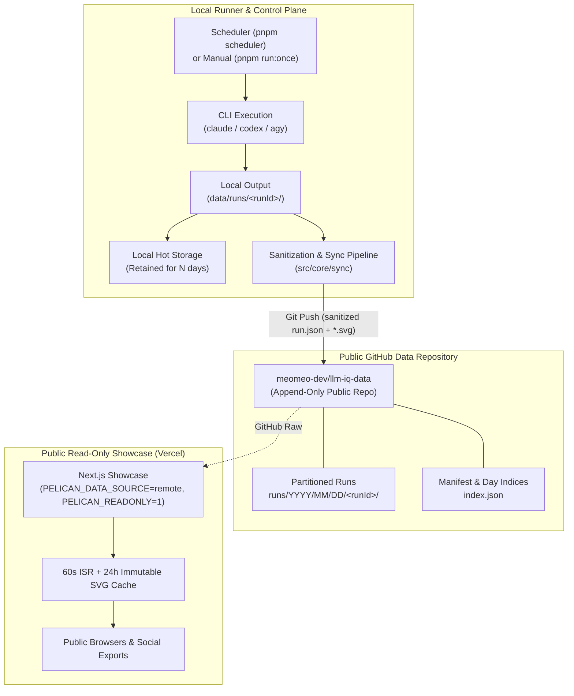

# Public Data Repository Separation & Vercel Showcase Architecture

> **English** | [简体中文](data-sync-architecture.zh-CN.md)

> **Status**: Implemented / Production Architecture  
> **Code Repository**: `meomeo-dev/llm-iq-dashboard`  
> **Data Repository**: `meomeo-dev/llm-iq-data`  
> **Created**: 2026-09-27  

---

## 1. Background & Core Engineering Challenges

As the Pelican on a Bicycle benchmark and the **54 built-in prompt entries** (30 standalone prompts + 24 rotating candidate suites containing **300 scene candidates**, totaling **330 unique benchmark prompt templates**) run continuously on a schedule, the system separates **Local Benchmark Execution** from **Public Read-Only Presentation** for four reasons:

1. **Execution requires local CLI credentials**: Benchmark runs depend on locally authenticated `claude`, `codex`, and `agy` CLIs, subscription/API tokens, and multi-minute timeouts that must never be exposed on a public web server.
2. **Preventing Git conflicts in the code repository**: Committing hourly JSON and SVG outputs into the code repository would cause constant rebase conflicts for contributors.
3. **Preventing Git repository bloat**: Accumulating thousands of SVG artworks and transcripts in the code repository would bloat `git clone` and CI builds to hundreds of megabytes or gigabytes.
4. **Zero-cost, high-concurrency read-only showcase**: Public visitors need fast, tamper-proof browsing on serverless edge infrastructure (such as Vercel) backed by GitHub Raw + ISR caching.

To address these requirements, the architecture enforces **physical separation of code and data**, **hot/cold tiered storage**, and **three-plane decoupling (Runner / Data Lake / Edge Showcase)**.

---

## 2. Three-Tier Physical Topology



---

## 3. Hot/Cold Tiering & Deterministic Retention Guard

### 3.1 Why Strict Hot/Cold Separation Is Required

- **Preventing Local Filesystem Traversal Collapse**: When the local server (`store.ts` and `/api/runs`) initializes or handles an SSE refresh, it scans `data/runs/`. Allowing thousands of historical runs to accumulate locally would degrade directory scans and JSON parsing from milliseconds to seconds.
- **Bounded DOM & Timeline Overhead**: Keeping the local hot window bounded while archiving the full history in `meomeo-dev/llm-iq-data` keeps both local I/O and Git tree fan-out constant.

### 3.2 Storage Tier Comparison

| Dimension | Local Hot Partition (`data/runs/`) | Public Cold Archive (`llm-iq-data`) |
| :--- | :--- | :--- |
| **Storage Medium** | Local disk `data/runs/<runId>/` | Dedicated GitHub repository `meomeo-dev/llm-iq-data` |
| **Retention Policy** | Rolling `retention.days` window (starter default 30 days; `null` retains all) | Permanent append-only archive (never deleted) |
| **Partition Layout** | Flat compact UTC directory `data/runs/<runId>/` | Date-partitioned tree `runs/YYYY/MM/DD/<runId>/` |
| **I/O Complexity** | Bounded by `retention.days` for constant-time scans | ≤ 48 entries per day directory, avoiding GitHub UI & Git tree slowdowns |
| **Contents** | Raw `.txt` CLI transcripts, contact sheets, `.judge.json`, `run.json`, `*.svg` | Sanitized `run.json` (with embedded `judge` summary) and verified `*.svg` only |
| **Primary Purpose** | Local debugging, live execution progress, immediate inspection | Long-term academic citation, public showcase, historical trend analysis |

### 3.3 Four-Step Closed-Loop Lifecycle & Retention Guard

```mermaid
sequenceDiagram
    autonumber
    participant Runner as Local Runner
    participant HotDir as Local Hot Storage (data/runs/)
    participant Hook as Sync Pipeline (src/core/sync)
    participant ColdRepo as Public Data Repo (llm-iq-data)
    participant Ledger as Sync Ledger (sync-state.json)
    participant Guard as Retention Guard (pruneExpiredRuns)

    Runner->>HotDir: 1. Before starting a round, executeRun calls pruneExpiredRuns via prepareRunStorage
    Runner->>Guard: Trigger expired run inspection
    Guard->>Ledger: Read per-run sync status (missing file = all unpublished)
    alt Expired (> retentionDays) AND status is published OR skipped/unpublishable-prompt, empty, discarded
        Guard->>HotDir: Physically delete directory (rm -rf) to free hot disk space
    else Expired (> retentionDays) AND status is skipped/rejected
        Guard->>HotDir: [Safety Preserve] Never auto-delete; log summary for manual review
    else Expired (> 2 × retentionDays) AND (missing run.json OR inProgress: true)
        Guard->>Ledger: Record skipped/abandoned in ledger
        Guard->>HotDir: Physically delete incomplete residual directory (rm -rf)
    else Expired (> retentionDays) AND directory is empty
        Guard->>HotDir: Remove expired empty directory
    else Expired (> retentionDays) BUT unpublished (exported or not in ledger)
        Guard->>HotDir: [Safety Circuit-Breaker] Preserve directory and log summary!
    end
    Runner->>HotDir: 2. Round completes, write final runId/ (run.json, svg, txt)
    Note over HotDir: Immediately visible on local dashboard
    alt autoSync is true OR manual pnpm sync:data
        Runner->>Hook: 3. Trigger sync pipeline
        Hook->>Hook: Usage backfill, SVG leak scan, run.json path redaction & validation
        Hook->>ColdRepo: Write runs/YYYY/MM/DD/<runId>/ and update DayIndex & index.json
        Hook->>ColdRepo: Git commit chore(data): sync <N> run(s)
        Hook->>Ledger: Record status: exported + commit SHA (or status: skipped)
        opt push is true
            Hook->>ColdRepo: git push to remote
            Hook->>ColdRepo: Verify reachability via git merge-base --is-ancestor
            Hook->>Ledger: Mark status: published + publishedAt
        end
    end
```

1. **Pre-Run Tiered Pruning (`pruneExpiredRuns`)**: Invoked before each round via `prepareRunStorage`. Only runs confirmed `published` (or `skipped/unpublishable-prompt`, `skipped/empty`, `skipped/discarded`) are deleted after `retention.days`; incomplete residuals older than `2 × retention.days` are marked `skipped/abandoned` and removed; `skipped/rejected` runs and unpublished runs are preserved.
2. **Immediate Hot Write**: Completed rounds write to `data/runs/<runId>/` for zero-latency local viewing.
3. **Sanitized Archive**: Exports sanitized `run.json` (with embedded `judge` summary stripped of contact sheet and transcript references, ACR-020) and verified `*.svg` files into `runs/YYYY/MM/DD/<runId>/`, updates `DayIndex` and root `DataRepoManifest`, and creates a Git commit.
4. **Push & Ancestor Verification**: When `--push` is used, runs `git fetch` + `git merge --ff-only @{u}` before exporting, pushes with a 120s timeout (never `--force`), and verifies via `git merge-base --is-ancestor` that the remote branch contains each commit before marking `published` in `sync-state.json`.
5. **Confirm-Published & Container Split (ACR-010 / ACR-011)**: In Docker deployments, `runner` mounts `/data-repo` with `autoSync: true, push: false` to commit locally (`exported`). The Owner can push via the web console (using a repository-scoped GitHub App token stored in `runner-secrets`) or push from the host and run `pnpm sync:data --confirm-published` to promote ancestor-verified commits to `published`.

### 3.3.1 Sync Ledger States (`sync-state.json`)

| Status (`status`) | Reason (`reason`) | Trigger & Meaning | Key Fields | Next Transition |
| :--- | :--- | :--- | :--- | :--- |
| `exported` | — | Sanitized files written to `/data-repo` working copy and committed locally | `exportedAt`, `commit`, `redactions` | Promoted to `published` after push & ancestor check |
| `published` | — | Pushed to remote and verified reachable on remote tracking branch | `exportedAt`, `commit`, `publishedAt`, `redactions` | Safely deleted by retention guard after `retention.days` |
| `skipped` | `unpublishable-prompt` | All prompts in the round are in `UNPUBLISHABLE_PROMPT_IDS` (e.g. `leijun-v1`) | `skippedAt`, `reason` | Safely deleted by retention guard after `retention.days` |
| `skipped` | `empty` | Round finished with zero completed attempts (e.g. cancelled immediately) | `skippedAt`, `reason` | Safely deleted by retention guard after `retention.days` |
| `skipped` | `discarded` | Explicitly discarded by Owner in the Data Repo panel (cannot discard already exported/published runs) | `skippedAt`, `reason` | Restorable in UI; deleted after `retention.days` |
| `skipped` | `rejected` | Blocked by secret/path/credential-fingerprint scanner | `skippedAt`, `reason`, `details` (file & rule name only) | **Never auto-deleted**; requires manual inspection |
| `skipped` | `abandoned` | Incomplete residual directory (missing `run.json` or `inProgress: true` for `> 2 × retention.days`) | `skippedAt`, `reason` | Physically deleted upon marking |

> **Note**: On startup, `src/core/run/recover-interrupted.ts` finalizes interrupted rounds that already have a `run.json` (marking them cancelled while preserving completed attempts) and removes empty directories containing only `progress.json`. Runs already marked `exported` or `published` are never overwritten with `skipped`.

### 3.3.2 Tiered Pruning Matrix

Pruning evaluates age from the `runId` UTC timestamp (`runIdTime`) against `retentionDays`:

| Directory / Run Type | Ledger Status | Condition (`now - runIdTime`) | Action & Ledger Update | Summary Log |
| :--- | :--- | :--- | :--- | :--- |
| Completed & published run | `published` | `> retentionDays` | Delete directory | Counted in `Pruned N expired run(s)` |
| Unpublishable prompt run | `skipped/unpublishable-prompt` | `> retentionDays` | Delete directory | Counted in `Pruned N expired run(s)` |
| Empty completed run | `skipped/empty` | `> retentionDays` | Delete directory | Counted in `Pruned N expired run(s)` |
| Owner-discarded run | `skipped/discarded` | `> retentionDays` | Delete directory | Counted in `Pruned N expired run(s)` |
| Leak-rejected run | `skipped/rejected` | Any age | **Preserve (never auto-delete)** | `Preserved N rejected expired run(s) (manual review required)` |
| Residual (missing `run.json` or `inProgress: true`) | Unrecorded / unprotected | `> 2 × retentionDays` | Atomically record `skipped/abandoned`, delete directory | Counted in `Pruned N expired run(s)` |
| Residual (missing `run.json` or `inProgress: true`) | Unrecorded / unprotected | `≤ 2 × retentionDays` | Preserve silently | No log |
| Read error (`EACCES`, etc.) or corrupt JSON | Any | Any age | Preserve (do not treat as residual) | Logs specific read/parse error |
| Previously `abandoned` but now has valid completed `run.json` | `skipped/abandoned` | `> retentionDays` | Preserve as unpublished run | Counted in `Preserved N unpublished expired run(s)` |
| Expired empty directory | None | `> retentionDays` | Delete directory | Counted in `Pruned N expired run(s)` |
| Unsynced or unconfirmed run | `exported` or unrecorded | `> retentionDays` | **Safety circuit-breaker: preserve** | `Preserved N unpublished expired run(s)` |
| Ledger file absent | — | — | Equivalent to all runs unpublished; preserve all | `Preserved N unpublished expired run(s)` |

### 3.4 On-Demand Cold Lookup & 62-Day Calendar Cap

In remote read-only mode (`PELICAN_DATA_SOURCE=remote`):
- **Server-Side Fetch & ISR**: Fetches from GitHub Raw with Next.js `revalidate: 60` (60s ISR + in-process cache) for JSON indices/records and 24-hour immutable caching for `/art` SVGs.
- **62-Day Calendar Cap (`CALENDAR_DETAIL_DAYS = 62`)**: `listRunStarts` fetches per-day `runs/YYYY/MM/DD/index.json` only for the most recent 62 days in `index.json` to get exact timestamps; older dates synthesize UTC noon timestamps (`<date>T12:00:00.000Z`) directly from `days[].runs` counts, bounding total calendar requests to `≤ 62`. If an individual day index fetch fails, it gracefully falls back to the manifest count.
- **Historical Drill-Down**: Selecting a date (e.g. `/?day=2026-06-15`) fetches only that day's partition (`runs/2026/06/15/`) on the server; browsers never fetch GitHub Raw directly.

---

## 4. Control Plane vs. Public Read-Only Viewer

```
                    ┌────────────────────────────┐
                    │      llm-iq-dashboard      │
                    └──────────────┬─────────────┘
                                   │
                ┌──────────────────┴──────────────────┐
                ▼                                     ▼
   [Local: Control Plane]                [Vercel: Read-Only Viewer]
   • Bind: 127.0.0.1:3000 / dev 3001     • Domain: llm-iq-dashboard.vercel.app
   • Run Once: Owner enabled             • Run Once: Hidden ("Read-Only Showcase" badge)
   • Auto-Run Toggle: Owner enabled      • Auto-Run Toggle: Hidden
   • Config (/config): Owner enabled     • Config (/config): Blocked (403 / redirect)
   • Pairing (/pair): Enabled            • Pairing (/pair): Blocked (404)
```

---

## 5. Data Sync & Sanitization Pipeline

### 5.1 Data Repository Directory Layout

```text
meomeo-dev/llm-iq-data/
├── README.md                      # Dataset documentation, schema reference & citation guide
├── LICENSE-CODE                   # MIT License (for validation & tooling scripts)
├── LICENSE-DATA                   # CC-BY-4.0 License (for benchmark datasets & SVG artworks)
├── index.json                     # DataRepoManifest (all dates & total run counts)
└── runs/
    └── 2026/
        └── 09/
            └── 27/
                ├── index.json     # DayIndex (ascending run summaries for that UTC day)
                ├── 20260927T021708Z/
                │   ├── run.json   # PublicRunRecord (sanitized public run record)
                │   ├── claude__claude-sonnet-5__low__classic-v1.svg
                │   ├── codex__gpt-6-luna__low__classic-v1.svg
                │   └── agy__gemini-3.8-flash__low__classic-v1.svg
                └── 20260927T031708Z/
```

### 5.2 Allowlist, Sanitization & Denylist Rules

- **Allowlist**:
  - `run.json`: Exported as `PublicRunRecord` (`publicSchemaVersion: 1`) with `rawFile: null`, backfilled token usage, sanitized `judge` summary, and public profile views (`profiles`, excluding `website`, `baseUrl`, `queryParams`, and API key state);
  - `*.svg`: Verified self-contained SVG artworks;
  - `index.json`: Updated `DayIndex` and root `DataRepoManifest`.
- **Multi-Layer Leak Scanning**:
  - Scans every SVG and `run.json` against `local-path`, `private-key`, `secret-pattern`, and sliding-window HMAC fingerprints of local CLI credentials and profile API keys (`leak-guard`);
  - Any SVG matching a rule is withheld (`svgFile: null` and logged in `redactions`);
  - Local home paths in `run.json` are normalized to `~`; if any sensitive path or secret pattern remains, the entire run is rejected (`skipped/rejected`);
  - Existing target directories with identical content are skipped idempotently; differing content aborts as a conflict.
- **Strict Denylist**:
  - `*.txt` raw CLI event streams and `*.judge-ai.txt` judge transcripts;
  - `*.sheet.png` contact sheets;
  - `.env`, credential files, local `pelican.config.yaml`, and `*.lock` / `requests/` runtime files.

### 5.3 Unpublishable Prompts

Prompts depicting real people or reserved for local testing (such as the removed `leijun-v1` prompt) are blocked by two synchronized allow/deny gates:
1. `UNPUBLISHABLE_PROMPT_IDS` in `src/core/data-repo/contract.ts` (stripped during export; rounds containing only unpublishable prompts are marked `skipped/unpublishable-prompt`);
2. `UNPUBLISHABLE_PROMPT_IDS` in `scripts/lib/validator.mjs` in the data repository CI.

---

## 6. Dual-Track Open-Source Licensing Strategy

| Asset Category | License | Rationale | Copyleft Impact |
| :--- | :--- | :--- | :--- |
| **Code & Tooling Scripts**<br/>(`LICENSE-CODE`) | **MIT License** | Matches `llm-iq-dashboard`; permissive for commercial and non-commercial reuse. | **None** |
| **Benchmark Datasets & SVG Artworks**<br/>(`LICENSE-DATA`) | **CC-BY 4.0**<br/>(Creative Commons Attribution 4.0 International) | Standard open-science license for evaluation datasets: allows commercial reuse, redistribution, and academic citation with attribution, without imposing copyleft obligations on software. | **None** |

---

## 7. Implemented Architecture & Module Map

1. **Core Sync Modules (`src/core/sync/`)**:
   - `leak-scan.ts`: Shared secret/path scanner and local path redaction;
   - `export-run.ts`: Builds `PublicRunRecord`, normalizes legacy records, backfills token usage, and sanitizes SVGs;
   - `data-repo-index.ts`: Maintains per-day `DayIndex` and root `DataRepoManifest`;
   - `sync-ledger.ts`: Atomically reads/writes `<PELICAN_DATA_DIR>/sync-state.json` (`exported`, `published`, and `skipped` with reasons `unpublishable-prompt`, `rejected`, `abandoned`, `empty`, `discarded`);
   - `ledger-skip.ts`, `ledger-decisions.ts`: Records skipped runs, handles Owner discard/restore actions, and preserves partial-attempt selection idempotency;
   - `sync-scope.ts`, `attempt-selection.ts`: Resolves sync scope (`path`, `repository`, `profiles`, `publishPrompts` allowlist) and per-attempt subset selection;
   - `sync-writer.ts`, `sync-content-check.ts`: Writes partition files/indices and verifies byte-for-byte idempotency against existing directories;
   - `data-repo-checkout.ts`: Auto-clones `dataRepo.repository` when `dataRepo.path` is missing or empty, and aborts on `origin` mismatch (ACR-023);
   - `data-repo-status.ts`, `sync-actions.ts`, `data-repo-action-lock.ts`: Aggregates panel status, dispatches panel actions across web/runner, and coordinates the mutex lock shared by sync and pruning;
   - `data-repo-git.ts`: Checks working-tree cleanliness, commit authorship, commits, and bounded-timeout pushes;
   - `confirm-published.ts`: Verifies remote ancestor inclusion via anonymous `git fetch` + `git merge-base --is-ancestor`;
   - `sync-orchestrator.ts`: Orchestrates candidate filtering, idempotency checks, conflict detection, and ledger updates.
2. **CLI Entrypoint (`src/bin/sync-data.ts`)**:
   - Invoked via `pnpm sync:data` with `--repo`, `--dry-run`, `--run`, `--push`, `--confirm-published`, and `--json` flags (exit codes: `0` success, `1` operational error, `2` leak rejection or conflict).
3. **Runner Post-Sync & Retention Hooks**:
   - `src/core/run/post-sync.ts`: Triggers auto-sync after round completion when `dataRepo.autoSync` is enabled (and runs publish confirmation when `push: false`), isolating any sync errors from benchmark results;
   - `src/core/retention.ts`: Enforces the tiered pruning matrix (`pruneExpiredRuns`).
4. **Owner Web Console & APIs (ACR-010 / ACR-011 / ACR-023)**:
   - `GET /api/data-repo`: Aggregates working copy health, `origin` verification, manifest, ledger, and pending runs;
   - `POST /api/data-repo/sync`: Executes `dry-run`, `export`, `confirm`, `push`, `discard`, and `restore` with mutex locking and two-step commit confirmation;
   - `/config` “Data Repository Settings” section updates `dataRepo.repository`, `path`, `autoSync`, and `push` in `pelican.config.yaml`.
