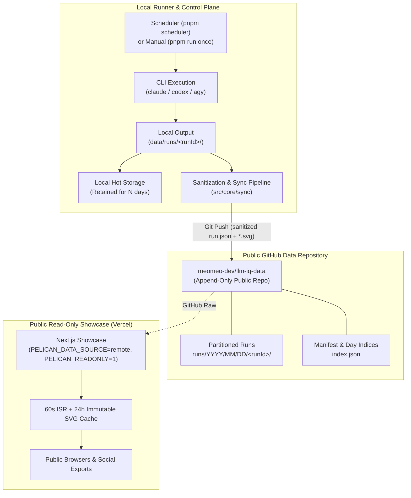

# Public Data Repository Separation & Vercel Showcase Architecture

> **English** | [简体中文](data-sync-architecture.zh-CN.md)

> **Status**: Implemented / Production Architecture  
> **Code Repository**: `meomeo-dev/llm-iq-dashboard`  
> **Data Repository**: `meomeo-dev/llm-iq-data`  

---

## 1. Background & Core Engineering Challenges

As the Pelican on a Bicycle benchmark and the 170+ frontier engineering & visual effects prompts run continuously on a schedule, the system separates **Local Benchmark Execution** from **Public Read-Only Presentation** for four reasons:

1. **Execution requires local CLI credentials**: Benchmark runs depend on locally authenticated `claude`, `codex`, and `agy` CLIs and long-running timeouts that must never be exposed on a public web server.
2. **Preventing Git conflicts in the code repository**: Committing hourly JSON and SVG outputs into the code repository would cause constant rebase conflicts for contributors.
3. **Preventing Git repository bloat**: Accumulating thousands of SVG artworks and transcripts in the code repository would bloat `git clone` and CI builds.
4. **Zero-cost, high-concurrency read-only showcase**: Public visitors need fast, tamper-proof browsing on serverless edge infrastructure (such as Vercel) backed by GitHub Raw + ISR caching.

---

## 2. Three-Tier Topology

---

## 3. Hot/Cold Tiering & Retention Guard

| Dimension | Local Hot Storage (`data/runs/`) | Public Cold Archive (`llm-iq-data`) |
| :--- | :--- | :--- |
| **Storage Medium** | Local disk `data/runs/<runId>/` | Dedicated GitHub repository `meomeo-dev/llm-iq-data` |
| **Retention Policy** | Rolling `retention.days` window (default 30 days) | Permanent append-only archive |
| **Directory Layout** | Flat UTC directory `data/runs/<runId>/` | Date-partitioned `runs/YYYY/MM/DD/<runId>/` |
| **Contents** | Raw `.txt` CLI transcripts, contact sheets, `run.json`, `*.svg` | Sanitized `run.json` (with embedded `judge` summary) and verified `*.svg` only |

### Retention Guard (`pruneExpiredRuns`)

Before starting each round, `pruneExpiredRuns` inspects `<PELICAN_DATA_DIR>/sync-state.json`:
- **Safe to prune**: Expired runs whose ledger status is `published` (or `skipped/unpublishable-prompt`, `skipped/empty`, `skipped/discarded`).
- **Safety circuit-breaker**: Expired runs that are still `exported` (not yet pushed/confirmed on the remote) or missing from the ledger are **never deleted**, preventing accidental data loss during network outages.
- **Rejected runs**: Runs marked `skipped/rejected` (blocked by secret/path scanner) are preserved on disk and logged for manual review.

---

## 4. Multi-Layer Sanitization & Leak Guard

1. **Zero Raw Transcripts**: Raw `.txt` CLI event streams and `.judge-ai.txt` transcripts are never exported (`rawFile: null` in `PublicAttempt`); token usage is extracted and backfilled into `run.json` before export.
2. **Path & Secret Scanning**:
   - Scans both `run.json` and `*.svg` against local absolute paths (`local-path`), private keys (`private-key`), cloud/API token patterns (`secret-pattern`), and sliding-window fingerprints of local CLI credential files (`leak-guard`).
   - Any SVG matching a leak rule is withheld from publication (`svgFile: null` and recorded in `redactions`).
   - Unpublishable prompt IDs (`UNPUBLISHABLE_PROMPT_IDS` in `src/core/data-repo/contract.ts`) are stripped at export time and rejected by the data repository CI validator.
3. **Sync Ledger Lifecycle (`sync-state.json`)**:
   - `exported`: Sanitized files written to local `/data-repo` working copy and committed to Git.
   - `published`: Verified via `git fetch` + `git merge-base --is-ancestor` that the commit is reachable on the remote upstream branch.
   - `skipped`: Recorded with reason (`unpublishable-prompt`, `empty`, `rejected`, `abandoned`, or `discarded`).
