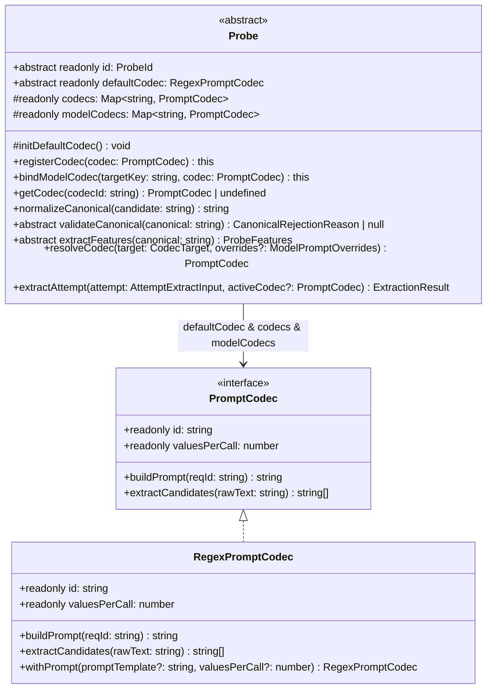

# 模型指纹模块设计

| 项 | 内容 |
|---|---|
| 状态 | 定稿（final），已完成第 1–2 期实施（与最新代码同步） |
| 日期 | 2026-10-17 |
| 算法基础 | 经典信息论 Jensen-Shannon 散度（Lin, 1991）与配对交叉验证 |
| 实施计划 | [model-fingerprint-implementation-plan.md](model-fingerprint-implementation-plan.md)：模块划分、命令、改动面、配置、分期与验收 |
| 后续 | 登记 issue，按 `/arch-revision` 立 ACR-024 并回填仓库级架构与开发文档 |

本文给出看板新增「模型指纹（model fingerprint）」模块的方法设计：通过受控输出任务的短提示词
（探针）对模型采样，提取应答字符串的字符与分段经验频率分布，用信息论中的 **Jensen-Shannon
散度（JSD）** 计算被测应答与各基准模型样本集之间的分布相似度。每个探针采用面向对象设计封装为
独立的 `Probe` 子类：内部将**提示词生成与应答提取成对内聚为编解码器（`PromptCodec`）**，并在探针
基类上固定统一的**领域标准值校验（`validateCanonical`）与统计特征切分（`extractFeatures`）**；
样本集按缺口增量补齐，使用者在日常核验中只选 CLI、`profile`、模型与探针列表。文中的「第 N 期」
见实施计划的分期。

## 1. 用途与使用方式

模型指纹回答一个问题：指定 CLI 与上游配置（`profile`）实际返回的应答，在统计分布上更
接近哪一个已有基准样本集的模型。`profile` 对齐本仓库既有定义：例如 `codex` 的 `default`
（官方默认登录态）或某个第三方上游 `profile`。用途：

- 核验第三方 `profile` 的应答分布是否与声明的模型一致。
- 鹈鹕作品被判「降智」时，补充一条参考线索：同一 `profile` 的应答分布是否更接近另一个
  已知模型。
- 定期对官方 `default` 登录态做对照核验，检测基准样本过期或 CLI 升级引起的输出分布变化。

核验结论是已采集基准样本集之间的相对比较，不构成对服务商路由行为或意图的证明。

| 操作 | 命令 | 使用者给出 | 模块完成 |
|---|---|---|---|
| 查看状态 | `pnpm fingerprint:status` | 可选 `--cli`、`--model` 或 `--probes` 过滤 | 列出配置 `references` 与磁盘已有样本集的模型 × 探针状态、每条样本的留一相似度、CLI 版本与补齐所需调用次数 |
| 采集 / 补采基准样本 | `pnpm fingerprint:fill` | 可选 `--cli`、`--model`、`--probes`、可选 `--profile`（缺省 `default`）、可选 `--count <n>`（单次试采条数上限，`0` 为仅应用剔除/恢复不调用模型）、可选 `--exclude` / `--include <reqId,...>`、可选 `--reset`（须显式指定 `--cli`、`--model` 与 `--probes`）、可选 `--dry-run`、`--yes` / `-y` | 指定 `--model` 时只针对该单一模型与所选探针独立定向采集（无需预置入 `references`，绝不触碰其他模型）；可先按 `reqId` 剔除/恢复异常样本，再按 `min(missingValues, count)` 增量补采；先报告所需的调用次数与估算费用 |
| 核验 | `pnpm fingerprint:check` | `--cli`、可选 `--profile`（缺省 `default`）与声明的 `--model`（或 `--declared`）；可选 `--probes`（1 个到全部探针，缺省按配置）、可选 `--dry-run`、`--yes` / `-y` | 先列出将核验与跳过的探针、候选对照模型、调用次数、估算费用与自检一致率，再采样打分，输出结论与成对比较 |
| 交叉验证自检 | `pnpm fingerprint:self-test` | 可选 `--cli`、`--model`、`--probes` 列表 | 离线对已有基准样本做配对交叉验证，输出各探针区分度、单条样本留一相似度、自身第 5 百分位下界、每对模型判定阈值、自检一致率、误判率及不同样本子集容量下的区分度变化 |
| 离线重算 | `pnpm fingerprint:rescore` | 历史核验记录 `--id <checkId>`（或位置参数 `<checkId>`） | 用当前最新的探针编解码与打分算法对历史核验原文及基准样本（含 `archive/` 回退）重新计算，追加重算条目 |

使用者按名称选择探针，界面显示每个探针的格式说明（中英双语展示文案）、自检区分度与调用
成本，不展示提示词全文。

## 2. 设计原则与工程动因

| 原则 | 做法 | 工程动因 |
|---|---|---|
| 探针面向对象内聚：提示词与提取成对封装（`PromptCodec`），领域标准值统一（`Probe`） | 每个探针实现为继承自抽象基类 `Probe` 的独立子类：将决定返回格式的**提示词生成（`buildPrompt`）与应答候选解析（`extractCandidates`）成对封装在同一编解码器对象 `PromptCodec` 中**；无论模型使用默认 `PromptCodec` 还是改变了返回格式（如列表、JSON）的定制 `PromptCodec`，均由各自的 `extractCandidates` 还原为探针统一的**领域标准值（Canonical Value）**，再交由 `Probe` 基类的 `validateCanonical` 校验与 `extractFeatures` 切分特征；样本集固定按 `<probe>.json` 存放，**不计算提示词哈希、不设版本号门禁** | “怎么问（提示词）”直接决定了模型“怎么答（返回格式）”，把提示词与提取逻辑拆成两个分家的模块会导致改了提示词返回格式（如把单行连字符改为编号列表或 JSON）就无法提取。用 `PromptCodec` 把提示词与解析器内聚在同一个对象里，既允许为特定模型彻底重写提示词结构与返回格式，又保证解码后的标准值在全模型间直接可比，改一个模型绝不牵连其他模型重跑 |
| 原始应答持久化与读取时实时解码打分 | 只有采集阶段发起 CLI 调用，并持久化调用结局 `outcome`、写文件标记 `wroteFile`、人工剔除标记 `excluded`、当次 `codecId` / `valuesPerCall` 与应答原文 `rawText`；`Probe.extractAttempt` 解码校验、JSD 分布计算与阈值标定均为无 I/O 确定性计算，读取时实时运行 | 日常维护常需针对模型输出微调 `PromptCodec` 解析逻辑或改进打分算法；不在磁盘固化静态的 `accepted`/`rejected` 结论，调整解析或打分规则后无需重调模型即可零成本对历史原文生效 |
| 样本集逐条累积、支持单模型试采与单条剔除补采 | 样本按（调用环境, 模型, 探针名）分文件存放，不绑定采集批次或固定槽位，也不绑定上游 API provider/vendor ID；支持 `--count <n>` 小步试采、按 `reqId` 剔除异常样本并只补采差额（`missingValues`） | 上游平台可能存在动态路由（偶发将部分请求路由至低规格模型），且新模型调试提示词时不宜一次盲跑 20 条；支持先试采几条验证通过率（合格样本直接留存）、按 `reqId` 剔除离群样本并只重采差额，绝不波及其他模型 |
| 探针相互独立、可任意组合 | 核验可选任意非空探针子集；每个探针单独采样、单独计算相似度；声明模型与各候选模型仅在双方共有的有效探针上成对比较 | 若要求全部 6 个探针齐备才可用、全部探针查询成功才打分，则任一探针偶发拒答或超时都会导致整次核验报废不出结果 |
| 基准采集与核验严格同调用环境 | 基准样本与待检核验必须经同一 CLI、同一基准思考强度配置与同一最小宿主隔离环境采样，禁止跨调用环境比较 | 各家 Agent CLI 内置数万 token 的系统提示词、工具声明与沙箱约束，且宿主机全局指令（如 `~/.codex/AGENTS.md`、`~/.claude`）与思考强度会显著改变模型输出短串的字符与词元分布；不同调用环境直接比较测出的是环境差异而非模型差异 |

各环节都不以“全部探针齐备”或“全局同一提示词格式”为前提：每个 `Probe` 子类内聚管理其
`PromptCodec` 编解码与领域标准值校验，各探针的样本集采集与打分彼此独立；为某个模型单独定制
`PromptCodec` 或修改默认提示词，不会令其他模型或本模型已采好的合格样本失效。一次核验内的成对
比较只用双方共有的有效探针；新增或删除一个模型的基准样本，不影响其他模型对的得分差与判定阈值。

## 3. 术语

| 术语 | 定义 |
|---|---|
| 模型指纹（model fingerprint） | 根据受控采样任务下应答字符串的字符与分段统计特征区分模型；与 `src/core/leak-guard.ts` 的凭据指纹（credential fingerprint）无关 |
| 上游配置（`profile`） | CLI 加 profile 名称；`default` 为该 CLI 的官方默认登录态（首期仅 `codex` 支持非默认 profile） |
| 调用环境（environment） | 同一 CLI、同一配置的基准思考强度、同一最小宿主隔离配置；不同调用环境的样本不可直接比较 |
| 探针（`Probe`） | 封装特定采样任务的领域对象（继承自抽象基类 `Probe`），内聚管理该任务的问答编解码器（`PromptCodec`）、领域标准值归一化与校验（`validateCanonical`）以及多粒度统计特征切分（`extractFeatures`） |
| 问答编解码器（`PromptCodec`） | 探针内部将“提示词生成（`buildPrompt`）”与“应答外层解析及组装标准值候选（`extractCandidates`）”成对封装在同一对象中的组件；提示词决定返回结果的外层格式，配套提取器按该格式解析应答，支持按模型继承或定制 |
| 领域标准值（canonical value） | 每个 `Probe` 定义的唯一归一化字符串表示（如 `palette` 为 5 个小写 `#rrggbb` 以 `-` 拼接的字符串，`words-zh` 为 8 个非叠字双字汉词以 `-` 拼接的字符串），作为各 `PromptCodec` 提取层与 `Probe` 校验/JSD 统计层之间的统一接口 |
| 样本集（sample set） | 同一（调用环境, 模型, 探针名）下的全部采样应答记录，存为 `samples/<cli>-<effort>/<model>/<probe>.json`；读取时经 `probe.extractAttempt` 解码展平出的有效合格值达到 `samplesPerProbe` 即可用 |
| 基准样本集（reference） | 对已知模型采得的样本集（缺省经 `default` 登录态，也支持显式指定可信 `profile`）；按探针分别可用，不要求全部探针齐备 |
| 声明模型（declared model） | 被测 `profile` 声明提供的目标模型 $C$ |
| 有效探针（valid probe） | 所选探针中，声明模型有可用基准样本集、且本次核验采满 `valuesPerCheck` 个合格查询值的探针 |
| 候选模型（candidate model） | 同调用环境下与声明模型至少共有一个有效探针（采样前预检时为未跳过探针）的其他已采集模型 $A$ |
| 核验（check） | 对指定 CLI 与 `profile` 按声明模型 $C$ 在各探针下绑定的 `PromptCodec` 采样解码，并在声明模型与各候选模型之间成对比较 |

## 4. 探针与问答编解码器（面向对象设计）

### 4.1 初始探针集与领域标准值契约

首版共 **6 个探针子类**（继承自 `src/core/model-fingerprint/probes/base.ts` 的抽象基类 `Probe`，
核验时可任选其中 1 个到 6 个），涵盖标识符、数值、UI 色值与中英文常见名词序列。各探针的全串
字符多样性统一在剥离固定前缀与分隔符后的净字符集 `new Set(this.extractFeatures(canonical).chars).size`
上计算：

| 探针 ID | 探针子类 | 领域标准值（Canonical Value）整串正则 | 领域不变量校验（`validateCanonical`） | 默认提示词模板要点（`defaultCodec`，均含 `<answer>` 与 `[req:${reqId}]`，不含具体合格样例值） |
|---|---|---|---|---|
| `uuid` | `UuidProbe` | `/^[0-9a-f]{8}-[0-9a-f]{4}-4[0-9a-f]{3}-[89ab][0-9a-f]{3}-[0-9a-f]{12}$/` | 净字符集（32 个十六进制字符）至少包含 8 种不同字符 | 要求在 `<answer>` 内每行输出 1 个符合 RFC 4122 格式的小写 v4 UUID（`xxxxxxxx-xxxx-4xxx-yxxx-xxxxxxxxxxxx`，`y` 为 `8/9/a/b`，净字符不少于 8 种），共 `${valuesPerCall}` 行，无解释或代码块 |
| `number` | `NumberProbe` | `/^[1-9][0-9]{11,17}$/` | 12–18 位无前导零十进制正整数，净字符集至少包含 5 种不同数字 | 要求在 `<answer>` 内每行输出 1 个 12–18 位无前导零十进制正整数（每位含至少 5 种不同数字，无千分位或标点），共 `${valuesPerCall}` 行 |
| `seed` | `SeedProbe` | `/^seed_[0-9a-f]{16}$/` | `seed_` 后接 16 位小写十六进制，净字符集（16 位十六进制字符）至少包含 5 种不同字符 | 要求在 `<answer>` 内每行输出 1 个 `seed_` 加 16 位小写十六进制字符组成的标识串（16 位十六进制含至少 5 种不同字符），共 `${valuesPerCall}` 行 |
| `palette` | `PaletteProbe` | `/^#[0-9a-f]{6}(-#[0-9a-f]{6}){4}$/` | 5 个互异的 `#rrggbb` 色值，每个色值除 `#` 后至少包含 2 种不同十六进制字符（禁用 `#000000`/`#ffffff` 等单字符重复色），净字符集（30 个十六进制字符）至少包含 6 种不同字符 | 要求在 `<answer>` 内每行输出 1 组由 5 个互异小写 `#rrggbb` 以 `-` 拼接的配色串（禁止单字符重复色如全 0 或全 f，全串含至少 6 种不同十六进制字符），共 `${valuesPerCall}` 行 |
| `words-en` | `WordsEnProbe` | `/^[a-z]{3,12}(-[a-z]{3,12}){7}$/` | 8 个互异的小写英文单词（每词 3–12 个字母），净字符集至少包含 10 种不同英文字母 | 要求在 `<answer>` 内每行输出 1 组由 8 个互异小写英文单数名词（庄园、航海、建筑或自然风物题材，每词 3–12 个纯字母）以 `-` 拼接的词串，共 `${valuesPerCall}` 行 |
| `words-zh` | `WordsZhProbe` | `/^\p{Unified_Ideograph}{2}(-\p{Unified_Ideograph}{2}){7}$/u` | 8 个互异的汉语双字词（仅限统一表意汉字 `\p{Unified_Ideograph}`，排除 `々`、`〇` 与部首），每词两字不同（禁用叠字词 `Array.from(word)[0] !== Array.from(word)[1]`），净字符集（16 个汉字）至少包含 10 个不同汉字 | 要求在 `<answer>` 内每行输出 1 组由 8 个互异双字汉语名词（古典园林、书房器物或草木题材，格式 `词1-词2-...-词8`，禁用叠字词、成语与人名，至少含 10 个不同汉字）以 `-` 拼接的词串，共 `${valuesPerCall}` 行 |

每次发送采样请求时，自动生成一个 8 位随机十六进制请求标识 `reqId`，由 `PromptCodec.buildPrompt(reqId)`
注入提示词（若模板含 `{{REQ_ID}}` 则原地替换，否则在末尾自动追加一行 `[req:xxxxxxxx]`），使同一探针每次
调用的请求文本字节不同，降低上游按完整请求文本缓存应答的可能。

### 4.2 `Probe` 与 `PromptCodec` 的内聚层次与按模型定制

为什么不能把“提示词生成”和“应答提取”拆成两个分家的模块？因为**提示词本身规定了模型返回结果的外层序列化格式
（Wire Format）**——如果为某个模型改写的提示词要求输出 `1..8` 编号列表或 JSON 数组，而提取器却还在用固定
连字符正则去扫全文，提取就会直接失败。因此，本模块用两个面向对象抽象把职责边界彻底理清：



1. **`PromptCodec`（问答编解码器：怎么问 $\leftrightarrow$ 怎么提，成对内聚）**：
   - 每个 `PromptCodec` 实例同时拥有 `buildPrompt(reqId): string` 和 `extractCandidates(rawText): string[]`。
   - `extractCandidates(rawText)` 负责按照它自己的 `buildPrompt` 所约定的返回格式解析 `rawText`，并将解析结果
     组装为该探针的**领域标准值外形字符串**（例如 `WordsZhProbe` 的标准值外形为 `"词1-词2-...-词8"`）。
   - 每个探针自带开箱即用的默认 `RegexPromptCodec`（`id: "default"`，默认 `DEFAULT_VALUES_PER_CALL = 5`），并支持两级按模型定制：
     - **轻量定制（只改提示词措辞或单次条数，返回格式仍为标准串）**：在配置文件 `modelFingerprint.modelPrompts` 或代码
       中调用 `defaultCodec.withPrompt(newPrompt?, valuesPerCall?)`，按需替换提示词模板与单次条数（未传 `newPrompt` 而仅传 `valuesPerCall` 时自动将默认模板中的数量词替换至目标条数，`codec.id` 保持 `"default"`），直接复用默认 `RegexPromptCodec.extractCandidates`；
     - **结构定制（连提示词结构和要求的返回外层格式都彻底改变）**：当某模型在单行连写 8 个词或 5 个色值容易数错
       个数、需要改为输出编号列表 `1. 词1 ... 8. 词8` 或 JSON 数组 `["词1", ...]` 时，为该模型实现一个自定义
       `PromptCodec`（如 `NumberedListWordsZhCodec` 或 `JsonArrayCodec`），在同一个对象内同时定义 `buildPrompt`
       与配套的 `extractCandidates`（把列表或 JSON 解析出来并用 `"-"` 拼成 `"词1-词2-...-词8"` 标准候选串）。
   - 编写提示词时注意不要在题面里直接写出合法的目标值样例，以免诱导模型照抄样例或在全文扫描时从回显题面中误提。
2. **`Probe`（探针抽象基类：领域标准值校验与特征提取，全模型统一）**：
   - 无论候选字符串来自默认 `RegexPromptCodec` 还是某模型专属的 JSON / 列表 `PromptCodec`，一旦还原为标准值候选串，
     后续一律交由同一个 `Probe` 子类的 `normalizeCanonical`、`validateCanonical`（校验 4.1 节整串正则、分段互异、
     禁叠字与字符多样性，失败返回 `CanonicalRejectionReason = "invalid_format" | "duplicate_segments" | "low_char_diversity"`）
     与 `extractFeatures`（剥离固定前缀与分隔符，提取净码点、双码点与分段特征）处理。
   - 核心接口数据结构：
     - `AttemptExtractInput`：`{ rawText: string; valuesPerCall: number; codecId?: string; wroteFile?: boolean }`；
     - `ExtractionResult`：`{ values: string[]; matchedCodecId: string | null; rejectionReason: RejectionReason | null }`；
     - `ProbeFeatures`：`{ readonly chars: readonly string[]; readonly bigrams: readonly string[]; readonly segments?: readonly string[] }`（其中 `chars` 为剥离固定前缀与分隔符后按 `Array.from` 切分的净 Unicode 码点序列 $L \ge 12$，`bigrams` 为单条样本内部相邻码点对 `chars[i] + chars[i + 1]`，长度 $L - 1 \ge 11$）。
3. **编解码器注册表与按目标解析（`probe.codecs`、`probe.modelCodecs` 与 `probe.resolveCodec`）**：
   - `codecs`：以 `codec.id` 为键登记本探针支持的全部 `PromptCodec`（含 `defaultCodec` 及所有通过 `registerCodec` 注册的自定义格式 `PromptCodec`），
     供 `extractAttempt` 读取历史记录时按 `attempt.codecId ?? "default"` 精确查找（即使模型后续在 `modelCodecs` 中改绑了新编解码器，历史记录的 `attempt.codecId` 依然可查）；
   - `modelCodecs`：以 `"<cli>:<model>"`（优先）或 `"<model>"` 为键（通过 `bindModelCodec(targetKey, codec)` 绑定并自动注册）映射至模型专属 `PromptCodec` 实例；
   - `resolveCodec({ cli, model }, configOverrides)`：先按 `"${cli}:${model}"` $\to$ `"${model}"` $\to$ `defaultCodec` 解析出基础编解码器，若 `configOverrides`（来自配置 `modelFingerprint.modelPrompts`）中存在对应覆盖项，再调用 `.withPrompt(override.prompt, override.valuesPerCall)` 生成轻量定制实例；核验声明模型 $C$ 时即用 `resolveCodec({ cli, model: C }, configOverrides)` 采样并解码。
4. **单模型小步试采与零跨模型波及**：
   - 接入新模型或为某个模型调试新 `PromptCodec` 时，可执行
     `pnpm fingerprint:fill -- --cli <cli> --model <model> --probes <probe> --count 3`
     只针对这 1 个模型的这 1 个探针先试采 3 条检验通过率，绝不触碰任何其他模型或探针；
   - 试采通过的合格值直接留在 `<probe>.json` 中，去掉 `--count 3` 即可继续补齐剩余缺口；
   - 更换某模型的提示词或切换 `PromptCodec` 后，磁盘上已有的合格样本不会失效；若想丢弃旧样本，可按 `reqId` 剔除
     （`--exclude <reqId,...>`）后只补采差额，或显式对该模型该探针执行 `--reset` 归档重采。
5. **日常工程与风物题材考量**：
   - 避开密钥、口令、加密原语及赌场、牌局等易触发模型安全拒答或网关内容审核的词汇；
   - 输出格式避开真实密钥前缀（如 `sk-`），源码与测试夹具中持有 UUID 或长候选串的变量/字段名避开 `*Token`、`*Secret`、
     `*Credential`、`*Password`、`*ApiKey` 后缀，确保通过 `scripts/check-secrets.ts` 扫描。

### 4.3 每次调用取值个数

看板经 CLI 调用模型，每次调用都携带 CLI 自身的系统上下文：本机实测一次 `codex` 默认登录态
调用的 `inputTokens` 约 3.5 万（最小隔离配置下仍约 2 万），而探针提示词仅约 1 KB。一次只取
1 个值时，绝大部分 token 消耗在 CLI 系统上下文上。`PromptCodec` 因此包含单次期望取值个数
`valuesPerCall`（内置 `defaultCodec` 缺省为 `DEFAULT_VALUES_PER_CALL = 5`，可通过 `modelPrompts` 按模型单独覆盖）：

- `1`：一次调用期望返回 1 个合格值。
- `k > 1`：一次调用期望返回 `k` 个互异的合格值，调用次数可降为约 `1/k`。

每条采样记录保存调用当次的 `valuesPerCall`（及非默认编解码器的 `codecId`）。读取样本集或回放核验
记录时，`probe.extractAttempt(attempt, activeCodec)` 从单次应答中解码并校验所有互异的领域标准值（若历史记录的 `attempt.valuesPerCall` 与回退链中当前 `codec.valuesPerCall` 不同，先调用 `codec.withPrompt(undefined, maxCount)` 对齐标签块合并窗口，再最多截取前
`attempt.valuesPerCall` 条），再将所有未剔除记录产出的合格值按采样顺序**展平（flatten）**，截取前
`samplesPerProbe`（基准）或 `valuesPerCheck`（核验）条合格值参与计算。哪怕单次调用要求输出 5 条而
模型只输出了 4 条合格值，这 4 条合格值也照常收下，不会因条数不等于 `valuesPerCall` 而整次作废；调整
`valuesPerCall` 更不会令历史记录失效。

## 5. 探针内聚解码与标准值校验流水线（`Probe.extractAttempt`）

本模块不设外部独立的 `extract.ts`；应答提取与校验内聚在 `Probe` 基类的模板方法
`probe.extractAttempt(attempt, activeCodec)` 中。该方法按 **`attempt.codecId ?? "default"`（通过 `this.codecs` 注册表查找） $\to$ `activeCodec` $\to$ `this.defaultCodec`**
构造按 `codec.id` 去重后的三级编解码器回退链（Fallback Dispatch），对每一级编解码器依次串联执行「阶段一：`PromptCodec` 多态候选提取（当 `codec.valuesPerCall !== maxCount` 时经 `codec.withPrompt(undefined, maxCount)` 适配单次提取窗口）」与
「阶段二：`Probe` 领域标准值统一校验」——若当前级在阶段一提取到 0 个候选，**或**提取到的候选在阶段二全部未通过
`validateCanonical`（即当前级产出的合格标准值条数为 0），则自动回退尝试下一级编解码器；一旦某级编解码器产出
**至少 1 个**通过阶段二 `validateCanonical` 的合格标准值，立即终止回退并采纳该级结果返回。因此，同一个
`<probe>.json` 中即使混合了早期用默认提示词采得的样本与后期切换自定义格式 `PromptCodec` 采得的样本，也能全部
自动识别并转为统一标准值，**零样本失效**。

1. **阶段一：按提示词协议提取并组装标准值候选（`codec.extractCandidates(rawText)`）**：
   - **默认 `RegexPromptCodec` 的提取规则**：
     1. 先提取全文中所有完整的 `/<answer\s*>((?:(?!<\/?answer\b)[\s\S])*?)<\/answer\s*>/gi` 标签块，分别用下表探针候选正则扫描，并过滤出**至少提取到 1 个候选串**的非空标签块；
     2. 若所有 `<answer>` 标签块均未提取到候选串（或全文无完整标签对），则回退直接扫描全文 `rawText`；
     3. 若存在含候选的标签块：当最后一个含候选的标签块已提取出 $\ge 2$ 个候选（或 `valuesPerCall === 1`）时，取该最后标签块的候选列表（自动忽略思维链草稿中的早期 `<answer>` 块与末尾说明文字中的空 `<answer>...</answer>` 块）；当 `valuesPerCall > 1` 且模型将每个值分拆在多个单候选 `<answer>` 块中时，按顺序合并最后 `valuesPerCall` 个含候选标签块的提取结果。
     4. 扫描时按探针使用下表**不含管道符 `|` 的连续负向前后行边界断言**（`(?<!A)(?<!B)...(?!C)(?!D)`）全局正则表达式提取符合本探针外形的字符串候选（防止将 6 个色值、9 个词、三字中文词、19 位数字或长小数的小数位截断误判为合格）：

| 探针子类 | 默认 `RegexPromptCodec` 候选提取正则（不含管道符 `|`） |
|---|---|
| `UuidProbe` | `/(?<![0-9a-zA-Z_-])[0-9a-fA-F]{8}-[0-9a-fA-F]{4}-[0-9a-fA-F]{4}-[0-9a-fA-F]{4}-[0-9a-fA-F]{12}(?![0-9a-zA-Z_-])/g` |
| `NumberProbe` | `/(?<![0-9a-zA-Z._+-])[1-9][0-9]{11,17}(?![0-9a-zA-Z_+-])(?!\.[0-9])/g` |
| `SeedProbe` | `/(?<![0-9a-zA-Z_-])[sS][eE][eE][dD]_[0-9a-fA-F]{16}(?![0-9a-zA-Z_-])/g` |
| `PaletteProbe` | `/(?<![0-9a-zA-Z_#-])(?<!#[0-9a-zA-Z]*[ \t]*-[ \t]*)#[0-9a-fA-F]{6}(?:[ \t]*-[ \t]*#[0-9a-fA-F]{6}){4}(?![0-9a-zA-Z_#-])(?![ \t]*-[ \t]*#)/g` |
| `WordsEnProbe` | `/(?<![0-9a-zA-Z_-])(?<![a-zA-Z][ \t]*-[ \t]*)[a-zA-Z]{3,12}(?:[ \t]*-[ \t]*[a-zA-Z]{3,12}){7}(?![0-9a-zA-Z_-])(?![ \t]*-[ \t]*[a-zA-Z])/g` |
| `WordsZhProbe` | `/(?<![\p{Script=Han}0-9a-zA-Z_-])(?<![\p{Script=Han}][ \t]*-[ \t]*)[\p{Script=Han}]{2}(?:[ \t]*-[ \t]*[\p{Script=Han}]{2}){7}(?![\p{Script=Han}0-9a-zA-Z_-])(?![ \t]*-[ \t]*[\p{Script=Han}])/gu` |

   - **自定义格式 `PromptCodec` 的提取规则**：若某模型绑定了自定义返回格式的 `PromptCodec`（例如要求
     模型输出 `1..8` 编号列表或 JSON 数组），则由该 `PromptCodec` 自身的 `extractCandidates(rawText)`
     解析对应结构并拼接组装为上表对应的探针标准值外形字符串（如 `"词1-词2-...-词8"`）。

2. **阶段二：领域标准值归一化、校验与批内去重截取（`Probe.normalizeCanonical` & `Probe.validateCanonical`）**：
   - **标准值归一化（`normalizeCanonical`）**：由 `Probe` 基类统一对每个候选串执行
     `candidate.normalize("NFC").trim().replace(/[ \t]*-[ \t]*/g, "-").toLowerCase()`，将连字符两侧
     **水平空白** `[ \t]*-[ \t]*` 归一为 `-`（不使用包含换行符的 `\s`）并统一转为小写（对 `NumberProbe` 数字与 `WordsZhProbe` 汉字天然幂等）。
   - **领域不变量校验（`validateCanonical`）**：各 `Probe` 子类对归一化后的标准值依次校验：4.1 节规定的
     整串正则表达式（如 `UuidProbe` 的 v4 版本位 `4` 与变体位 `[89ab]`、`WordsZhProbe` 的 `\p{Unified_Ideograph}`；不匹配记为 `invalid_format`）、分段互异性及 `WordsZhProbe` 禁用叠字词规则（不通过
     记为 `duplicate_segments`）、单段与净字符集 `new Set(this.extractFeatures(canonical).chars).size` 最少不同字符数（不通过记为 `low_char_diversity`）。
   - **保序去重与截取**：将通过全部校验的标准值按出现顺序去重，最多截取前 `attempt.valuesPerCall` 条作为
     本次调用的提取结果；只要提取出**至少 1 条**合格标准值，即采纳这些合格值。

**拒绝原因枚举（`RejectionReason`，仅当本次调用提取出 0 条合格值时按以下严格优先级判定）**：
1. `tool_write_instead_of_inline`：采集事实标记 `attempt.wroteFile === true`（无论 `rawText` 是否为空，只要最终提取出 0 条合格值均优先归为此类）；
2. `empty_output`：`attempt.wroteFile !== true` 且 `attempt.rawText.trim() === ""`；
3. `invalid_format` | `duplicate_segments` | `low_char_diversity`（统称 `CanonicalRejectionReason`，即 `validateCanonical` 的非空返回值）：三级编解码器回退链中至少有一级在阶段一提取出了候选串，但全部候选均未通过阶段二 `validateCanonical`，取跨级尝试中首个提取出候选串的那一级里首个触发的阶段二失败原因（不被后续兜底编解码器的 `no_candidate` 覆盖）；
4. `no_candidate`：`attempt.rawText.trim() !== ""`，且三级编解码器回退链在阶段一均未提取到任何候选串。

**存储与重算规则**：
- 样本集 JSON 中的每条应答记录只持久化采集事实与人工剔除状态：
  - `outcome`：`"ok"`（适配器正常返回且未命中凭据泄漏）| `"timeout"`（超时）|
    `"content-filter"`（适配器返回错误且错误信息匹配 `content_filter`、`safety`、
    `moderation`、`blocked` 等安全拦截特征）| `"error"`（其他适配器错误）|
    `"leak-blocked"`（命中 `src/core/leak-guard.ts` 凭据指纹，不保存 `rawText`）；
  - `codecId?: string`：当次采样使用的非默认 `PromptCodec` 标识（缺省 `"default"` 可省略；仅用于读取时
    优先分派配套的 `extractCandidates` 方法，绝不作淘汰样本的门禁）；
  - `wroteFile?: boolean`：本次调用中模型是否触发了写文件工具（`reply.writtenFiles.length > 0`）；
  - `excluded?: boolean`：使用者手工剔除标记（可通过 `--exclude <reqId,...>` 剔除；原记录保留在磁盘
    供审计或通过 `--include <reqId,...>` 恢复，但不计入有效合格值，也不参与分布计算与交叉验证）；
  - `rawText`：应答原文（`leak-blocked` 时为空串）。
  **不持久化静态的 `accepted` / `rejected` 结论**。
- 读取样本集（`store.ts` / `plan.ts`）或执行 `fingerprint:rescore` 时，对所有
  `outcome === "ok" && !excluded` 的记录（含基准样本与核验查询尝试）实时调用对应探针实例的
  `probe.extractAttempt(attempt, activeCodec)`，将各记录提取出的合格标准值（附带来源 `reqId`）按采集
  顺序**展平（flatten）**为有效合格值序列：样本集有效合格值总条数记为 $V_{\text{valid}}$，打分与自检使用
  的基准样本池固定截取前 $N = \text{samplesPerProbe}$ 条合格值（核验查询集固定截取前
  $m = \text{valuesPerCheck}$ 条合格值）。当使用者剔除部分记录后，`plan.ts` 自动计算缺口
  `missingValues = max(0, samplesPerProbe - V_valid)`，下次执行 `fingerprint:fill` 时只增量补采差额
  （若指定 `--count <n>` 则本次仅采 `min(missingValues, n)` 条），无需重采其余样本。

## 6. 打分与结论

### 6.1 单探针 Jensen-Shannon 分布相似度 $S_p(Q, M)$

本模块采用信息论中的 **Jensen-Shannon 散度（JSD，Lin 1991）** 度量查询样本集合 $Q$ 与模型基准
样本子集 $M$ 在多粒度离散特征上的经验频率分布相似度：

1. **探针特征切分（`probe.extractFeatures`）与多样本计数池化**：
   对任意非空合格标准值集合 $S = \{s_1, \dots, s_n\}$，先调用该探针实例自身的
   `probe.extractFeatures(s_i)` 方法剥离本探针固定结构前缀与分隔符（`SeedProbe` 剥离前导 `seed_`；
   `UuidProbe`、`PaletteProbe`、`WordsEnProbe`、`WordsZhProbe` 剥离 `-` 与 `#`），按 `Array.from`
   切分为该样本的净 Unicode 码点序列 $c_1 c_2 \dots c_L$（$L \ge 12$）及可选分段词元序列（`jsd.ts`
   只消费 `ProbeFeatures` 接口，不硬编码具体探针名称），再将集合 $S$ 内所有样本在同一粒度 $g$ 下的特征
   出现次数累加（pooled counts）并除以总特征数，得到归一化经验频率分布 $\hat{P}_S^{(g)}$
   （满足 $\sum_x \hat{P}_S^{(g)}(x) = 1$）：
   - **一阶字符分布 $\hat{P}_S^{(1)}$**：统计所有样本净码点序列中各 Unicode 码点 $c_i$ 的出现频率；
   - **二阶字符/构词位置分布 $\hat{P}_S^{(2)}$**：在每条样本或每个独立分段内部提取二阶特征，绝不跨样本或跨 `-` 分段边界拼接伪二元组（`UuidProbe`、`NumberProbe`、`SeedProbe` 统计净序列相邻码点对；`PaletteProbe` 与 `WordsEnProbe` 在每个独立色段/英文单词内部统计相邻码点对；`WordsZhProbe` 因每个分段恒为双字词，提取词首 `${c1}_` 与词尾 `_${c2}` 构词位置二元特征，消除跨词拼接噪声且不与整词 `segments` 重复）；
   - **分段词元分布 $\hat{P}_S^{(\text{seg})}$**（由 `PaletteProbe`、`WordsEnProbe`、`WordsZhProbe`
     的 `extractFeatures` 产出）：将每条标准值按 `-` 切分为独立分段词元，统计各分段词元的出现频率；其中 `PaletteProbe` 在提取 `segments` 特征时将每个 24-bit `#rrggbb` 颜色量化为各通道高 2 位的 6-bit RGB 色彩立方体块（`#${q4(r)}${q4(g)}${q4(b)}`，$q_4(x) = \lfloor \text{hex}(x)/4 \rfloor \in \{0,1,2,3\}$，状态空间 $4^3 = 64$），消除 $16^6$ 精确色值与 $16^3 = 4096$ 色桶在小样本下的稀疏偏差，同时保持 `chars` 与色内 `bigrams` 为原始十六进制序列。
2. **Jensen-Shannon 散度与相似度计算**：
   对任意两个非空离散概率分布 $P$ 与 $Q$（入口断言 $\text{supp}(P) \neq \emptyset \land \text{supp}(Q) \neq \emptyset$，
   若任一分布为空则抛出异常），设中点分布 $M = \frac{1}{2}(P + Q)$，以 2 为底的
   Kullback-Leibler 散度为 $D_{\text{KL}}(P \parallel M) = \sum_{x: P(x)>0} P(x) \log_2 \frac{P(x)}{M(x)}$，
   则 Jensen-Shannon 散度与相似度为：
   $$\text{JSD}(P \parallel Q) = \frac{1}{2} D_{\text{KL}}(P \parallel M) + \frac{1}{2} D_{\text{KL}}(Q \parallel M) \in [0, 1]$$
   $$\text{sim}(P, Q) = 1 - \text{JSD}(P \parallel Q) \in [0, 1]$$
   （工程实现中对 $\text{JSD}(P \parallel Q)$ 与 $\text{sim}(P, Q)$ 执行 `Math.min(1, Math.max(0, x))` 钳制，消除 IEEE 754 浮点累加在边界 `0` 与 `1` 处的 $10^{-16}$ 级舍入漂移。）
   **数学性质**：
   - **有界性与对称性**：对任意非空离散分布 $P, Q$，恒有 $\text{sim}(P, Q) = \text{sim}(Q, P) \in [0, 1]$
     （分布完全相同时为 $1$，支撑集完全不相交时为 $0$）；
   - **稀疏分布直接可比**：只要 $P(x) > 0$ 或 $Q(x) > 0$，中点分布 $M(x) = \frac{1}{2}(P(x) + Q(x))$
     即严格大于 $0$，$D_{\text{KL}}(P \parallel M)$ 与 $D_{\text{KL}}(Q \parallel M)$ 处处良定义且有限；
   - **未共现特征的拆分不变性**：对所有未在 $Q$ 中出现的特征 $x \notin \text{supp}(Q)$，由于
     $M(x) = \frac{1}{2}P(x)$ 且 $\log_2(P(x)/M(x)) = 1$，它们对 $D_{\text{KL}}(P \parallel M)$
     的总贡献恒等于 $\sum_{x \notin \text{supp}(Q)} P(x) = 1 - \sum_{x \in \text{supp}(Q)} P(x)$，
     仅取决于落在对方支撑集之外的总概率质量，而与未共现特征被拆分为多少个不同种类无关。
3. **单探针基础得分、按探针自由度标定的基准容量 $N_p$ 与等容量基准子集平均相似度**：
   设探针 $p$ 的粒度集合为：
   $$\mathcal{G}_p = \begin{cases} \{1, 2\}, & p \in \{\texttt{uuid}, \texttt{number}, \texttt{seed}\} \\ \{1, 2, \text{seg}\}, & p \in \{\texttt{palette}, \texttt{words-en}, \texttt{words-zh}\} \end{cases}$$
   给定查询集 $Q$ 与基准子集 $M_{\text{sub}}$，单次子集得分为：
   $$\text{score}_p(M_{\text{sub}}, Q) = \frac{1}{|\mathcal{G}_p|} \sum_{g \in \mathcal{G}_p} \text{sim}\!\left(\hat{P}_{M_{\text{sub}}}^{(g)},\, \hat{P}_Q^{(g)}\right) \in [0, 1]$$
   因 6 类探针的特征空间自由度差异巨大（从十进制/十六进制字符到开放式英汉双字词表），支持通过 `samplesByProbe` 按探针独立设定基准样本目标容量 $N_p = \text{resolveProbeTargetSamples}(p, \text{config}) \ge 10$（内置按特征空间自由度标定的推荐表 `DEFAULT_SAMPLES_BY_PROBE = { uuid: 40, number: 40, seed: 50, palette: 60, "words-en": 60, "words-zh": 80 }`，未配置 `samplesByProbe[p]` 时回退至 `samplesPerProbe`），且 $1 \le m = \text{valuesPerCheck} \le \lfloor \min_p N_p / 2 \rfloor$。
   在从样本集展平构造容量为 $N_p$ 的基准样本池 $M_p$ 时，每个调用 `reqId` 最多计入前 $\lfloor N_p / (2m) \rfloor$ 条有效合格值，确保任意留出 $m$ 条值（当 $m=1$ 且单次调用返回多条合格值时，自检与真实核验均将该次调用产出的整批合格值池化为查询分布 $Q$）并按 `reqId` 整组排除同批值后，剩余序列 $\widetilde{M}_p^{(r)}$ 的长度恒满足 $|\widetilde{M}_p^{(r)}| \ge N_p - \lfloor N_p / 2 \rfloor = \lceil N_p / 2 \rceil \ge 5 > 0$。
   为消除交叉验证留出折与全量基准池之间的经验分布有限样本偏差（Finite-Sample Bias）且严格保持跨模型成对独立性：
   - **单模型子参照容量与基准池对半收敛度**：定义为 $N_{\text{ref},p}(M) = \min_{1 \le r \le R} |\widetilde{M}_p^{(r)}|$，单模型核验评估（`selfSim`、`selfLowerBound`、`probeScores[p][M]` 以及单探针核验下界 `intraProbeLowerBound`）在 $R$ 个截取 $\widetilde{M}_p^{(r)}$ 前 $N_{\text{ref},p}(M)$ 条的子集上求平均，而 `plan.ts` 汇报的基准池内部收敛度 `intraProbeSim` 则按 `reqId` 无重叠均衡对半划分（最多 20 折等容量半池互比均值）直接度量基准池 $M_p$ 自身的分布收敛程度：
     $$S_p(Q, M) = \frac{1}{R} \sum_{r=1}^R \text{score}_p\!\left(M_{\text{sub}}^{(r)}\!\big(N_{\text{ref},p}(M)\big),\, Q\right) \in [0, 1]$$
   - **模型对公共子参照容量**：对任意模型对 $(C, A)$ 的成对比较（6.3 节 $\Delta_p(A)$ 与 6.5 节 $\Delta_{p,C}^{(r)}, \Delta_{p,A}^{(r)}$），取双方公共容量 $N_{\text{ref},p}(C, A) = \min\!\big(N_{\text{ref},p}(C),\, N_{\text{ref},p}(A)\big)$，在双方各自截取前 $N_{\text{ref},p}(C, A)$ 条的等容量子集上计算单探针相似度差 $\Delta_p(A)$。
   由于 $N_p$、$m$ 与折数 $R$ 直接按展平后的有效合格值条数定长定义，既保证每次比较中 $C$ 与 $A$ 的基准子集容量严格相等，又保证新增或删除第三个模型绝不改变 $(C, A)$ 的得分差与判定阈值。

### 6.2 有效探针筛选与候选模型确定

1. 探针列表：使用者指定，或取配置 `probes`（缺省为全部 6 个探针）。
2. 发起调用前逐个检查所选探针。声明模型 $C$ 在该探针上没有可用基准样本集（展平后的有效合格值
   少于 `samplesPerProbe`）时，该探针跳过、不发起调用，并与补齐所需调用次数一并列出；其余探针
   照常采样。
3. 候选模型：同调用环境下与声明模型 $C$ 至少共有一个未跳过探针的其他已采集模型 $A$。没有
   共同探针的模型列为「未比较」，并给出缺失的探针。
4. 核验采样时，每个未跳过探针按声明模型 $C$ 解析出的 `valuesPerCall` 发起请求，最多尝试调用次数为
   $\lceil \text{valuesPerCheck} / \text{valuesPerCall} \rceil \cdot \text{checkAttempts}$。一旦累计
   提取出至少 $m = \text{valuesPerCheck}$ 个合格查询值即停止该探针采样，并截取前 $m$ 个合格值作为
   查询集 $Q$；用完尝试次数仍未采满 $m$ 个合格值时，该探针不进入本次有效探针集合 $\mathcal{P}_C$，
   在结果中单列；若某候选模型 $A$ 因此与声明模型不再有共同有效探针（$\mathcal{P}_{C,A} = \emptyset$），
   该候选模型转列为「未比较」，其余探针与候选模型照常计算结论。
5. 当声明模型没有任何可用探针时，列出缺口，不发起调用。

一个探针跳过或采样失败，只影响用到它的比较；一个候选模型缺少部分探针的样本集，只在双方
共有的有效探针上参与比较，不被整体排除。

### 6.3 成对比较与自身分布下界

设本次核验声明模型 $C$ 的有效探针集合为 $\mathcal{P}_C$（$|\mathcal{P}_C| \ge 1$）：

- **单模型自身平均相似度与第 5 百分位下界**：
  定义查询 $Q$ 在声明模型 $C$ 上的自身平均相似度（JSON 字段 `selfSim`）为：
  $$\text{selfSim}(Q, C) = \frac{1}{|\mathcal{P}_C|} \sum_{p \in \mathcal{P}_C} S_p(Q, C) \in [0, 1]$$
  同时由交叉验证自检（见 6.5）在同一有效探针集合 $\mathcal{P}_C$ 上算出声明模型 $C$ 自身模拟
  相似度的第 5 百分位下界 $q_{0.05}(C; \mathcal{P}_C)$（JSON 字段 `selfLowerBound`），防止上游
  被替换为未采集基准样本的第三种模型时因离候选模型 $A$ 更远而被误判为「一致」；当同调用环境下
  仅有声明模型 $C$ 一份基准样本（尚无候选模型 $A$）时，亦可单独执行该下界检验。
- **候选模型成对比较**：
  对每个与 $C$ 共有有效探针集合 $\mathcal{P}_{C,A} = \mathcal{P}_C \cap \mathcal{P}_A \neq \emptyset$
  的候选模型 $A$，在双方公共子参照容量 $N_{\text{ref},p}(C, A)$ 下计算两模型在各共有探针上的相似度差：
  $$\Delta_p(A) = \frac{1}{R}\sum_{r=1}^R \left[\text{score}_p\!\left(C_{\text{ref},p}^{(r)}\!\big(N_{\text{ref},p}(C, A)\big),\, Q_p\right) - \text{score}_p\!\left(A_{\text{ref},p}^{(r)}\!\big(N_{\text{ref},p}(C, A)\big),\, Q_p\right)\right] \in [-1, 1]$$
  缺省按等权算术平均汇总为成对平均得分差（JSON 字段 `scoreDiff` 与 `rawScoreDiff`）：
  $$D_{\text{raw}}(A) = \frac{1}{|\mathcal{P}_{C,A}|} \sum_{p \in \mathcal{P}_{C,A}} \Delta_p(A) \in [-1, 1]$$
  （同时支持按自检算出的各探针类内合并标准差
  $\hat{\sigma}_{p,C,A} = \sqrt{\frac{1}{2(R-1)}\sum_{r=1}^R \big[(\Delta_{p,C}^{(r)} - \bar{\Delta}_{p,C})^2 + (\Delta_{p,A}^{(r)} - \bar{\Delta}_{p,A})^2\big]}$
  采用带下界保护 $\epsilon = 10^{-4}$ 的归一化逆标准差权重
  $w_{p,C,A} = \frac{\max(\hat{\sigma}_{p,C,A}, \epsilon)^{-1}}{\sum_{p' \in \mathcal{P}_{C,A}} \max(\hat{\sigma}_{p',C,A}, \epsilon)^{-1}}$
  计算加权得分差 $D(A) = \sum_{p \in \mathcal{P}_{C,A}} w_{p,C,A} \Delta_p(A) \in [-1, 1]$，
  详见待决事项 #4；第 1 期缺省令 $w_{p,C,A} = 1 / |\mathcal{P}_{C,A}|, D(A) = D_{\text{raw}}(A)$）。
  $D(A) > 0$ 表示查询值在统计分布上更接近声明模型 $C$。
  - $D(A)$ 与判定阈值 $t_{C,A}$ 严格只依赖 $C$ 与 $A$ 在共有有效探针集 $\mathcal{P}_{C,A}$ 上的
    基准样本与本次查询值，与其他候选模型无关。
- **排名**：在覆盖本次全部有效探针 $\mathcal{P}_C$ 的模型之间，按 $\mathcal{P}_C$ 上的平均相似度
  降序排列（分值相等时按模型名确定性码点升序 `compareCodePointOrder(a.model, b.model)` 决胜）；只覆盖部分有效探针的模型不参与总排名，只出现在成对比较表中。

### 6.4 结论状态机

设候选模型集合为 $\mathcal{A} = \{A : \mathcal{P}_{C,A} \neq \emptyset\}$，其中在共有探针集
$\mathcal{P}_{C,A}$ 上通过自检标定出有效判定阈值 $t_{C,A}$ 的**可区分候选模型子集**为
$\mathcal{A}_{\text{dist}} \subseteq \mathcal{A}$。核验结论 `verdict` 按以下优先级顺序做互斥判定
（状态 0 → 状态 1 → 状态 2 → 状态 3，无条件重叠与死角）：

| 优先级 | 结论枚举（`verdict`） | 展示名称 | 严格判定条件 |
|---|---|---|---|
| 0 | `"not-comparable"` | 不可比 | $\mathcal{P}_C = \emptyset$（有效探针数为 0） |
| 1 | `"inconsistent"` | 不一致 | $\mathcal{P}_C \neq \emptyset$ 且存在至少一个可区分候选模型 $A \in \mathcal{A}_{\text{dist}}$ 满足 $D(A) \le -t_{C,A}$（查询值显著更接近 $A$；此条优先于声明模型自身下界检查。在所有同时满足 $D(A) \le -t_{C,A}$ 且通过候选自身下界 $\text{selfSim}_{\mathcal{P}_{C,A}}(Q, A) \ge q_{0.05}(A; \mathcal{P}_{C,A})$ 的达标候选子集 $\mathcal{A}_{\text{match}}$ 中，按（1）$D(A)$ 最小、（2）共有探针数 $|\mathcal{P}_{C,A}|$ 最多、（3）$\text{selfSim}_{\mathcal{P}_{C,A}}(Q, A)$ 最大、（4）模型名字典序最小唯一选取最优胜出模型记录为 `closestCandidate: A*`；若 $\mathcal{A}_{\text{match}} = \emptyset$ 则置 `closestCandidate: null` 提示可能为未建档第三方模型） |
| 2 | `"consistent"` | 一致 | $\mathcal{P}_C \neq \emptyset$，查询通过自身下界 $\text{selfSim}(Q, C) \ge q_{0.05}(C; \mathcal{P}_C)$，存在至少一个可区分候选模型（$\mathcal{A}_{\text{dist}} \neq \emptyset$），且对所有 $A \in \mathcal{A}_{\text{dist}}$ 均满足 $D(A) \ge t_{C,A}$ |
| 3 | `"inconclusive"` | 低置信 | 除上述三种状态外的全部其余情形，并按互斥子原因写入 `inconclusiveReason`：<br>• `"below-self-lower-bound"`：无候选模型达到不一致阈值（$\forall A \in \mathcal{A}_{\text{dist}}, D(A) > -t_{C,A}$），但 $\text{selfSim}(Q, C) < q_{0.05}(C; \mathcal{P}_C)$；<br>• `"within-threshold-margin"`：$\text{selfSim}(Q, C) \ge q_{0.05}(C; \mathcal{P}_C)$ 且 $\mathcal{A}_{\text{dist}} \neq \emptyset$，但存在 $A \in \mathcal{A}_{\text{dist}}$ 处于灰区 $-t_{C,A} < D(A) < t_{C,A}$；<br>• `"single-reference-only"`：$\text{selfSim}(Q, C) \ge q_{0.05}(C; \mathcal{P}_C)$ 且同调用环境下尚无任何候选模型（$\mathcal{A} = \emptyset$，已通过自身下界初筛但无对照模型）；<br>• `"candidates-indistinguishable"`：$\text{selfSim}(Q, C) \ge q_{0.05}(C; \mathcal{P}_C)$ 且 $\mathcal{A} \neq \emptyset$，但当前探针组合下所有候选模型均未达到目标准确率（$\mathcal{A}_{\text{dist}} = \emptyset$） |

每对模型的判定阈值 $t_{C,A}$ 由交叉验证自检计算得出（见 6.5），不用硬编码常数。若同调用
环境下存在自检已知无法区分的同族相邻版本（$A \in \mathcal{A} \setminus \mathcal{A}_{\text{dist}}$），
在核验报告中单独标注为“区分度不足（同族相近模型）”，不阻塞对其他可区分候选模型 $\mathcal{A}_{\text{dist}}$
的判定。

### 6.5 配对无重叠交叉验证自检

自检（`self-test.ts`）不调用模型。对每个基准样本集展平后的前 $N = \text{samplesPerProbe}$ 条有效
合格值做**配对无重叠交叉验证**：

1. **统一折数、按 `reqId` 无自重叠且同容量的折切分**：
   设单次核验查询容量固定为 $m = \text{valuesPerCheck}$（$1 \le m \le \lfloor N / 2 \rfloor$）：
   - 当 $m = 1$ 时，所有探针统一执行全部 $R = N$ 折留一交叉验证（LOOCV）：第 $r$ 折
     （$r = 1, \dots, N$）在模型 $C$ 与候选模型 $A$ 上分别留出第 $r$ 条合格值作为模拟查询折
     $B_{C,p}^{(r)} = \{x_r^{(C,p)}\}$ 与 $B_{A,p}^{(r)} = \{x_r^{(A,p)}\}$（容量均为 $1$）；
   - 当 $m > 1$ 时，在下标集合 $\{1, \dots, N\}$ 上生成 $R = \min\!\big(\binom{N}{m}, 50\big)$ 组互异的容量为 $m$ 的下标子集 $I^{(r)} \subset \{1, \dots, N\}$（当 $\binom{N}{m} \le 50$ 时取字典序全部互异组合；当 $\binom{N}{m} > 50$ 时使用以 `((N * 65537) ^ (m * 257) ^ 0x9e3779b9) >>> 0` 为种子的确定性 32 位 `mulberry32` 伪随机数生成器无放回抽取 50 组升序排列且互异的下标组合），
     在所有探针与模型上同步取模拟查询折 $B_{\cdot,p}^{(r)} = \{x_i^{(\cdot,p)} : i \in I^{(r)}\}$（容量均为 $m$）；
   - 从基准池 $M_p$ 中构造子参照折时，除移除 $B_{M,p}^{(r)}$ 外，还将与
     $B_{M,p}^{(r)}$ 中任一值共享同一调用 `reqId` 的其余同批合格值一并排除（严禁将同一次多值调用拆入
     查询折与基准折），记剩余有效值序列为 $\widetilde{M}_p^{(r)}$（恒有 $|\widetilde{M}_p^{(r)}| \ge \lceil N / 2 \rceil \ge 5$）。单模型自身下界计算按展平顺序截取 $\widetilde{C}_p^{(r)}$ 的前 $N_{\text{ref},p}(C) = \min_{1 \le r \le R} |\widetilde{C}_p^{(r)}|$ 条；模型对 $(C, A)$ 成对阈值标定按展平顺序各自截取前 $N_{\text{ref},p}(C, A) = \min\!\big(N_{\text{ref},p}(C),\, N_{\text{ref},p}(A)\big)$ 条构造 $C_{\text{ref},p}^{(r)}$ 与 $A_{\text{ref},p}^{(r)}$（当均为单值调用时恒有 $N_{\text{ref},p}(C) = N_{\text{ref},p}(C, A) = N - m$），始终满足
     $\text{reqIds}\big(B_{C,p}^{(r)}\big) \cap \text{reqIds}\big(C_{\text{ref},p}^{(r)}\big) = \emptyset$、
     $\text{reqIds}\big(B_{A,p}^{(r)}\big) \cap \text{reqIds}\big(A_{\text{ref},p}^{(r)}\big) = \emptyset$、
     $\left|B_{C,p}^{(r)}\right| = \left|B_{A,p}^{(r)}\right| = m$、
     $\left|C_{\text{ref},p}^{(r)}\right| = \left|A_{\text{ref},p}^{(r)}\right| = N_{\text{ref},p}(C, A)$。
   由此保证所有探针与模型的折数 $R$ 恒定一致，且自检模拟与真实核验中的每一次 JSD 计算均在严格
   不相交且容量对等的样本集上进行，既无样本自重叠抬高偏差，也无有限样本容量失配偏差。
2. **自身第 5 百分位下界 $q_{0.05}(C; \mathcal{P}_C)$**：
   对第 $r = 1, \dots, R$ 折模拟查询 $B_C^{(r)}$，计算其在有效探针集 $\mathcal{P}_C$ 上的自身平均
   相似度 $\text{selfSim}^{(r)}(C) = \frac{1}{|\mathcal{P}_C|}\sum_{p \in \mathcal{P}_C} \text{score}_p\big(C_{\text{ref},p}^{(r)}(N_{\text{ref},p}(C)), B_{C,p}^{(r)}\big)$，
   将 $\{\text{selfSim}^{(r)}(C)\}_{r=1}^R$ 升序排列为 $v_{(1)} \le \dots \le v_{(R)}$，取下取整
   次序统计量 $q_{0.05}(C; \mathcal{P}_C) = v_{(\max(1, \lfloor 0.05 R \rfloor))}$（对应 0-based 升序数组下标 `Math.max(0, Math.floor(0.05 * R) - 1)`）。
3. **模型对的判定阈值 $t_{C,A}$**：
   在共有探针集 $\mathcal{P}_{C,A}$ 上，分别对称模拟被测模型实际为 $C$（查询折 $B_{C,p}^{(r)}$）与
   实际为 $A$（查询折 $B_{A,p}^{(r)}$）的第 $r = 1, \dots, R$ 折得分差：
   $$\Delta_{p,C}^{(r)} = \text{score}_p\!\left(C_{\text{ref},p}^{(r)},\, B_{C,p}^{(r)}\right) - \text{score}_p\!\left(A_{\text{ref},p}^{(r)},\, B_{C,p}^{(r)}\right), \quad D_C^{(r)} = \sum_{p \in \mathcal{P}_{C,A}} w_{p,C,A}\,\Delta_{p,C}^{(r)}$$
   $$\Delta_{p,A}^{(r)} = \text{score}_p\!\left(C_{\text{ref},p}^{(r)},\, B_{A,p}^{(r)}\right) - \text{score}_p\!\left(A_{\text{ref},p}^{(r)},\, B_{A,p}^{(r)}\right), \quad D_A^{(r)} = \sum_{p \in \mathcal{P}_{C,A}} w_{p,C,A}\,\Delta_{p,A}^{(r)}$$
   对候选阈值 $t \ge t_{\min} = 10^{-4}$，定义双边覆盖率与条件准确率：
   $$\text{Cov}_C(t) = \frac{1}{R}\sum_{r=1}^R \mathbb{I}\!\left(\left|D_C^{(r)}\right| \ge t\right), \quad \text{Cov}_A(t) = \frac{1}{R}\sum_{r=1}^R \mathbb{I}\!\left(\left|D_A^{(r)}\right| \ge t\right)$$
   $$\text{Acc}_{\text{cond}}(t) = \frac{\sum_{r=1}^R \mathbb{I}\!\left(D_C^{(r)} \ge t\right) + \sum_{r=1}^R \mathbb{I}\!\left(D_A^{(r)} \le -t\right)}{\sum_{r=1}^R \mathbb{I}\!\left(\left|D_C^{(r)}\right| \ge t\right) + \sum_{r=1}^R \mathbb{I}\!\left(\left|D_A^{(r)}\right| \ge t\right)}$$
   在满足**双边最小样本覆盖率**（$\text{Cov}_C(t) \ge 0.5$ 且 $\text{Cov}_A(t) \ge 0.5$，且分母
   有效判定总折数 $\ge \min(10, R)$，防止单边退化或在极少数尾部样本上过拟合出假阈值）的前提下，在升序排列的有限候选阈值集合 $\mathcal{T}_{\text{cand}} = \text{sort}_{\uparrow}\!\big(\{10^{-4}\} \cup \{|D_C^{(r)}| \ge 10^{-4}\}_{r=1}^R \cup \{|D_A^{(r)}| \ge 10^{-4}\}_{r=1}^R\big)$ 中取最小的
   $t$ 使 $\text{Acc}_{\text{cond}}(t) \ge \text{targetAccuracy}$。找不到满足条件的
   $t$ 时，标记该模型对在当前探针组合下区分度不足（$A \notin \mathcal{A}_{\text{dist}}$，JSON 中 `threshold: null`）。
4. **自检一致率（`expectedConsistency`）与误判率（`expectedFalseInconsistentRate`）**：
   将被测模型确为声明模型 $C$ 的 $R$ 折模拟查询代入 6.4 节状态机（第 $r$ 折直接使用无自重叠的留出折得分 $\text{selfSim}^{(r)}(C)$ 与对各候选模型的 $D_C^{(r)}(A)$），统计得到 `"consistent"` 的
   比例作为 `expectedConsistency`、得到 `"inconsistent"` 的比例作为 `expectedFalseInconsistentRate`（当 $\mathcal{A}_{\text{dist}} = \emptyset$ 时状态机恒判为 `"inconclusive"`，`expectedConsistency` 为 `0`）。
5. **单条样本留一相似度（`sampleSelfSim`）**：
   设样本集当前全部未剔除的有效合格值序列为 $C_p$（共 $V_{\text{valid}}$ 条，样本抽屉同时标识每条值是否处于前 $N = \text{samplesPerProbe}$ 条生效窗口内）。对每条有效采样记录 `reqId`（设其提取出的合格值集合为 $V_{\text{reqId}}$），当 $|C_p \setminus V_{\text{reqId}}| > 0$ 且 $|V_{\text{reqId}}| > 0$ 时计算留一相似度
   $\text{score}_p\big(C_p \setminus V_{\text{reqId}},\, V_{\text{reqId}}\big)$；当 $C_p \setminus V_{\text{reqId}} = \emptyset$（如 `--count 1` 试采阶段仅有 1 条有效记录）时置 `sampleSelfSim = null`（展示为 `—`）。若采集期间部分请求被上游动态路由到异构低规格
   模型，对应记录的 `sampleSelfSim` 会出现可观测偏离，使用者可直接按 `reqId` 剔除并重采补齐。
6. **单探针区分度（`probeSeparability`）与不同样本容量区分度曲线（`capacityCurve`）**：
   - 对单探针 $p$，遍历所有在该探针上同时拥有可用样本的无序模型对，单独在该单探针上运行双边覆盖率阈值标定，统计可区分模型对数、总模型对数与有效阈值均值作为 `probeSeparability[p]: { distinguishablePairs: number; totalPairs: number; meanThreshold: number | null }`；
   - 在样本容量梯度 `[5, 10, 15, ..., samplesPerProbe]`（满足 $N_{\text{level}} \ge \max(5, 2m)$）上分别执行配对自检，输出 `capacityCurve: Array<{ subsetSize: number; distinguishablePairs: number; totalPairs: number; meanExpectedConsistency: number }>`。

核验前显示所选探针组合的自检一致率，存在区分度不足的模型对时一并提示。

## 7. 调用环境一致性约束

基准样本采集与核验必须保持相同的调用环境（同一 CLI、同一思考强度配置、相同的最小隔离配置），
否则测出的是调用环境差异而非模型差异。本模块的隔离与一致性规则：

- **目录归档与强度折叠**：样本集按 `<cli>-<effort>`（`<effort>` 取 `modelFingerprint.effort`
  配置的逻辑强度，缺省 `low`）分目录存放，使同一 CLI 下的所有基准模型处于同一目录、可互为
  候选模型；样本集路径**不绑定上游 API provider/vendor ID**，每条采样记录在自身的 `profile`
  字段记录采集来源（缺省 `default`，也允许显式指定可信 `profile` 采集或补采）。样本集元数据中
  同时记录经能力目录 `foldEffort` 折叠后的实际强度 `appliedEffort` 与 `effortHonored`，若两模型
  实际生效强度不同，在报告中显式标注。模型名作目录名时使用 `src/core/types.ts` 的
  `sanitizeSegment` 做路径安全编码。
- 看板适配器不传 temperature、seed、输出上限等采样参数；采集与核验均使用 CLI 缺省值。单次调用
  超时沿用看板既有目标解析优先级（`targets[].timeoutMs` > `timeoutByEffort` > `timeoutByCli` > `defaultTimeoutMs`）。
- **固定空工作目录与缓存预热**：
  - 指纹调用不写入鹈鹕考场规则（`src/core/house-rules.ts` 的 `AGENTS.md`、`CLAUDE.md`、
    `GEMINI.md`），也不附加 `run.harnessGuard` 原文；
  - 采集与核验使用固定的空工作目录路径 `data/scratch/model-fingerprint`（避免每次调用路径变化
    打断 CLI 系统提示词的 Prompt Cache 前缀；每次探针调用前确保 `mkdir(workdir, { recursive: true })`
    并在作业启动前及检测到 `wroteFile` 后清空目录内文件；`src/core/scratch-cleanup.ts` 的
    `pruneOrphanScratch` 跳过 `"model-fingerprint"` 子目录）；
  - 在同一会话内，将首个待采探针的第 1 次正式采样请求串行先发（其应答正常计入样本集或核验
    记录），待首请求返回建立上游缓存前缀后，其余待采请求再按 `concurrency` 并发执行。
- **三家 CLI 的宿主环境隔离**：
  - **`codex`**：第三方 `profile` 与 `default` profile 在指纹调用（`options?.createDefaultCleanHome === true` / `request.fingerprint === true`）中统一使用临时目录生成的最小隔离环境（`src/adapters/codex-profile-home.ts`，同时将 `CODEX_HOME` 与 `HOME` 指向该临时目录以隔离宿主机 `~/.codex/AGENTS.md`、MCP、plugins 与 `~/.agents/skills`），且在 `config.toml` 中均写入 `project_doc_max_bytes = 0` 与 `[history]\npersistence = "none"`（阻断 `codex`
    从 `data/scratch/model-fingerprint` 向上遍历读取宿主 Git 仓库根目录的 `AGENTS.md` 与 `.agents/skills/`；
    其中 `default` profile 不写第三方 `profile` 专用的 `model_provider = "pelican"` 段，并将宿主机
    `join(process.env.CODEX_HOME?.trim() || join(homedir(), ".codex"), "auth.json")`（若存在）
    **以符号链接（symlink）方式接入**，严禁直接复制 `auth.json` 副本，防止采样期间触发 OAuth
    `refresh_token` 轮换后随临时目录删除而导致宿主机登录态失效；宿主机使用环境变量密钥鉴权且无
    `auth.json` 时跳过软链）。
  - **`claude`**：指纹调用（`request.fingerprint === true`）在 `--tools ""` 基础上追加 `--safe-mode --no-session-persistence`，
    隔离宿主机 `~/.claude` 下的全局指令、hooks、skills、MCP servers，并禁止向宿主机写入会话
    历史文件。
  - **`agy`**：指纹调用（`request.fingerprint === true`）跳过写入 `.mcp.json` 并追加 `--disable-slash-commands`；
    当 `absorbEvent` 捕获到 `write_to_file` 工具事件时，跳过外部文件读盘并直接向 `reply.writtenFiles`
    推入占位项 `{ path: writtenPath, content: "" }`（保持 `reply.writtenFiles.length > 0`），在样本记录中标记
    `wroteFile: true`，若正文未提取出合格值则由 `probe.extractAttempt` 记为 `tool_write_instead_of_inline`，不从外部文件兜底读取。
- **CLI 版本记录**：作业启动时采集一次 `<cli> --version` 记入每条应答记录；若同一调用环境
  下的基准样本存在不同 CLI 版本，在状态表与报告中输出版本偏移提示。

### 7.4 Web 控制台、接口与分容器实时推送（第 2 期）

- **权限与只读展台隔离**：`/fingerprint` 页面与 `/api/fingerprint*` 接口仅对已配对所有者设备开放（读接口 `requireOwner`，写接口 `requireOwnerAction`）；只读展台模式（`PELICAN_READONLY=1` 或 `PELICAN_DATA_SOURCE=remote`）下工具栏隐藏指纹入口，访问 `/fingerprint` 重定向回 `/`，接口返回 `403`。
- **分容器请求与 SSE 推送**：当 `externalRunner()` 开启时，Web 进程将 `fill` 与 `check` 动作写入 `data/requests/`（`fingerprint-fill` / `fingerprint-check`）交由 `runner` 容器执行；`live-hub.ts` 监听 `data/model-fingerprint/jobs/*.json` 并经 `/api/events` 广播 `"fingerprint-job"` SSE 事件。

## 8. 数据布局与记录格式

```text
data/model-fingerprint/
├── samples/<cli>-<effort>/<model>/<probe>.json                          样本集，文件级互斥锁与原子替换更新
├── archive/<cli>-<effort>/<model>/<probe>.<timestamp>.json              重置或归档的历史样本集（<timestamp> 为紧凑 UTC YYYYMMDDTHHMMSSmmmZ）
├── checks/<yyyy-mm>/<checkId>.json                                      一次核验一份记录
└── jobs/<jobId>.json（及 <jobId>.cancel.json）                           作业进度、进程标识与取消标记
```

### 8.1 样本集文件（`<probe>.json`）
顶层字段包含：`probe`（`ProbeId`）、`cli`（`CliKind`）、`environment`（`"<cli>-<effort>"`）、
`model`（模型名）、`requestedEffort`、`appliedEffort`、`effortHonored`，以及应答记录列表 `attempts`
（每项含 `at`、`profile`、`reqId`、`codecId?`、`valuesPerCall`、`outcome`、`wroteFile?`、`excluded?`、
`rawText`、`durationMs`、`usage`、`estimatedCostUsd`、`cliVersion`）。
- **不绑定提示词哈希与版本号**：样本集文件固定按探针名 `<probe>.json` 存放，不计算提示词哈希，也不绑定
  版本号。当使用非默认 `PromptCodec` 采样时，记录可选的 `codecId` 仅用于读取时优先选用配套的
  `extractCandidates` 方法还原出领域标准值；因此为某个模型修改提示词或切换定制 `PromptCodec`
  不会令已落盘的合格样本失效，新旧编解码器采出的合格记录可直接合并计入有效合格值。
- **单条剔除与差额补采**：使用者可通过命令行 `--exclude <reqId,...>`（或 `--include <reqId,...>`
  恢复；当同一命令中某 `reqId` 同时出现在两者时 `--exclude` 优先）以及看板样本抽屉剔除异常样本。被剔除记录不计入有效合格值；随后的补齐操作仅针对缺口
  `missingValues = max(0, samplesPerProbe - V_valid)`（若指定 `--count <n>` 则为
  `targetNewValues = min(missingValues, n)`；当 `--count 0` 时仅持久化剔除/恢复状态而不发起调用）
  增量采样追加，保留其余有效样本不变。
- **干跑与确认前零磁盘副作用**：`plan.ts` 先在内存副本上模拟应用 `--reset`、`--exclude`、`--include`
  并计算 `missingValues`、`targetNewValues` 与预计调用次数/费用；指定 `--dry-run` 或人工取消确认时直接退出，
  绝不提前修改 `<probe>.json` 或移动 `archive/`。
- **单次补齐调用上限**：单个样本集最多尝试调用次数为
  `ceil(targetNewValues / activeCodec.valuesPerCall) * maxCallsFactor`；达到上限仍未采满目标条数时停止该探针
  采样并报告拒绝/失败原因分布，其他探针照常采集。

### 8.2 核验记录（`<checkId>.json`）与作业记录（`jobs/<jobId>.json`）

```json
{
  "checkId": "20261016-233000-codex-proxy-a",
  "createdAt": "2026-10-16T23:30:00.000Z",
  "cli": "codex",
  "profile": "proxy-a",
  "environment": "codex-low",
  "declaredModel": "gpt-5.5",
  "requestedEffort": "low",
  "appliedEffort": "low",
  "effortHonored": true,
  "cliVersion": "codex 0.42.0",
  "selectedProbes": ["uuid", "number", "seed", "palette", "words-en", "words-zh"],
  "skippedProbes": [],
  "validProbes": ["uuid", "number", "seed", "palette", "words-en", "words-zh"],
  "failedProbes": [],
  "uncomparedModels": [],
  "probeAttempts": {},
  "probeScores": {
    "uuid": { "gpt-5.5": 0.842, "gpt-6-mini": 0.715 }
  },
  "selfSim": 0.831,
  "selfLowerBound": 0.764,
  "expectedConsistency": 0.95,
  "expectedFalseInconsistentRate": 0.0,
  "verdict": "consistent",
  "inconclusiveReason": null,
  "closestCandidate": null,
  "comparisons": [
    {
      "candidateModel": "gpt-6-mini",
      "candidateAppliedEffort": "low",
      "sharedProbes": ["uuid", "number", "seed", "palette", "words-en", "words-zh"],
      "probeDeltas": { "uuid": 0.127 },
      "scoreDiff": 0.114,
      "rawScoreDiff": 0.114,
      "threshold": 0.048,
      "distinguishable": true,
      "candidateSelfSim": 0.715,
      "candidateLowerBound": 0.752
    }
  ],
  "ranking": [
    { "model": "gpt-5.5", "meanSim": 0.831 },
    { "model": "gpt-6-mini", "meanSim": 0.717 }
  ],
  "rescores": []
}
```

- **复合字段契约**：
  - `skippedProbes`：`Array<{ probe: ProbeId; missingValues: number; estimatedCalls: number }>`（因声明模型基准未满额而跳过的探针及补齐所需调用数）；
  - `failedProbes`：`Array<{ probe: ProbeId; collectedValues: number; attemptsUsed: number; lastReason: RejectionReason | ProbeOutcome }>`（核验采样未凑满 `valuesPerCheck` 的探针）；
  - `uncomparedModels`：`Array<{ model: string; missingProbes: ProbeId[] }>`（与声明模型无共有有效探针的模型）；
  - `probeAttempts`：`Partial<Record<ProbeId, ProbeAttempt[]>>`（保存本次核验各探针的原始调用记录，复用 8.1 节 `attempts` 元素结构，供 `rescore` 离线重算）；
  - `selfSim`、`selfLowerBound`、`expectedConsistency`、`expectedFalseInconsistentRate`：`number | null`（当 `verdict === "not-comparable"` 即 `validProbes.length === 0` 时为 `null`）；
  - `comparisons[].threshold`：`number | null`（当 `distinguishable: false` 时为 `null`）；
  - `rescores`：追加式数组，每项含 `{ rescoredAt, validProbes, probeScores, selfSim, selfLowerBound, expectedConsistency, expectedFalseInconsistentRate, verdict, inconclusiveReason, closestCandidate, comparisons, ranking }`。
- **作业进度文件（`jobs/<jobId>.json`）**：含 `jobId`、`kind: "fill" | "check"`、`pid`、`pidStart?`、`startedAt`、`updatedAt`、`finishedAt: string | null`、`cancelledAt: string | null`、`completedCalls`、`totalEstimatedCalls`、`failedCalls`、`currentTarget: string | null`、`currentProbe: ProbeId | null`、`checkId: string | null`、`error: string | null`。

### 8.3 存储、并发与归档规则
- 用量由 `src/pricing/usage.ts` 的 `usageFromTranscript` 从转录解析，费用由
  `src/pricing/catalog.ts` 的 `estimateCost` 估算。补齐与核验前，优先按同一 `(cli, model, probe)` 的历史单次均价估算，若该探针尚无费用记录则回退至同一 `(cli, model)` 在其他探针上的历史单次均价；完全无历史费用记录时只报调用次数（`estimatedCostUsd: null`）。
- **双层并发保护与 `inFlight` 预占计数**：
  1. 在 `src/core/model-fingerprint/store.ts` 中实现按规范化绝对路径索引的进程内 Promise 互斥队列
     `withProbeFileLock(filePath, fn)`，所有对 `<probe>.json` 的读—改—写操作（追加采样记录、更新
     `excluded` 标记、重置归档）均在锁内读取最新状态并调用 `writeJsonPathAtomic`（写随机后缀 `.staging`
     临时文件后 `rename` 原子替换）落盘；当存在活跃指纹作业（`findActiveFingerprintJob() !== null`）时，
     外部剔除/恢复与重置请求直接返回 409 Conflict 拒绝；
  2. `collect.ts` 在并发采集中按期望合格值条数 `inFlightCalls * activeCodec.valuesPerCall` 预占缺口，
     仅当 `collectedNewValues + inFlightCalls * activeCodec.valuesPerCall < targetNewValues` 且总发起
     调用数未达上限时才派生新并发请求，防止多值调用下的超额采样。
- 执行 `--reset` 重置样本集时，**必须同时显式指定 `--cli <cli>`、`--model <model>` 与 `--probes <probe,...>`**（拒绝未限定模型或探针的批量重置），将目标 `<probe>.json` 移入
  `data/model-fingerprint/archive/<cli>-<effort>/<model>/<probe>.<timestamp>.json`（`<timestamp>` 采用紧凑 UTC 格式 `YYYYMMDDTHHMMSSmmmZ`，保证文件名按字典序即时间序），不直接删除。
  `fingerprint:rescore` 默认在 `samples/` 中查找基准样本集；若 `samples/` 下不存在该探针样本集或展平后的有效合格值少于 `samplesPerProbe`（尚不可用），则自动回退到
  `archive/` 中查找最新的满额归档样本集。
- 数据仅保存在本机，不进入公开数据仓，`src/core/data-repo/contract.ts` 不变。

## 9. 采样与维护开销

- **建立单个模型的基准样本**：6 个探针 × 每探针 20 条合格值 = 120 条合格值（也可只采所选
  探针子集，或通过 `--count <n>` 先小步试采 $n$ 条），直接通过样本集内部的配对无重叠交叉验证
  完成自检与阈值标定，无需额外采集独立的留出集。
- **为特定模型定制 `PromptCodec` 或微调提示词**：**0 次跨模型重采**（其他模型及本模型已有的合格
  样本全部保持有效；本模型仅需补采剩余缺口 `missingValues`，或按需使用 `--exclude` / 单模型单探针
  `--reset` 补采）。
- **修改 `PromptCodec` 提取逻辑、标准值校验或打分公式**：0 次模型调用（直接读取已落盘的应答原文离线重算）。
- **单次核验**：调用次数为（未跳过探针数 × `ceil(valuesPerCheck / valuesPerCall)`，不计失败
  重试）；只选 1 个探针、取 1 个值时最少仅需 1 次调用。当探针设 `valuesPerCall = k > 1` 时，
  调用次数进一步降为约 `1/k`。

## 10. 非目标

- 不接入 HTTP provider API，只使用看板现有的 CLI 适配器。
- 不发布到公开数据仓；公开产物中不包含第三方 `profile` 的核验记录。
- 不做跨 CLI 比较。
- 第 1–2 期（首版）不做混合比例估计、开放集归因与自动监测（轮次后置监测与混合比例估计归入第 3 期）。

## 11. 待决事项

| # | 问题 | 建议 |
|---|---|---|
| 1 | 每次调用取值个数 `valuesPerCall` | 第 1 期对单值（`k = 1`）与多值（如 `k = 5` 或 `10`）做小规模实采对比，验证通过率、缓存命中与交叉验证区分度后定默认值 |
| 2 | 指纹调用的思考强度 | 缺省 `low`；若怀疑上游仅在高思考强度请求上替换模型或降级强度，后续支持显式传 `--effort high` 对照 |
| 3 | 基准样本采集的 `profile` 范围 | 配置 `references` 批量采集缺省走各 CLI 的 `default` 登录态；命令行显式传 `--profile <profile>` 时允许采集并记入 `attempts[].profile` |
| 4 | 成对得分差的探针加权方式 | 第 1 期缺省用等权算术平均 $D_{\text{raw}}(A)$，实采后用交叉验证对比归一化逆标准差加权的准确率 |
| 5 | 与鹈鹕轮次互斥 | 共用全局活动工作检查（`findActiveWork`，同时覆盖鹈鹕采样与 AI 裁判 `isJudging` 阶段）：同账号并发会挤占速率上限，干扰鹈鹕基准的耗时与超时统计 |
| 6 | 各探针的实测区分度与缺省组合 | 第 1 期实采后用 `self-test` 检验 6 个探针各自的格式通过率与区分度，确定缺省探针组合 |
| 7 | `targetAccuracy` 初值与多候选影响 | 初值暂定 `0.95`；成对阈值 $t_{C,A}$ 仅由模型对 $(C, A)$ 独立标定，多候选模型对整体一致率的影响直接通过自检一致率 `expectedConsistency` 评估 |
| 8 | 与看板预算的关系 | 除单探针调用次数上限（`maxCallsFactor`）外，评估是否增加单次作业费用上限或并入看板每日预算统计 |

## 12. 风险与局限

- **闭集限制**：仅在已采集基准样本的模型之间比较；虽有自身分布下界 $q_{0.05}(C; \mathcal{P}_C)$
  辅助拦截明显偏离的未建档模型，仍无法指认未采集过基准样本的具体模型名称。
- **同族相近模型区分度**：同族相邻小版本可能分布高度接近；自检将无法达到目标准确率的模型对
  单列提示。
- **CLI 升级偏移**：CLI 版本升级可能改变内置系统指令并引起输出分布变化；需配合对官方
  `default` 配置的定期对照核验发现偏移并归档重采。
- **小样本方差**：单次核验采样数少、方差较大，参与探针越少波动越大；核验报告附自检一致率，
  实际判断应结合多次核验记录。
- **拒答与内容过滤**：不同模型或上游对特定题面的拒答率可能不同；采样失败的探针在对应比较
  中按缺失处理。

## 13. 算法文献依据

- 分布相似度度量基于标准信息论中的 **Jensen-Shannon 散度（JSD）**：J. Lin, *"Divergence
  measures based on the Shannon entropy"*, IEEE Transactions on Information Theory, vol. 37,
  no. 1, pp. 145–151, 1991。
- 模块代码、提示词与测试夹具全部在本仓库内按上述公开数学公式与工程规格独立编写，基准样本
  全部经本仓库 CLI 适配器实采生成。
