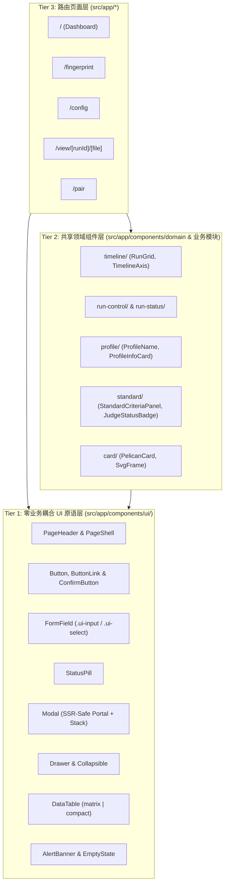

# Web 设计系统（Design System）与组件模块架构重构方案

本方案基于 `docs/review/ui/` 下 6 个专题、12 份审查报告的实证发现编制，旨在彻底解决当前前端代码库「无统一设计系统、无基础 UI 原语层、跨页面 UX 割裂、全局 CSS 污染与类名碰撞、内联样式泛滥、以及受行数门禁倒逼产生的机械碎片化」六大核心问题。

---

## 一、 设计目标与工程约束

### 1.1 核心原则
1. **零重型第三方 UI 框架**：不引入 Tailwind CSS、CSS-in-JS 运行时或重型组件库（如 MUI / AntD / Radix），基于仓库现有的原生 CSS 自定义属性（CSS Variables）+ React 19 构建轻量、零业务耦合的设计系统。
2. **严格遵守代码长度门禁（`config/code-length-policy.yaml`）**：所有新建或重构的 `.ts` ≤ 500 行（函数 ≤ 50 行）、`.tsx` ≤ 300 行（函数 ≤ 80 行）、`.css` ≤ 300 行；通过**原语复用 + 纯函数视图模型抽离**自然降低组件行数，杜绝“按行数把同一个组件或同一个 CSS 选择器的 `@media` 硬切成碎片”。
3. **自动化门禁兜底**：所有设计系统规则必须转化为可由 `pnpm check:ui` 静态检查并挂入 `lefthook.yml` `pre-commit` 的确定性规则，防止后续 AI 或人工提交再次退化为散装实现。

### 1.2 方案直接解决的审查问题矩阵

| 审查发现的核心病灶 | 典型实证位置 | 本方案对应解决层 |
| :--- | :--- | :--- |
| **Token 残缺、僵尸变量与幽灵变量** | `globals.css` 缺字阶/间距阶/层级阶；`--radius-md` 等 0 引用；`pair.css:9,28` 引用未定义的 `--line`、`--danger`；全仓 116 处硬编码色值（绿/黄/蓝各分裂为 3 套） | **§二 Design Tokens 层（`src/app/tokens.css`）** + **§五 `UI-02` / `UI-04` 静态门禁** |
| **16 种散装字号（含 5 种 `.5px` 半像素）与 17 种圆角** | 全仓 193 处 `font-size`（`9px`～`20px`，含 `10.5px`/`11.5px`/`12.5px`/`13.5px`/`14.5px`）、94 处硬编码圆角 | **§二 7 级整数像素字阶与 7 级圆角阶** |
| **缺乏通用 UI 原语，各页面重复手写** | 5 个路由 4 套顶栏（含幽灵类 `.masthead`）、14+ 套按钮、11+ 套徽章、4 套 Modal、4 套 Drawer、3 套 Table | **§三 Tier 1 通用基础 UI 原语层（`src/app/components/ui/`）** |
| **全局裸标签污染 vs `/pair` 原生控件裸奔** | `config-base.css:51-122` 全局污染裸 `button`/`input`/`label`；`/pair` 退化为白底输入框与系统灰按钮 | **§三 `ui/Button` + `ui/FormControls`** + **§五 `UI-03` 禁裸标签门禁** |
| **跨目录全局 CSS 类名冲突与幽灵类名** | `.matrix`（时间线 Grid vs 配置页 Table）、`.profile-card`（Fixed 浮层 vs 配置页卡片）冲突；8+ 处幽灵类名 | **§三 `.ui-*` 命名空间隔离 + 冲突类名重命名清单** |
| **62 处 JSX 内联样式（`style={{ ... }}`）泛滥** | `src/app/fingerprint/*.tsx`（44 处）+ `ModelFingerprintSection.tsx`（18 处） | **§三 原语替代 + `config-fingerprint.css`** + **§五 `UI-01` 禁静态内联样式门禁** |
| **浮层 `transform` 包含块陷阱与 `Esc` 键失灵** | `RunOnceProfileModal` 被困在父级 `.run-once-panel` 内且按 `Esc` 双重关闭；`DataRepoPushDialog` 与 `FingerprintSampleDrawer` 不支持 `Esc` 关闭 | **§三 `ui/Modal`（Portal + 模态栈 `useModalBehavior`）与 `ui/Drawer`** |
| **按行数硬切导致的杂物间文件与循环依赖** | `FingerprintCheckSections.tsx` ⇄ `FingerprintCheckTimeline.tsx` 循环依赖；`run-control-stop.css` 混入菜单 `@media` | **§四 模块边界重整与防碎片化拆分规范** |

---

## 二、 第一层：Design Tokens 规范设计（`src/app/tokens.css`）

新建 `src/app/tokens.css`，并在 `src/app/globals.css` 首行通过 `@import "./tokens.css";` 引入。所有页面与组件严禁绕过 Token 硬编码色值、半像素字号或魔术层级。

### 2.1 完整 Token 规范定义

```css
/* src/app/tokens.css — 全站唯一权威的设计系统标尺 */
:root {
  /* ==========================================================================
   * 1. 色彩系统（Color & Semantic Surface Tokens）
   * 设计准则：90% 深色中性灰面板 + 5% 主题蓝强调 + 5% 单点状态色
   * ========================================================================== */
  /* 背景与表面海拔 */
  --bg: #0b0f17;
  --surface: #10161f;
  --surface-hi: #182030;
  --surface-hover: #1f2940;
  --surface-subtle: rgba(148, 163, 184, 0.06);
  --surface-bar: rgba(148, 163, 184, 0.10);
  --surface-bar-hi: rgba(148, 163, 184, 0.18);
  --canvas-bg: #ffffff;
  --backdrop-bg: rgba(3, 6, 12, 0.72);

  /* 边框层级 */
  --border: #232d3d;
  --border-subtle: rgba(255, 255, 255, 0.07);
  --border-tick: rgba(230, 232, 238, 0.42);
  --border-focus: #6b7385;

  /* 文本层级 */
  --text: #e6e8ee;
  --text-dim: #9aa2b1;
  --text-faint: #6b7385;
  --text-on-solid: #ffffff;

  /* 语义色三元组（主色 + 半透明浅底 -tint + 半透明描边 -border）
   * 彻底统一全站分裂的 Tailwind / GitHub Primer 色值 */
  --accent: #4f8df7;
  --accent-hover: #3b7ce6;
  --accent-tint: rgba(79, 141, 247, 0.14);
  --accent-border: rgba(79, 141, 247, 0.45);

  --ok: #4ade80;
  --ok-tint: rgba(74, 222, 128, 0.12);
  --ok-border: rgba(74, 222, 128, 0.40);

  --warn: #fbbf24;
  --warn-tint: rgba(251, 191, 36, 0.12);
  --warn-border: rgba(251, 191, 36, 0.40);

  --err: #f87171;
  --err-tint: rgba(248, 113, 113, 0.12);
  --err-border: rgba(248, 113, 113, 0.45);

  /* ==========================================================================
   * 2. 排版与字号阶梯（Typography Scale）
   * 彻底废除 10.5px / 11.5px / 12.5px / 13.5px / 14.5px 等拍脑袋半像素字号
   * ========================================================================== */
  --font-sans: ui-sans-serif, system-ui, -apple-system, BlinkMacSystemFont,
    "Segoe UI", Roboto, "PingFang SC", "Hiragino Sans GB", "Microsoft YaHei", sans-serif;
  --font-mono: ui-monospace, SFMono-Regular, Menlo, Monaco, Consolas, monospace;

  --text-2xs: 10px;   /* 微型胶囊、角标、排名序号（原 9px / 10px / 10.5px） */
  --text-xs: 11px;    /* 辅助说明、探针名、表头副标题、徽章文字（原 11px / 11.5px） */
  --text-sm: 12px;    /* 密集数据表、卡片页脚、次要元数据、折叠摘要（原 12px / 12.5px） */
  --text-base: 13px;  /* 标准按钮、表单输入框、标准卡片正文（原 13px / 13.5px） */
  --text-md: 14px;    /* 页面默认正文、重要结论标题（原 14px / 14.5px / 15px） */
  --text-lg: 16px;    /* 卡片/面板主标题 h2（原 16px / 17px / 18px） */
  --text-xl: 20px;    /* 页面主标题 h1、模态窗主标题（原 1.1rem / 20px） */

  /* ==========================================================================
   * 3. 间距阶梯（Spacing Scale，4px 基准 + 6px/10px 紧凑档）
   * ========================================================================== */
  --space-1: 4px;
  --space-1-5: 6px;
  --space-2: 8px;
  --space-2-5: 10px;
  --space-3: 12px;
  --space-4: 16px;
  --space-5: 20px;
  --space-6: 24px;
  --space-8: 32px;
  --gap: var(--space-4);

  /* ==========================================================================
   * 4. 圆角与控件尺寸阶梯（Radius & Control Size Scale）
   * ========================================================================== */
  --radius-xs: 4px;     /* 微型标签、内嵌代码、小色块 */
  --radius-sm: 6px;     /* 紧凑按钮、探针格、进度条行 */
  --radius-md: 8px;     /* 标准按钮、表单输入框、内嵌横幅 */
  --radius: 10px;       /* 标准卡片、下拉菜单面板 */
  --radius-lg: 14px;    /* 大型看板面板、模态窗主体 */
  --radius-xl: 24px;    /* 泳道指纹大磁贴 (.fp-folder) */
  --radius-pill: 999px; /* 胶囊徽章、状态圆点 */

  --control-height-sm: 28px;
  --control-height: 32px;
  --control-height-lg: 36px;

  /* ==========================================================================
   * 5. 层级与海拔阴影阶梯（Z-Index & Elevation Scale）
   * ========================================================================== */
  --z-sticky-cell: 2;
  --z-sticky-head: 3;
  --z-sticky-bar: 10;
  --z-dropdown: 80;
  --z-modal: 200;
  --z-drawer: 220;
  --z-modal-nested: 250;
  --z-popover: 300;
  --z-toast: 400;

  --shadow-sm: 0 4px 12px rgba(0, 0, 0, 0.30);
  --shadow-md: 0 12px 32px rgba(0, 0, 0, 0.48);
  --shadow-lg: 0 24px 64px rgba(0, 0, 0, 0.65);
  --shadow-sticky-col: 2px 0 6px rgba(0, 0, 0, 0.25);
  --shadow-sticky-bottom: 0 -6px 16px rgba(0, 0, 0, 0.35);
}
```

### 2.2 响应式断点收敛规范
由于 CSS 自定义属性不能直接用于 `@media (max-width: var(...))`，在 `src/app/tokens.css` 头部注释及 `check-ui-hygiene.ts` 门禁中强制锁定全站仅允许使用 **3 个标准视口断点**（淘汰现有的 9 个散装断点 `380px / 400px / 440px / 640px / 767px / 768px / 769px / 900px / 1080px`，包括同步修改 `globals.css:44,51,82,88` 的 `768px` 与 `400px`）：
- **Mobile（窄屏手机）**：`@media (max-width: 640px)` / `@media (min-width: 641px)`
- **Tablet（平板与紧凑分栏）**：`@media (max-width: 900px)` / `@media (min-width: 901px)`（同时修复 `menu-base.css` `768px` 与 `menu-panels.css` `640px` 遮罩错位问题，统一对齐到 `640px`）
- **Desktop（宽屏桌面）**：`@media (max-width: 1200px)` / `@media (min-width: 1201px)`

### 2.3 业务几何常量与导出配色契约保护（不可破坏边界）
1. **11 个主看板业务几何常量保持不变**：原 `src/app/globals.css:25-41` 中的 `--badge-height`、`--card-header-height`、`--card-footer-height`、`--lane-label-width`、`--axis-height`、`--head-height`、`--cell-width`、`--cell-height`、`--tile-size`、`--folder-padding`、`--folder-gap` 与 [`track-layout.ts`](../../../src/app/components/timeline/track-layout.ts#L8-L18)、[`timeline-svg.ts`](../../../src/app/components/export/timeline-svg.ts#L40-L50)、[`timeline-portrait-svg.ts`](../../../src/app/components/export/timeline-portrait-svg.ts#L31-L32)、[`result-set-svg.ts`](../../../src/app/components/export/result-set-svg.ts#L70-L71) 存在跨语言像素镜像关系，继续保留在 `globals.css` 且**严禁改名或改值**。
2. **`readPalette()` 11 个基础颜色变量契约**：[`export-image.ts:65-81`](../../../src/app/components/export/export-image.ts#L65-L81) 在运行时通过 `getComputedStyle(document.documentElement)` 读取 `--bg`、`--surface`、`--surface-hi`、`--border`、`--text`、`--text-dim`、`--text-faint`、`--accent`、`--ok`、`--warn`、`--err`，其在 `tokens.css` 中的变量名与色值保持 100% 兼容。
3. **主看板 `.folder` 同心圆角几何关系保护**：主看板 216×216 `.folder` 外圆角保持 `44px`（内槽 `.folder-slot` 保持 `18px`，内边距 `16px`，与 `timeline-svg.ts:301,315` 的 `rx="44"` / `rx="18"` 严格一致，定义为 `--folder-radius: 44px`、`--folder-slot-radius: 18px`），而 `--radius-xl: 24px` 专供 `.fp-folder` 使用。

---

## 三、 第二层：三层组件模块架构（Three-Tier Component Architecture）

前端目录与依赖关系严格划分为三层，单向依赖：**`Tier 3 (Route Pages)` → `Tier 2 (Domain Components)` → `Tier 1 (UI Primitives)`**。



### 3.1 Tier 1：通用基础 UI 原语层（`src/app/components/ui/`）详细设计

**架构铁律**：
1. `src/app/components/ui/` 下的所有文件**严禁 `import` `@/core/*` 中的任何业务类型**（只允许依赖 React、`next/link` 及同目录 Hook）。
2. 所有样式类名统一以 `.ui-` 前缀命名；为遵守 `.css` ≤ 300 行门禁并避免 8 个碎片文件，原语样式按职责内聚为 **3 个 CSS 文件**（由 `src/app/globals.css` 直接 `@import`）：
   - `src/app/components/ui/ui-controls.css`（~165 行）：覆盖 `Button`, `ButtonLink`, `ConfirmButton`, `FormField`, `StatusPill`；
   - `src/app/components/ui/ui-overlays.css`（~155 行）：覆盖 `Modal`, `Drawer`, `Collapsible`；
   - `src/app/components/ui/ui-layout.css`（~160 行）：覆盖 `PageShell`, `PageHeader`, `DataTable`, `AlertBanner`, `EmptyState`。
3. 每个 `.tsx` 原语文件严格控制在 **45～120 行**以内（单函数 ≤ 60 行）。

#### 原语 1：`PageShell` & `PageHeader`（`src/app/components/ui/PageHeader.tsx` + `ui-layout.css`）
- **职责边界**：专职统一 **4 个二级/工具页面（`/fingerprint`、`/config`、`/view`、`/pair`）** 的顶栏与页宽容器（主看板首页 `/` 保持领域组件 `Toolbar.tsx` 的 4 区响应式工作台布局，在底层共用 `ui/Button`、`Menu`、`RunStatus` 与 `LanguageSwitch`）。
- **解决痛点**：消除幽灵类 `.masthead`、`.viewer-head`、`.fp-header` 的各自为政；修复 `/config` 与 `/pair` 把 `<Link>` 和 `<LanguageSwitch />` 塞进 `<h1>` 的语义错误；使用 Next.js `<Link>` 替代 `/fingerprint` 的 `<a href="/">` 硬刷新；修复 `/view` 无返回首页入口的死胡同；`subtitle` 使用 `<div className="ui-page-subtitle">` 容器以合法容纳 `/view` 页的 `.viewer-meta` 与 `.badges` 块级元素。
- **组件接口**：
  ```tsx
  export interface PageShellProps {
    width?: "wide" | "narrow" | "full"; // wide=1600px (/, /fingerprint, /config), narrow=720px (/pair), full=100vw (/view)
    className?: string;
    children: React.ReactNode;
  }

  export interface PageHeaderProps {
    title: React.ReactNode;
    subtitle?: React.ReactNode;   // 渲染于 <div className="ui-page-subtitle"> 内，支持块级徽章行
    backHref?: string;            // 使用 Next.js <Link> 渲染返回链接
    backLabel?: string;
    centerSlot?: React.ReactNode; // 放置页面居中切换器（如 /view 的 ArtViewerSiblings）
    actionsSlot?: React.ReactNode; // 放置 RunStatus、TimeZoneMenu、RunOnce、导航按钮与 LanguageSwitch
    sticky?: boolean;
  }
  ```

#### 原语 2：`Button`、`ButtonLink` & `ConfirmButton`（`src/app/components/ui/Button.tsx` + `ui-controls.css`）
- **解决痛点**：替代全站 14+ 套散装按钮类名與 `<a className="button">` 幽灵类、替代 `fingerprint-matrix.css:164` 的 `.fp-card button:not(.fp-cell-btn):not(.fp-tab)` 脆弱选择器、收编 `StatefulActionButton`（1×1 Grid 防抖动叠层）与 `StopRunButton`（二次确认状态机），并为 `/config` 删除 Profile（`ProfileCard`）、删除 API Key（`ProfileCredentialField`）、移除配对设备（`DeviceTable`，淘汰 `window.confirm`）提供统一二次确认保护。
- **组件接口**：
  ```tsx
  export interface ButtonProps extends React.ButtonHTMLAttributes<HTMLButtonElement> {
    variant?: "default" | "primary" | "danger" | "ghost";
    size?: "sm" | "md";
    busy?: boolean;
    busyLabel?: React.ReactNode; // 传入时自动启用 .ui-btn-stack 1×1 Grid 叠层保持宽度恒定
  }

  export interface ConfirmButtonProps extends Omit<ButtonProps, "onClick"> {
    confirmLabel: React.ReactNode;
    cancelLabel?: React.ReactNode;
    confirmPrompt?: React.ReactNode; // 展开二次确认时显示的警示语（如重置样本确认提示）
    onConfirm: () => Promise<void> | void;
  }
  ```

#### 原语 3：`FormField` & `CheckboxField`（`src/app/components/ui/FormField.tsx` + `ui-controls.css`）
- **解决痛点**：彻底清除 `src/app/config/config-base.css:51-122` 对裸 `label`、`input`、`select`、`textarea`、`button` 的全局标签污染；支持 `layout?: "stack" | "inline"`，为 `/pair`、`/config`、`/fingerprint` 提供统一的深色表单控件类（`.ui-field`, `.ui-label`, `.ui-input`, `.ui-select`, `.ui-textarea`, `.ui-check-row`），修复 `/pair` 白底输入框裸奔问题并消解 `ModelFingerprintSection.tsx` 的内联样式。

#### 原语 4：`StatusPill`（`src/app/components/ui/StatusPill.tsx` + `ui-controls.css`）
- **解决痛点**：统一全站 11+ 套胶囊与徽章（`.fp-badge`、`.fp-sim-tag`、`.badge-readonly`、`.standard-tag`、`.schedule-badge`、`.tier-badge`、`.data-repo-health-badge`），并支持可选 `onClick` 交互态（替代 `.modal-standard-pill`）。
- **组件接口**：
  ```tsx
  export interface StatusPillProps {
    tone?: "neutral" | "ok" | "warn" | "err" | "accent";
    variant?: "subtle" | "outline" | "solid";
    dot?: boolean;
    mono?: boolean;
    onClick?: () => void; // 传入时渲染为 <button type="button" className="ui-pill is-interactive">
    title?: string;
    className?: string;
    children: React.ReactNode;
  }
  ```

#### 原语 5：`Modal`（`src/app/components/ui/Modal.tsx` + `ui-overlays.css` + `use-overlay-stack.ts`）
- **解决痛点与 SSR 兼容策略**：
  1. **组件树解耦 + 渐进式 SSR-Safe Portal**：
     - 首先在组件树层面将 `RunOnceProfileModal` 移出带 `transform: translate(-50%, -50%)` 的 `.run-once-panel`（作为 `Menu` 内与 `.menu-panel` 并列的兄弟节点渲染），无需依赖 Portal 即可根治 `position: fixed` 包含块陷阱且天然兼容 `root.current.contains`；
     - `Modal` 提供 `portal?: boolean`（默认 `false` 原位渲染，100% 兼容本仓库 15 个使用 Node.js `renderToStaticMarkup` 的无 DOM 单元测试）；当显式设置 `portal={true}` 时，SSR 与 `renderToStaticMarkup` 阶段仍原位输出完整 DOM 树以保障静态快照测试断言，仅在客户端 `useEffect` 挂载后调用 `createPortal(..., document.body)`。
  2. **全局浮层栈（`useOverlayStack`）与 `useMenuDismiss` 协同**：按下 `Escape` 键时仅触发栈顶浮层的 `onClose` 并停止传播；同时导出 `hasActiveOverlay()` 接入 [`use-menu-dismiss.ts`](../../../src/app/components/menu/use-menu-dismiss.ts#L13-L20)，当存在活动浮层时父级 `Menu` 自动忽略外部 `pointerdown` 与 `Escape`，彻底淘汰业务代码中脆弱的 `choosingRef` 锁。
  3. **统一无障碍与插槽**：统一接入 `role="dialog" aria-modal="true"`、`document.body` 滚动锁定、焦点恢复、`subHeader`（供 `ModelModal` 固定黄金标准抽屉）、`footer`（供确认弹窗底部按钮栏）与右上角标准 `32×32px` 关闭按钮。
- **组件接口**：
  ```tsx
  export interface ModalProps {
    open: boolean;
    onClose: () => void;
    title: React.ReactNode;
    ariaLabel?: string; // 当 title 含交互组件（如 ProfileName）时提供纯文本无障碍名称
    subtitle?: React.ReactNode;
    headerActions?: React.ReactNode;
    subHeader?: React.ReactNode;
    footer?: React.ReactNode;
    size?: "sm" | "md" | "lg" | "columns"; // columns 模式由 --col-count 动态计算宽度
    colCount?: number;
    portal?: boolean;   // 默认 false，SSR 永远原位输出
    className?: string;
    children: React.ReactNode;
  }
  ```

#### 原语 6：`Drawer` & `Collapsible`（`src/app/components/ui/Drawer.tsx` + `ui-overlays.css`）
- **解决痛点**：
  - `Drawer`：复用 `useOverlayStack`，为 `FingerprintSampleDrawer` 补齐 `Esc` 关闭、`body` 滚动锁定、`role="dialog" aria-modal="true"` 以及 `onPointerDown` 遮罩点击检测（防止在抽屉内拖拽选中文本松手时误关抽屉）。
  - `Collapsible`：统一封装 `<details className="ui-collapsible"><summary className="ui-collapsible-summary">`，支持右侧摘要槽 `summaryExtra?: React.ReactNode`，使用 CSS 旋转箭头指示器替代 `.viewer-drawer`、`.fp-tech-drawer`（修复硬编码 `"▸ "` 不旋转问题）、`.data-repo-discarded` 及 `CustomPromptEditor`。

#### 原语 7：`DataTable`（`src/app/components/ui/DataTable.tsx` + `ui-layout.css`）
- **解决痛点**：采用轻量包装器 + CSS 变量驱动的双列 Sticky 工具类（`.ui-col-sticky-1` / `.ui-col-sticky-2` + `--ui-sticky-col-1-w`），提供两种明确区分的表格模式：
  - `variant="matrix"`：用于基准样本矩阵等宽表，支持横向滚动容器与前两列 `sticky` 冻结（`box-shadow: var(--shadow-sticky-col)`）；
  - `variant="compact"`：`width: 100%` 自适应父容器宽度，**不设置 `min-width: 980px`**，彻底解决 `CheckTechDrawer` 在 `680px` 单列弹窗与 `310px` 多列卡片内套用 `.fp-matrix-table` 导致横向爆表的问题；同时替代配置页的 `<table className="matrix">`（消除与首页时间线 `.matrix` 的重名冲突）、`.device-table` 与 `.judge-table`。

#### 原语 8：`AlertBanner` & `EmptyState`（`src/app/components/ui/AlertBanner.tsx` + `ui-layout.css`）
- **解决痛点**：
  - `AlertBanner`：统一 `tone?: "info" | "ok" | "warn" | "err"`、`title`、`actions`、`onDismiss` 的页内横幅，消灭 `.fp-job-banner` 上的 3 处内联 `style={{ borderColor, color }}` 补丁，并与 `ConfigAlerts`、`CliStatusBanner`、`DataRepoPanel` 结果横幅统一视觉语言；
  - `EmptyState`：统一首页 `EmptyDay`（补齐 `owner` / `readonly` 权限感知，避免对只读读者提示点击不存在的「跑一次」）、`RunBlock` 筛选为空状态（提供一键「重置筛选」按钮）与指纹页 `CheckEmptyState`。

---

### 3.2 Tier 2：跨路由领域组件去重与解耦清单

| 领域组件 | 当前问题与重复位置 | 重构动作 |
| :--- | :--- | :--- |
| **`StandardCriteriaPanel`** | [`ModelStandardPanel.tsx`](../../../src/app/components/model-modal/ModelStandardPanel.tsx) 与 [`ArtViewerFoot.tsx:64-100`](../../../src/app/view/ArtViewerFoot.tsx#L64-L100) 重复实现黄金标准 G1–G5 双栏详情；`model-modal-standard.css:113-132` 与 `viewer-drawers.css:107-126` 逐字复制了 20 行 `.standard-tag` CSS | 提取共享组件 `src/app/components/standard/StandardCriteriaPanel.tsx`，弹窗与 `/view` 页共用同一份组件与样式 |
| **`JudgeStatusBadge`** | [`PelicanCard.tsx:143-163`](../../../src/app/components/card/PelicanCard.tsx#L143-L163)（`.judge-tag`）与 [`JudgeDrawer.tsx:33-45`](../../../src/app/view/JudgeDrawer.tsx#L33-L45)（`.judge-pill`）对同一 `CardJudgeView` 各写一套 | 基于 `StatusPill` 封装唯一的 `JudgeStatusBadge` |
| **`ProfileName` & `ProfileInfoCard`** | `profile.css:42` 的 `.profile-card`（`position: fixed` 浮层）与 `config-profiles.css:37` 的 `.profile-card`（静态卡片）重名冲突；`ProfileNameProps.cards` 强耦合 `DashboardCard[]`；`fingerprint-check-store.ts` 100% 复制了 `run-selection-store.ts` 的 `readStoredProfiles` | 1. 将浮层外框改为 `.profile-popover-card`（保留内部 `.profile-card-gone` 兼容单测）；<br>2. 将 `cards` 改为可选 `cards?: readonly DashboardCard[]`（默认 `[]`）；<br>3. 将 Profile 选择持久化提取为共享的 `src/app/components/profile/profile-selection-store.ts` |
| **`RunOnceHeadBar` & `run-once-profiles.ts`** | [`FingerprintCheckPanel.tsx:199-209`](../../../src/app/fingerprint/FingerprintCheckPanel.tsx#L199-L209) 仅因右列标题为「探针」而非「题目」复制了 11 行头部 JSX；`fingerprint-check-model.ts` 克隆了 `run-once-profiles.ts` 的 5 个纯函数 | 1. 为 `RunOnceHeadBar` 增加可选 `secondColumnTitle?: string`；<br>2. 从 `run-once-profiles.ts` 导出共享的 `supportsProfiles`、`shorten`、`profileChoices`、`startMode` |
| **`TimelineAxis` / `Calendar` / `useScrollAnchor`** | `FingerprintCheckTimeline.tsx` 100% 复制了 `RunGrid.tsx` 的 `useScrollAnchor` 和 `use-dashboard-time.ts` 的 `useNow`，并用 `new Array<DashboardCard>(n)` 构造稀疏数组欺骗 `Calendar` | 1. 为 `Moment` 增加可选 `totalCount?: number`（向后兼容 `cards.length`）；<br>2. 从 `src/app/components/timeline/` 导出共享的 `useScrollAnchor` 与 `useNowTick` |
| **`Menu`（下拉菜单）** | `menu-rows.css` 与 `menu-panels.css` 硬编码了 `.zone-id`、`.export-panel`、`.filter-panel`、`.day-panel` 等首页业务选择器；且在 `641px–768px` 存在遮罩与面板断点不一致 | 1. `menu-base.css` 只保留纯下拉容器样式，业务面板样式迁回 `toolbar/`；<br>2. 遮罩与面板的移动端 Modal 切换断点统一对齐到 `640px` |

---

## 四、 第三层：路由模块边界重整与防碎片化规范

### 4.1 `/fingerprint` 模块解耦与“杂物抽屉文件”清理
审查发现 `src/app/fingerprint/` 存在 2 处循环依赖、1 处反向层级依赖、2 个职责混杂的“杂物间文件”、服务端快照重复构造、6 处死状态/未消费 Props 以及双重请求风暴。重构方案如下：

1. **消除循环依赖、反向依赖与杂物文件**：
   - 将 `FingerprintCheckSections.tsx`（240 行）拆解归位：
     - `CheckLauncherFooter` + `UnreadyBaselineNote` → 在 `FingerprintCheckPanel.tsx` 复用 `RunOnceHeadBar` 与 `run-once-profiles.ts` 减重后并入 `FingerprintCheckPanel.tsx`（确保总行数 ≤ 220 行，低于 `.tsx` 300 行门禁），并复用 `ui/ConfirmButton` 统一停止作业取消入口；
     - `CheckEmptyState` → 复用 `ui/EmptyState` 直接在 `FingerprintCheckTimeline.tsx` 渲染，删除无意义的透传壳 `CheckHistorySection`，彻底切断 `FingerprintCheckSections.tsx` ⇄ `FingerprintCheckTimeline.tsx` 循环依赖；
     - `CheckProbeAttemptsSection` → 作为独立命名子组件函数移入 `FingerprintCheckTechDrawer.tsx`（保持各函数 ≤ 55 行，低于 `.tsx` 80 行函数上限），修正其表头错位（`Codec` / `Accepted` 与 `Outcome` / `rawText` 张冠李戴）及硬编码英文（`· failed:` / `· uncompared:`）。
   - 将 `fingerprint-check-store.ts` 底部的重导出拆开，切断 `fingerprint-check-model.ts` ⇄ `fingerprint-check-store.ts` 循环依赖。
   - 将 `normalizeCheckProfile`、`resolveActiveCheckView`、`isRecordCheckPassed`、`orderCheckRecordsByProfile` 下沉至 `fingerprint-model.ts`，消除 `fingerprint-detail-model.ts` 对 `fingerprint-timeline-model.ts` 的反向依赖；同时将 `fingerprint-model.ts:311-395` 中的网络请求与 DOM `<a>` 下载副作用抽离为 `use-fingerprint-bundle.ts`。
   - 提取 `src/app/fingerprint/page.tsx:45-96` 与 `src/app/api/fingerprint/route.ts:108-151` 共享的服务端快照构造函数（修复 `page.tsx` 漏传 `activeWork` 字段的漂移）。
2. **补齐 `/fingerprint` 顶栏时区切换与 `FingerprintSampleDrawer.tsx` 交互重构**：
   - 在 `/fingerprint` 顶栏 `PageHeader` 的 `actionsSlot` 挂入 `TimeZoneMenu` 与 `LiveClock`（水合前使用服务端传入的 `defaultTimeZone` 而非硬编码 `"Asia/Shanghai"`）；
   - `FingerprintSampleDrawer` 接入 `ui/Drawer` 获得 `Esc` 关闭与背景滚动锁定；将已声明却被丢弃的 `profiles`、`selectedProfile`、`onChangeProfile` 渲染在抽屉顶部工具栏，支持在抽屉内直接选定 Profile 补采；重构内部 `AttemptCard` 为两行紧凑结构并增加状态筛选胶囊（全部 / 有效 / 异常与已排除），为 `<pre className="fp-pre">` 增加 `max-height: 160px; overflow-y: auto`。
3. **消除 SSE 进度步进时的双重 I/O 风暴与静默吞错**：
   - 在 `FingerprintDashboard.tsx` 中，当收到 `fingerprint-job` SSE 事件时，仅在作业进入终态（`completed` / `failed` / `cancelled`）或首次启动时拉取完整 `/api/fingerprint` 快照，步进期间直接消费 SSE 实时进度对象；捕获 `refreshAll` 与 `loadDrawerCell` 的网络异常并通过 `ui/AlertBanner` 提示用户。
4. **修复幽灵类名与 Tab 外壳跳变**：
   - 统一「发起渠道核验」与「基准样本矩阵」两个 Tab 的主面板容器圆角与标题字阶；
   - `FingerprintCheckTile.tsx:149` 的 `.status-legend-item` 修正为 `.legend-item`，清理未定义的 `.verdict-*` 类与 `.fp-form-grid` 死规则；
   - `FingerprintCheckTimeline.tsx:247,255` 补齐 `.row-pass-head` 与 `.row-pass-pct` 间距样式；
   - 删除未消费的死状态与冗余 Props（同步更新 [`test/core/model-fingerprint/ui-model.test.ts:402,421-433`](../../../test/core/model-fingerprint/ui-model.test.ts#L402-L433)）。

### 4.2 `/config`、`/view`、`/pair` 跨页缺陷同步修复
1. **`/pair` 页面样式补齐与只读契约保持**：
   - 替换 `pair.css:9,28` 与 `config-actions.css:75` 中未定义的 `--line`、`--danger` 为 `var(--border)`、`var(--err)`；
   - 输入框与按钮接入 `.ui-input`、`ui/Button` 与 `ui/ButtonLink`，修复 `<a className="button">` 幽灵类，消除深色背景下的白底输入框与系统灰按钮；
   - **保持只读展台模式下 `/pair` 调用 `notFound()` 返回 HTTP 404 不变**（严格遵守 [`scripts/showcase-smoke/assertions.ts:110`](../../../scripts/showcase-smoke/assertions.ts#L110) 的冒烟测试契约）。
2. **`/config` 页面作用域收敛与布局对齐**：
   - 将 `config-base.css:51-122` 的顶层裸标签样式彻底迁移至 `.ui-label` / `.ui-input` / `.ui-select` / `.ui-textarea` / `.ui-btn` / `.ui-check-row` 类名下（**严禁写成 `.config button` 或 `.config label` 后代裸标签选择器**），并将 `config-actions.css` 的 `.actions` 重命名为 `.config-actions-bar`（消除对 `pair.css` `.actions` 的污染）；
   - 将 `config/page.tsx:98-99` 的 `<DataRepoPanel />` 与 `<DevicePanel />` 纳入 `.config`（`max-width: 1100px`）容器内，消除右侧 `228px` 错位；修正 `≤ 900px` 下 `ConfigSideNav` 压在 `PageHeader` 上方的 DOM 顺序；精简 `ConfigSectionShell.tsx` 中的 8 个零逻辑透传包装函数；
   - 重构 `ModelFingerprintSection.tsx`：新建 `src/app/config/config-fingerprint.css` 清零 18 处内联样式，消除 `samplesPerProbe` 与 `samplesByProbe` 的失效冲突，并保留 `#matrix`、`#profiles` 锚点及底部模型列表（兼容 `ui-model.test.ts:326-328`）；
   - 清零主看板与配置页其余 6 处静态内联样式（[`page.tsx:60`](../../../src/app/page.tsx#L60)、[`RunStatus.tsx:181`](../../../src/app/components/run-status/RunStatus.tsx#L181)、[`TimeoutForm.tsx:137`](../../../src/app/config/TimeoutForm.tsx#L137)、[`ReferenceSourceDisplay.tsx:38,61,68`](../../../src/app/components/ReferenceSourceDisplay.tsx#L38-L68)）。
3. **`/view` 页面导航与抽屉高度修复**：
   - 顶栏接入 `PageHeader` 补齐返回看板 `/` 链接与 `.viewer-actions` 垂直居中；
   - 为 `.viewer-foot` 设置 `max-height: 55vh; overflow-y: auto`，防止展开底部 `JudgeDrawer` 时将上方画布 `.viewer-stage` 挤压至 `0px`。

### 4.3 防“行数门禁机械切碎”与跨文件撕裂 CSS 归位清单
- **CSS 归位清单**：严禁把同一个 CSS 选择器的桌面端样式、状态修饰符与 `@media` 响应式规则拆在两个不同文件。在 Phase 3 集中归位以下 6 处被机械腰斩的样式：
  1. `run-control-stop.css:45-143` 中混入的 `.run-once-panel` 响应式规则；
  2. `run-status-panel.css` 与 `run-status-calls.css` 中被切开的 `.run-dot` 状态类与 `.run-panel` `@media`；
  3. `cards-base.css` 与 `cards-footer.css` 中首尾分隔的 `.card-grid`；
  4. `timeline-board.css` 与 `timeline-track.css` 中分隔的 `.board-panel` / `.row-label`；
  5. `model-modal-dialog.css` 与 `model-modal-content.css` 中分隔的 `.modal-head`；
  6. `toolbar-responsive.css:72-86` 中跨模块直接覆写 `run-control` 的 `.auto-run` 规则。
- **React 组件组织规则**：严禁新建 `*-Sections.tsx` 或 `*-Shell.tsx` 堆放无关联组件；当组件行数接近阈值时，通过**抽离纯函数 `*-model.ts` + 调用 `src/app/components/ui/` 原语**保持组件精简。

### 4.4 客户端状态韧性、异步错误处理与只读边界修复
1. **统一 `localStorage` 安全读写**：封装 `safeLocalStorageGet` / `safeLocalStorageSet`（内置 `try/catch`），修复 [`use-stored-time-zone.ts:16,20`](../../../src/app/components/toolbar/use-stored-time-zone.ts#L16-L20) 在无痕/禁用存储下抛 `DOMException` 崩溃的问题。
2. **修复未绑定关闭回调与未捕获网络异常**：
   - 在 [`DataRepoPanel.tsx:191`](../../../src/app/config/DataRepoPanel.tsx#L191) 绑定 `useDataRepoActions` 导出的 `dismissResult` 与 `dismissError`；
   - 在 [`use-device-panel.ts:12-15`](../../../src/app/config/use-device-panel.ts#L12-L15) 为 `fetch("/api/session")` 补齐 `!res.ok` 与 `.catch()` 处理，防止异常时 `loading` 永久卡死在 `true`。
3. **补齐本地只读模式守卫与防连点锁**：
   - 将 [`ToolbarCenter.tsx:47`](../../../src/app/components/toolbar/ToolbarCenter.tsx#L47) 的 `!remote` 改为 `!remote && !readonly`，防止本地只读模式（`PELICAN_READONLY=1`）渲染 `AutoRunToggle` 并建立无意义的 `/api/events` SSE 连接；
   - 修复 [`use-run-once-state.ts:130-136`](../../../src/app/components/run-control/use-run-once-state.ts#L130-L136) 在发起成功后 `500ms` 延迟关闭面板期间提前将 `busy` 置为 `false` 导致的连点重复触发漏洞。

### 4.5 `docs/ui/` 设计文档同步收口
- 基于正式落地的 `src/app/tokens.css` 与 `src/app/components/ui/` 生成 [`docs/ui/dashboard/design-system.md`](../../ui/README.md)，在已废弃的 [`dial-design-brief.md`](../../ui/dashboard/dial-design-brief.md) 顶部标注 `Status: Superseded`；
- 全面更新 [`docs/ui/UX_STATE_MAP.md`](../../ui/UX_STATE_MAP.md)（对齐 `640px/900px/1200px` 断点、补齐 `/fingerprint` 路由与 6 个浮层状态、修正 `scripts/diagnostics/ux_state_crawler.py` 路径），并清理 [`docs/ui/ux_coverage_report.json`](../../ui/ux_coverage_report.json) 中的本机私有路径。

---

## 五、 第四层：自动化静态门禁设计（`scripts/check-ui-hygiene.ts`）

新增 `scripts/check-ui-hygiene.ts`（遵守 `config/code-length-policy.yaml`：单文件 ≤ 500 行、每个检查函数 ≤ 50 行，配套单元测试 `test/scripts/check-ui-hygiene.test.ts`），在 `package.json` 注册 `"check:ui": "tsx scripts/check-ui-hygiene.ts"`，支持渐进式目录范围 `ENFORCED_DIRS`（Phase 1 锁定 `tokens.css` + `components/ui`，Phase 2 扩展锁定 `fingerprint/` + `ModelFingerprintSection` 并挂入 `lefthook.yml`，Phase 3B 锁定全仓 `src/app/`）。脚本在剥离注释后执行以下 4 条零误报静态检查：

1. **规则 `UI-01`（基于 TypeScript AST 禁止静态 JSX 内联样式）**：
   - 使用 `ts.createSourceFile` 解析 `.tsx` 中的 `JsxAttribute(name="style")`，并追踪同文件内的 `Identifier` 样式对象变量（如 `style={modalStyle}`），杜绝正则漏检。
   - **仅放行两类动态属性**：
     - 以 `--` 开头的 CSS 自定义属性（如 `"--upstream-count"`、`"---ui-sticky-col-1-w"`）；
     - 动态几何/哈希色属性 `{"left", "top", "right", "bottom", "width", "height", "gridColumn", "background"}`——**且其 AST 值节点严禁为纯静态字面量**（`StringLiteral` / `NumericLiteral` / `NoSubstitutionTemplateLiteral`，从而精准放行 `width: \`${row.barPercent}%\`` 与 `background: profileColor(name)`，同时精准拦截 `width: "100%"` 与 `background: "var(--surface-hi)"`）。**注意：`gridTemplateColumns` 不在白名单内**，强制使用 `--upstream-count` 等 CSS 变量驱动网格列数以保留 `@media` 响应式覆盖能力。
   - 其余一切静态样式键（`fontSize`, `color`, `display`, `gap`, `margin*`, `padding*` 等）无条件报错阻断。
2. **规则 `UI-02`（禁止裸色值、非 Token 字号与非标 `@media` 断点）**：
   - 扫描除 `src/app/tokens.css`、`src/app/globals.css`、`src/app/components/profile/profile-color.ts`、`src/app/components/export/**` 以外的所有 `src/app/**/*.{css,tsx}`：
     - 禁止在 CSS 规则或 TSX `style`/SVG 属性中出现 `#hex`、`rgb(...)`、`rgba(...)`、`hsl(...)` 裸色值字面量（允许 `color-mix(in srgb, var(--*) ..., transparent)`）；
     - 除 `tokens.css` 外，所有 CSS `font-size:` 声明必须引用 `var(--text-*)`（或 `inherit`）；
     - 所有 `@media` 宽度断点仅允许 `640px`、`641px`、`900px`、`901px`、`1200px`、`1201px`。
3. **规则 `UI-03`（三级选择器门禁：禁止裸交互标签与多重 `:not()` 链）**：
   - 扫描除 `src/app/globals.css` 以外的所有 `src/app/**/*.css`，将每个选择器按顶层逗号拆为分支 `[s_0, ..., s_k]`：
     - **`UI-03a`**：起始段 `s_0` 必须以 `.className` 开头（拦截顶层裸标签 `button { ... }` 及标签限定类 `button.primary`、`label.checkbox`）；
     - **`UI-03b`**：末端段 `s_k` 若不含 `.className`，仅允许排版/表格/折叠结构标签（`h1`–`h4`, `p`, `span`, `code`, `pre`, `table`, `thead`, `tbody`, `tr`, `th`, `td`, `summary`, `details`, `ul`, `li`, `a` 等），**严禁以无类名的交互与表单控件标签 `button`, `input`, `select`, `textarea`, `label` 作为末端目标**（拦截 `.fp-card button`、`.config button`、`.config label` 等后代污染，豁免 `.ui-check-row > input` / `.menu-row input`）；
     - **`UI-03c`**：禁止连续 `:not(...)...:not(...)` 脆弱排除链。
4. **规则 `UI-04`（跨目录主类名唯一所有权与未定义/过期回退 CSS 变量检测）**：
   - **`UI-04a`（`leadingClass` 跨目录唯一所有权）**：提取每个选择器分支首段 `s_0` 的第一个类名 `leadingClass`（如 `.btn:hover` → `btn`，`.status.ok` → `status`），同一 `leadingClass`（除 `.ui-*` 外）只允许归属唯一目录 `path.dirname(file)`（同目录多文件与第二顺位修饰类 `.ok` 零误报；跨目录重名如 `.matrix`、`.profile-card`、`.badge`、`.standard-tag` 100% 拦截）；扩展跨模块组件时将本模块类名置于首位（如 `.fp-folder.folder`、`.run-once-panel.menu-panel`）；
   - **`UI-04b`（顶层单类名跨目录泄漏拦截）**：若某目录定义了无祖先限定的单类名选择器 `.cls`，禁止其他目录在选择器或 TSX 中引用 `cls`（精准拦截 `.actions`）；
   - **`UI-04c`（幽灵变量与冗余 Fallback 拦截）**：剥离注释后校验所有 `var(--name)` 必须在 `tokens.css`、`globals.css` 或组件内有定义，且对全局已定义 Token 禁止携带硬编码字面量回退值（拦截 `var(--radius, 6px)`、`var(--radius-md, 7px)`）。

---

## 六、 分阶段实施路线图与验收标准

为确保每一阶段均可独立提交、独立通过全量自动化测试且单次变更规模可控，将实施路线划分为 **4 个渐进阶段（Phase 1 → Phase 2 → Phase 3A → Phase 3B）**：

| 阶段 | 核心任务 | 涉及目录 | 验收门禁 |
| :--- | :--- | :--- | :--- |
| **Phase 1：Design Tokens、UI 原语层与渐进门禁基建** | 1. 落地 `src/app/tokens.css` 并接入 `globals.css`（保护 11 个业务几何常量与 `readPalette` 11 色）；<br>2. 在 `src/app/components/ui/` 实现 8 组零业务耦合原语与 3 个内聚样式文件（`ui-controls.css`, `ui-overlays.css`, `ui-layout.css`）；<br>3. 上线 `scripts/check-ui-hygiene.ts`（初始锁定 `tokens.css` 与 `components/ui/`）及 `test/scripts/check-ui-hygiene.test.ts`、`test/ui/*` | `src/app/tokens.css`<br>`src/app/globals.css`<br>`src/app/components/ui/*`<br>`scripts/check-ui-hygiene.ts`<br>`test/ui/*`<br>`test/scripts/*` | 1. `src/app/components/ui/*` 零 `@/core/*` 引用；<br>2. 原语单测覆盖 `renderToStaticMarkup` SSR 兼容性、模态栈 `Esc` 行为、定宽按钮、双模式表格；<br>3. `pnpm check:ui`、`pnpm lint`、`pnpm test`、`pnpm check:length`、`pnpm build` 全部通过 |
| **Phase 2：`/fingerprint` 与 `ModelFingerprintSection` 全面原语化收口** | 1. 用 `ui/*` 原语重构 `/fingerprint` 全部组件与 `ModelFingerprintSection.tsx`（顶栏补齐 `TimeZoneMenu` 与 `LiveClock`）；<br>2. 拆解 `FingerprintCheckSections.tsx` 消除循环依赖、反向依赖、重复快照加载与死 Props，同步更新 `test/core/model-fingerprint/ui-model.test.ts`；<br>3. 修复 `FingerprintSampleDrawer`（抽屉内选 Profile 补采、两行 `AttemptCard`、状态筛选胶囊）、`CheckProbeAttemptsSection` 表头错位及 SSE 双重刷新风暴；<br>4. 清零 62 处静态内联样式，将 `fingerprint/` 与 `ModelFingerprintSection` 纳入 `check:ui` 强制范围并挂入 `lefthook.yml` | `src/app/fingerprint/*`<br>`src/app/config/ModelFingerprintSection.tsx`<br>`src/app/config/config-fingerprint.css`<br>`test/core/model-fingerprint/ui-model.test.ts`<br>`lefthook.yml` | 1. `/fingerprint` 与 `ModelFingerprintSection` 静态内联样式降至 0；<br>2. 零循环依赖、零幽灵类名；<br>3. `pnpm check:ui`、`pnpm lint`、`pnpm test`、`pnpm check:length`、`pnpm build` 全部通过 |
| **Phase 3A：跨页领域组件去重、结构/状态修复与 HTML 快照同步** | 1. 修复 `/pair` 裸奔控件与幽灵变量（保持只读模式 404 契约）、`RunOnceProfileModal` 移出 `.run-once-panel`、`/view` 顶栏与抽屉高度、`/config` 裸标签剥离与面板宽度对齐；<br>2. 落地共享 `StandardCriteriaPanel`、`JudgeStatusBadge`、`profile-selection-store.ts`，重命名冲突类 `.profile-popover-card` / `.actions` / `.matrix`（配置页表格），清零剩余 6 处静态内联样式；<br>3. 修复 §4.4 的 5 项客户端状态/异常处理与只读守卫缺陷；<br>4. 统一 `test/app/` 14 个快照测试接入 `expectFixture`（`UPDATE_FIXTURES=1`），刷新并人工审查 67 个 `.html` 快照夹具 | `src/app/components/*`<br>`src/app/config/*`<br>`src/app/view/*`<br>`src/app/pair/*`<br>`test/app/*`<br>`test/fixtures/markup/*` | 1. 保留诊断脚本宿主语义类名（`.modal`, `.viewer-drawer`, `.toolbar` 等）；<br>2. `pnpm check:ui`、`pnpm lint`、`pnpm test`、`pnpm check:length`、`pnpm build`、`pnpm showcase:smoke` 全部通过 |
| **Phase 3B：全仓 CSS Token 数值收敛、设计文档同步与全量门禁锁定** | 1. 将主看板、配置页、查看页剩余的硬编码色值、非标字号、非标圆角与非标 `@media` 断点收敛至 `tokens.css`，归位 §4.3 的 6 处跨文件撕裂 CSS；<br>2. 生成 `docs/ui/dashboard/design-system.md`，更新 `docs/ui/UX_STATE_MAP.md`、`docs/ui/README.md` 与 `ux_coverage_report.json`；<br>3. 将 `scripts/check-ui-hygiene.ts` 扫描范围切换为全仓 `src/app/**` | `src/app/**/*.css`<br>`docs/ui/*`<br>`scripts/check-ui-hygiene.ts` | 1. `pnpm check:ui` 全仓 `src/app/**` 0 违规通过；<br>2. `pnpm lint`、`pnpm test`、`pnpm validate:prompts`、`pnpm check:length`、`pnpm check:secrets`、`pnpm build` 全部通过 |

