# 指纹页模块边界、状态管理与文件拆分合理性审计

## 1. 总体诊断：「按行数门禁凑文件」替代了「按组件领域职责划分模块」

对照仓库 [`config/code-length-policy.yaml`](../../../../config/code-length-policy.yaml#L4-L12) 的硬上限（`.tsx` 文件 ≤ 300 行、`.ts` 文件 ≤ 500 行、`.css` 文件 ≤ 300 行；`.tsx` 单函数 ≤ 80 行、`.ts` 单函数 ≤ 50 行），盘点 `src/app/fingerprint/` 下全部文件：

| 文件路径 | 行数 | 门禁上限 | 距上限余量 | 拆分特征与架构问题 |
| --- | ---: | ---: | ---: | --- |
| [FingerprintCheckTimeline.tsx](../../../../src/app/fingerprint/FingerprintCheckTimeline.tsx) | 287 | 300 | 13 行 | 将空状态拆去 `FingerprintCheckSections.tsx` 并形成**双向循环依赖** |
| [FingerprintDashboard.tsx](../../../../src/app/fingerprint/FingerprintDashboard.tsx) | 280 | 300 | 20 行 | 为压进 280 行与 80 行函数上限，将单行塞多个语句/属性；顶层控制器耦合 10 个状态 |
| [fingerprint-check-modal.css](../../../../src/app/fingerprint/fingerprint-check-modal.css) | 269 | 300 | 31 行 | 单行紧缩书写规则（L47–L49、L170–L175、L225–L269）以规避 300 行门禁 |
| [FingerprintCheckSections.tsx](../../../../src/app/fingerprint/FingerprintCheckSections.tsx) | 239 | 300 | 61 行 | **典型杂物间**：混放顶栏下拉底部栏、泳道空状态、零逻辑透传壳、模态窗第 4 层采样表 |
| [FingerprintCheckPanel.tsx](../../../../src/app/fingerprint/FingerprintCheckPanel.tsx) | 236 | 300 | 64 行 | 将底部栏与未就绪提示拆入 `FingerprintCheckSections.tsx`；残留 4 个未使用的死 Props |
| [FingerprintMatrixHead.tsx](../../../../src/app/fingerprint/FingerprintMatrixHead.tsx) | 234 | 300 | 66 行 | **名不副实**：名为 `Head`，实则塞入导入导出 Hook、Profile 下拉框、通用按钮原语、横幅与 `<thead>` |
| [FingerprintCheckDetail.tsx](../../../../src/app/fingerprint/FingerprintCheckDetail.tsx) | 232 | 300 | 68 行 | 核验详情前 3 段，第 4 段拆去 `FingerprintCheckTechDrawer.tsx` |
| [FingerprintMatrix.tsx](../../../../src/app/fingerprint/FingerprintMatrix.tsx) | 230 | 300 | 70 行 | 与 `FingerprintMatrixHead.tsx`（234 行）合计 464 行，因超 300 行而一刀切为两半 |
| [FingerprintSampleDrawer.tsx](../../../../src/app/fingerprint/FingerprintSampleDrawer.tsx) | 209 | 300 | 91 行 | 残留 3 个未解构、未使用的死 Props（`profiles`、`selectedProfile`、`onChangeProfile`） |
| [FingerprintCheckTechDrawer.tsx](../../../../src/app/fingerprint/FingerprintCheckTechDrawer.tsx) | 173 | 300 | 127 行 | 跨领域从 `FingerprintMatrixHead.tsx` 导按钮、从 `FingerprintCheckSections.tsx` 导采样表 |
| [FingerprintCheckTile.tsx](../../../../src/app/fingerprint/FingerprintCheckTile.tsx) | 163 | 300 | 137 行 | 混放泳道单元格卡片与泳道面板顶部 2 个图例组件 |
| [FingerprintCheckModal.tsx](../../../../src/app/fingerprint/FingerprintCheckModal.tsx) | 135 | 300 | 165 行 | 残留未使用的死 Prop `onSelectCheck` |
| [fingerprint-check-model.ts](../../../../src/app/fingerprint/fingerprint-check-model.ts) | 449 | 500 | 51 行 | 与 `fingerprint-check-store.ts`（88 行）合计 537 行，因超 500 行而拆出并形成**双向依赖** |
| [fingerprint-model.ts](../../../../src/app/fingerprint/fingerprint-model.ts) | 413 | 500 | 87 行 | 混放纯函数视图模型、JSON 序列化、HTTP 请求与 DOM `<a>` 下载副作用 |
| [fingerprint-timeline-model.ts](../../../../src/app/fingerprint/fingerprint-timeline-model.ts) | 292 | 500 | 208 行 | 将核验记录基础判定函数塞在泳道模型中，导致详情模态反向依赖泳道模型 |
| [fingerprint-detail-model.ts](../../../../src/app/fingerprint/fingerprint-detail-model.ts) | 243 | 500 | 257 行 | 反向 import `fingerprint-timeline-model.ts` |
| [fingerprint-check-store.ts](../../../../src/app/fingerprint/fingerprint-check-store.ts) | 88 | 500 | 412 行 | 反向 import `fingerprint-check-model.ts`，又被后者 re-export |

**根本问题**：`src/app/fingerprint/` 下的 16 个源码文件平铺在同一个目录中，没有任何子目录分层，且多处文件拆分并非基于组件职责内聚（Cohesion），而是当单个文件写满 300 行（`.tsx`）或 500 行（`.ts`）后，将溢出的函数和组件剪切到附属文件中，导致**跨层级杂物间、名不副实的模块、循环依赖以及大量重构残留的死状态/死 Props**。

---

## 2. 重点模块边界审计

### 2.1 `FingerprintCheckSections.tsx`（239 行）：横跨 3 个无关层级的「杂物间」与循环依赖

[`FingerprintCheckSections.tsx`](../../../../src/app/fingerprint/FingerprintCheckSections.tsx) 导出了 1 个辅助函数与 5 个 React 组件。按组件树层级与业务职责分析，这 6 个导出项分属 **3 个完全不相干的 UI 领域**：

```mermaid
flowchart TD
  subgraph HeaderDropdown["领域 1：顶栏「跑一次」下拉菜单"]
    Panel["FingerprintCheckPanel.tsx"]
    StartLabel["checkStartLabel (L12-L24)"]
    Unready["UnreadyBaselineNote (L26-L56)"]
    Footer["CheckLauncherFooter (L58-L102)"]
    Panel --> Unready
    Panel --> Footer
    Footer --> StartLabel
  end

  subgraph MainSwimlane["领域 2：页面主体 24h 核验泳道"]
    Dash["FingerprintDashboard.tsx"]
    HistSec["CheckHistorySection (L157-L185)"]
    Timeline["FingerprintCheckTimeline.tsx"]
    EmptyDay["CheckEmptyDay (L104-L155)"]
    Dash --> HistSec
    HistSec -->|"1. 正向引用"| Timeline
    Timeline -->|"2. 反向引用（构成循环依赖）"| EmptyDay
  end

  subgraph ModalTech["领域 3：详情模态窗第 4 层折叠抽屉"]
    Modal["FingerprintCheckModal.tsx"]
    Detail["FingerprintCheckDetail.tsx"]
    Tech["FingerprintCheckTechDrawer.tsx"]
    Attempts["CheckProbeAttemptsSection (L187-L238)"]
    Modal --> Detail --> Tech --> Attempts
  end
```



1. **领域 1 —— 顶栏「跑一次」菜单的内部子部件（L12–L102）**：
   - [`checkStartLabel`](../../../../src/app/fingerprint/FingerprintCheckSections.tsx#L12-L24)、[`UnreadyBaselineNote`](../../../../src/app/fingerprint/FingerprintCheckSections.tsx#L26-L56)、[`CheckLauncherFooter`](../../../../src/app/fingerprint/FingerprintCheckSections.tsx#L58-L102) 仅服务于顶栏下拉面板 [`FingerprintCheckPanel.tsx`](../../../../src/app/fingerprint/FingerprintCheckPanel.tsx#L16-L19)。只因 `FingerprintCheckPanel.tsx` 已有 236 行，放不下这 90 行代码，便被塞进了 `FingerprintCheckSections.tsx`。
2. **领域 2 —— 泳道面板的零逻辑透传空壳与空状态（L104–L185）**：
   - [`CheckHistorySection`](../../../../src/app/fingerprint/FingerprintCheckSections.tsx#L157-L185) 是一个**没有任何自身逻辑、没有任何 DOM 节点、仅把 7 个 props 原样转发给 `<FingerprintCheckTimeline>` 的空壳组件**（共 29 行）。它是从旧版（提交 `29f29d4` 的左列表+右详情布局）改版为 24 小时泳道时留下的历史过渡壳。
   - [`CheckEmptyDay`](../../../../src/app/fingerprint/FingerprintCheckSections.tsx#L104-L155) 是泳道无记录时的空状态提示，仅被 [`FingerprintCheckTimeline.tsx`](../../../../src/app/fingerprint/FingerprintCheckTimeline.tsx#L16) 调用。只因 `FingerprintCheckTimeline.tsx` 已达 287 行（距 300 行红线仅差 13 行），无法容纳这 52 行的 `CheckEmptyDay`，便将其塞入 `FingerprintCheckSections.tsx`。
   - **由此直接制造了模块循环依赖（Circular Dependency）**：
     - [`FingerprintCheckSections.tsx` L8](../../../../src/app/fingerprint/FingerprintCheckSections.tsx#L8)：`import { FingerprintCheckTimeline } from "./FingerprintCheckTimeline";`
     - [`FingerprintCheckTimeline.tsx` L16](../../../../src/app/fingerprint/FingerprintCheckTimeline.tsx#L16)：`import { CheckEmptyDay } from "./FingerprintCheckSections";`
3. **领域 3 —— 核验详情弹窗底部技术抽屉的原始采样表（L187–L238）**：
   - [`CheckProbeAttemptsSection`](../../../../src/app/fingerprint/FingerprintCheckSections.tsx#L187-L238) 渲染单条核验记录的跳过/失败探针说明与 `probeAttempts` 明细表格，它的唯一调用方是核验详情模态窗第 4 层折叠块 [`FingerprintCheckTechDrawer.tsx`](../../../../src/app/fingerprint/FingerprintCheckTechDrawer.tsx#L9)。它与同文件的 `CheckLauncherFooter`（顶栏跑一次页脚）和 `CheckEmptyDay`（泳道空状态）在组件树上相隔 4 层，毫无关联。

---

### 2.2 `FingerprintMatrixHead.tsx`（234 行）：借「表头」之名混装 5 类跨领域职责

[`FingerprintMatrix.tsx`](../../../../src/app/fingerprint/FingerprintMatrix.tsx)（230 行）与 [`FingerprintMatrixHead.tsx`](../../../../src/app/fingerprint/FingerprintMatrixHead.tsx)（234 行）是从一个 464 行的矩阵模块硬拆出来的两个文件。`FingerprintMatrixHead.tsx` 的命名表明它应是矩阵表头组件，但实际塞入了以下 5 类职责各异的代码：

1. **导入导出状态与网络 IO Hook —— `useMatrixBundleActions`（[`L21–L54`](../../../../src/app/fingerprint/FingerprintMatrixHead.tsx#L21-L54)）**：
   - 管理 `exportingKey`、`importing`、`banner` 三个状态，调用 `downloadFingerprintBundle` 和 `uploadFingerprintBundle` 执行 `.tar.gz` 基准包的上传下载，这属于业务 Action Hook，而非表头视图。
2. **补采计划确认栏里的 Profile 下拉框 —— `FillProfileSelect`（[`L56–L91`](../../../../src/app/fingerprint/FingerprintMatrixHead.tsx#L56-L91)）**：
   - 该组件既不在 `MatrixCardHeader` 中使用，也不在 `MatrixTableHead` 中使用，而是被 [`FingerprintMatrix.tsx`](../../../../src/app/fingerprint/FingerprintMatrix.tsx#L211-L218) 的 `FillPlanPreviewBox`（补采预检横幅）调用。
3. **跨模块共用的定宽状态切换按钮原语 —— `StatefulActionButton`（[`L93–L120`](../../../../src/app/fingerprint/FingerprintMatrixHead.tsx#L93-L120)）**：
   - 这是一个纯通用的 UI 基础按钮（使用 `.fp-btn-stack` 1×1 Grid 叠层避免按钮切换 loading 文案时宽度抖动）。
   - 因为它被定义在 `FingerprintMatrixHead.tsx` 中，导致核验详情模态窗里的 [`FingerprintCheckTechDrawer.tsx`](../../../../src/app/fingerprint/FingerprintCheckTechDrawer.tsx#L10) 为了渲染“重算结论（Rescore）”按钮，不得不跨业务领域去 `import { StatefulActionButton } from "./FingerprintMatrixHead"`（[`L52–L58`](../../../../src/app/fingerprint/FingerprintCheckTechDrawer.tsx#L52-L58)）。
4. **卡片标题栏与隐藏 `<input type="file">` 触发器 —— `MatrixCardHeader`（[`L122–L162`](../../../../src/app/fingerprint/FingerprintMatrixHead.tsx#L122-L162)）**及**导入结果通知条 —— `MatrixBundleBanner`（[`L164–L194`](../../../../src/app/fingerprint/FingerprintMatrixHead.tsx#L164-L194)）**。
5. **真正的 HTML `<thead>` 组件 —— `MatrixTableHead`（[`L196–L234`](../../../../src/app/fingerprint/FingerprintMatrixHead.tsx#L196-L234)）**：全文件 234 行中，只有最后 39 行是真正的矩阵表头。

---

### 2.3 `FingerprintDashboard.tsx`（280 行）：顶层上帝控制器、人工压缩排版与死状态

#### （1）`useFingerprintController` + `useDashboardHandlers` 的状态耦合與函数硬切分
- 在 [`FingerprintDashboard.tsx`](../../../../src/app/fingerprint/FingerprintDashboard.tsx#L40-L96) 中，`useFingerprintController` 集中持有了整页所有子领域的 10 个状态：
  - 全局快照与请求锁：`snapshot`（L41）、`busy`（L42）、`errorMsg`（L43）、`refreshSeqRef`（L52）、`liveJob`（L53）；
  - 顶栏菜单状态：`openMenu`（L51）；
  - 矩阵补采专属状态：`fillProfiles`（L44）、`fillTarget`（L47）；
  - 样本抽屉专属状态：`drawerState`（L50）；
  - 核验面板与重算专属状态：`checkPlan`（L48）、`rescoringId`（L49）。
- 因为单函数不能超过 80 行（[`config/code-length-policy.yaml` L11](../../../../config/code-length-policy.yaml#L11)），开发者将原本连在一起的控制器拆成 `useFingerprintController`（57 行，只放 `useState` 并把全部 setter 暴露出去）和 `useDashboardHandlers`（72 行，接收 `ctrl` 返回对象并直接调用 `ctrl.setFillTarget` / `ctrl.setCheckPlan` / `ctrl.setOpenMenu` / `ctrl.setRescoringId`）。这种拆分并未降低状态耦合度，反而让状态读写分散在两个函数之间。
- 为了把整個文件控制在 300 行以内（当前 280 行），代码中出现了明显的人工压缩行号痕迹：
  - [`L17–L21`](../../../../src/app/fingerprint/FingerprintDashboard.tsx#L17-L21)：11 个 import 符号挤在 5 行内；
  - [`L81–L87`](../../../../src/app/fingerprint/FingerprintDashboard.tsx#L81-L87)：`try { await fn(); } catch (err) { ... } finally { setBusy(false); }` 全部压缩为单行；
  - [`L89–L95`](../../../../src/app/fingerprint/FingerprintDashboard.tsx#L89-L95)：17 个返回值属性每行塞 3～5 个；
  - [`L188–L239`](../../../../src/app/fingerprint/FingerprintDashboard.tsx#L188-L239)：JSX 组件调用把多个 props 拼在同一行（如 L193 单行塞入 4 个 props）。

#### （2）重构未清理干净的死状态（Dead State）与死 Props 清单
在多次布局调整（如将 `FingerprintCheckPanel` 移入顶栏、将历史列表改为 24h 泳道、将 Profile 选择移至预检确认框）后，多处组件接口与状态未做同步清理，留下了大量无效代码：

| 所在文件与行号 | 死状态 / 死 Prop 名称 | 链路断裂证据 |
| --- | --- | --- |
| [`FingerprintDashboard.tsx` L48, L131–L133, L194, L197](../../../../src/app/fingerprint/FingerprintDashboard.tsx#L48) | `checkPlan` state、`handleCheck("plan")` 分支、`onPreviewPlan` prop | `FingerprintDashboard` 声明了 `checkPlan` 状态（初始值 `null`）并将 `onPreviewPlan={(drafts) => void actions.handleCheck("plan", drafts)}` 传给 `FingerprintCheckPanel`；但 [`FingerprintCheckPanel.tsx` L125](../../../../src/app/fingerprint/FingerprintCheckPanel.tsx#L125) **根本没有解构 `onPreviewPlan`**，导致 `handleCheck("plan")` 永远不会被调用，`checkPlan` 永远为 `null`，下游 `CheckLauncherFooter` 接收到的 `pendingPlan` 也永远是 `null`！ |
| [`FingerprintCheckSections.tsx` L67, L71](../../../../src/app/fingerprint/FingerprintCheckSections.tsx#L67) | `CheckLauncherFooter` 的 `onPreview?: () => void` | 在 props 类型中声明了 `onPreview`，但在 L71 解构时直接丢弃，未渲染任何预览按钮 |
| [`FingerprintCheckPanel.tsx` L43, L46, L55](../../../../src/app/fingerprint/FingerprintCheckPanel.tsx#L43-L55) | `checks?`、`rescoringId?`、`onRescore?` | 旧版 `FingerprintCheckPanel` 包含历史列表时的遗留 props；移入顶栏后，[`FingerprintDashboard.tsx` L192–L200](../../../../src/app/fingerprint/FingerprintDashboard.tsx#L192-L200) 不再传入这 3 个属性，`FingerprintCheckPanel` 内部也完全未使用 |
| [`FingerprintCheckModal.tsx` L23, L28–L36](../../../../src/app/fingerprint/FingerprintCheckModal.tsx#L23-L36) | `onSelectCheck?: (checkId: string) => void` | [`FingerprintCheckTimeline.tsx` L159](../../../../src/app/fingerprint/FingerprintCheckTimeline.tsx#L159) 传入了 `onSelectCheck={st.setOpenCheckId}`，但 `FingerprintCheckModal` 在 L28–L36 解构参数时**直接忽略了 `onSelectCheck`**，弹窗内无任何地方调用它 |
| [`FingerprintSampleDrawer.tsx` L18–L20, L31–L41](../../../../src/app/fingerprint/FingerprintSampleDrawer.tsx#L18-L41) | `profiles?`、`selectedProfile?`、`onChangeProfile?` | 在 `FingerprintSampleDrawerProps` 接口中定义了这 3 个属性，但调用方未传，`FingerprintSampleDrawer` 函数签名（L31–L41）也完全没有解构它们 |
| [`fingerprint-check-model.ts` L57, L388–L392, L405](../../../../src/app/fingerprint/fingerprint-check-model.ts#L57) | `CheckSelectionState.panelChoices` | `computeCheckSelectionState` 专门计算并返回了 `panelChoices` 数组，但 [`FingerprintCheckPanel.tsx`](../../../../src/app/fingerprint/FingerprintCheckPanel.tsx) 只读取了 `selectionState.choices`，`panelChoices` 在全仓无任何消费者 |

---

### 2.4 5 个 `.ts` 模型/状态文件的边界与耦合问题

#### （1）`fingerprint-check-model.ts`（449 行）⇄ `fingerprint-check-store.ts`（88 行）的循环依赖与强拆
- [`fingerprint-check-store.ts` L2](../../../../src/app/fingerprint/fingerprint-check-store.ts#L2) 反向引用模型文件：`import type { CheckTargetItem } from "./fingerprint-check-model";`
- [`fingerprint-check-model.ts` L203–L212](../../../../src/app/fingerprint/fingerprint-check-model.ts#L203-L212) 又将 `fingerprint-check-store.ts` 的全部导出项 re-export 出去：
  ```ts
  export {
    CHECK_PROFILE_STORAGE_KEY,
    CHECK_SELECTION_STORAGE_KEY,
    readStoredCheckProfiles,
    readStoredCheckSelection,
    reconcileCheckTargets,
    resolveCheckProbes,
    writeStoredCheckProfiles,
    writeStoredCheckSelection,
  } from "./fingerprint-check-store";
  ```
- 两个文件合计 537 行，仅仅因为合并后会超过 `.ts` 文件 500 行门禁，便把 88 行剪切到 `fingerprint-check-store.ts` 再用 barrel re-export 粘回去。

#### （2）领域公共函数错放在 `fingerprint-timeline-model.ts`，引发详情模型反向依赖泳道模型
- [`normalizeCheckProfile`](../../../../src/app/fingerprint/fingerprint-timeline-model.ts#L65-L68)、[`resolveActiveCheckView`](../../../../src/app/fingerprint/fingerprint-timeline-model.ts#L78-L81)（合并最新一次 `rescores` 结论）、[`isRecordCheckPassed`](../../../../src/app/fingerprint/fingerprint-timeline-model.ts#L83-L93)（判定单条核验记录是否通过）与 [`orderCheckRecordsByProfile`](../../../../src/app/fingerprint/fingerprint-timeline-model.ts#L108-L117) 是所有核验视图共用的底层领域函数，与“24 小时时间线泳道”无关。
- 由于它们被定义在 `fingerprint-timeline-model.ts` 中，导致核验详情卡片模型 [`fingerprint-detail-model.ts` L9](../../../../src/app/fingerprint/fingerprint-detail-model.ts#L9) 和详情模态窗 [`FingerprintCheckModal.tsx` L11–L15](../../../../src/app/fingerprint/FingerprintCheckModal.tsx#L11-L15) 都必须反向依赖 `fingerprint-timeline-model.ts`。

#### （3）`fingerprint-model.ts`（413 行）违背“纯函数视图模型”定位，混入网络请求与 DOM 下载副作用
- [`fingerprint-model.ts` L1–L3](../../../../src/app/fingerprint/fingerprint-model.ts#L1-L3) 文件头注释声明为“纯函数视图模型与请求构造器”，但文件后半段（[`L311–L395`](../../../../src/app/fingerprint/fingerprint-model.ts#L311-L395)）直接塞入了：
  - `fetchFingerprintSnapshot()`、`postFingerprintJson()`、`patchSampleJson()`、`uploadFingerprintBundle()` 四个异步网络请求函数；
  - `downloadFingerprintBundle()`（[`L359–L382`](../../../../src/app/fingerprint/fingerprint-model.ts#L359-L382)）：在模型文件内直接操作浏览器 `URL.createObjectURL(blob)`、`document.createElement("a")`、`document.body.appendChild(anchor)`、`anchor.click()` 与 `setTimeout(() => URL.revokeObjectURL(url), 1000)`。

#### （4）服务端快照加载逻辑在 `page.tsx` 与 `api/fingerprint/route.ts` 之间 100% 重复
- 主看板将服务端初始数据加载抽成了独立的 [`dashboard-page-data.ts`](../../../../src/app/components/dashboard/dashboard-page-data.ts#L1-L120)，配置页抽成了 [`config-page-loader.ts`](../../../../src/app/config/config-page-loader.ts#L1-L28)。
- 而指纹页没有提取共享的 `fingerprint-page-loader.ts`：[`src/app/fingerprint/page.tsx`](../../../../src/app/fingerprint/page.tsx#L45-L96) 与 [`src/app/api/fingerprint/route.ts`](../../../../src/app/api/fingerprint/route.ts#L108-L151)（`buildSelfTestsByCli` + `buildDashboardSnapshot`）把完全相同的 50 余行数据读取、矩阵规划、补采规划、按 CLI 构建自检报告和 Profile 列表组装代码复制了两遍，且已出现字段漂移（`route.ts` L144 查询并返回了 `activeWork`，而 `page.tsx` L87–L108 漏掉了 `activeWork`）。

---

## 3. 模块重构与边界收敛建议

1. **按业务子域建立清晰的子目录或内聚模块，消除平铺杂物间**：
   - **删除 `FingerprintCheckSections.tsx`**：
     - 将 `CheckHistorySection` 空壳直接移除，由 `FingerprintDashboard.tsx` 直接渲染 `FingerprintCheckTimeline`；
     - 将 `CheckEmptyDay` 归入 `timeline/` 子模块（消除与 `FingerprintCheckTimeline.tsx` 的循环依赖）；
     - 将 `CheckLauncherFooter`、`UnreadyBaselineNote`、`checkStartLabel` 归入 `launcher/`（或直接复用参数化改造后的 `src/app/components/run-control/RunOnceFooter.tsx`）；
     - 将 `CheckProbeAttemptsSection` 归入 `check-modal/`（与 `FingerprintCheckTechDrawer.tsx` 同域）。
   - **拆分并重命名 `FingerprintMatrixHead.tsx`**：
     - 将 `StatefulActionButton` 提升为共享 UI 原语（如 `src/app/components/ui/StatefulActionButton.tsx`）；
     - 将 `useMatrixBundleActions` 加上 `downloadFingerprintBundle` / `uploadFingerprintBundle` 抽为独立的 `use-fingerprint-bundle.ts`；
     - `FingerprintMatrixHead.tsx` 仅保留矩阵卡片头与表头视图。
2. **清理全部死状态与死 Props**：
   - 移除 `FingerprintDashboard.tsx` 中永不触发的 `checkPlan` 状态与 `onPreviewPlan` 回调（或真正接通预检触发逻辑）；
   - 移除 `FingerprintCheckPanelProps` 中的 `checks`、`rescoringId`、`onRescore`；
   - 移除 `FingerprintSampleDrawerProps` 中的 `profiles`、`selectedProfile`、`onChangeProfile`；
   - 移除 `FingerprintCheckModalProps` 中的 `onSelectCheck` 及 `CheckSelectionState` 中的 `panelChoices`。
3. **收敛服务端快照加载与客户端实时刷新链路**：
   - 将 `src/app/fingerprint/page.tsx` 与 `src/app/api/fingerprint/route.ts` 重复的快照构造逻辑收敛至单一服务端函数；
   - 理清 `/fingerprint` 页内 `RunStatus`（`useRunProgress` -> `router.refresh()`）与 `useFingerprintController`（`useLiveFingerprintJob` -> `fetch("/api/fingerprint")`）的刷新职责，避免每次探针调用完成时触发双倍全量计算，并统一使用带二次确认的 `StopRunButton` 取消作业。
