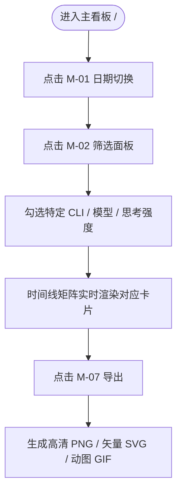
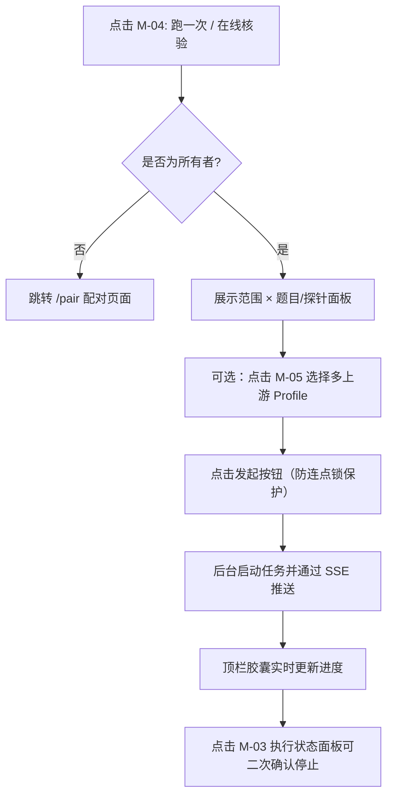
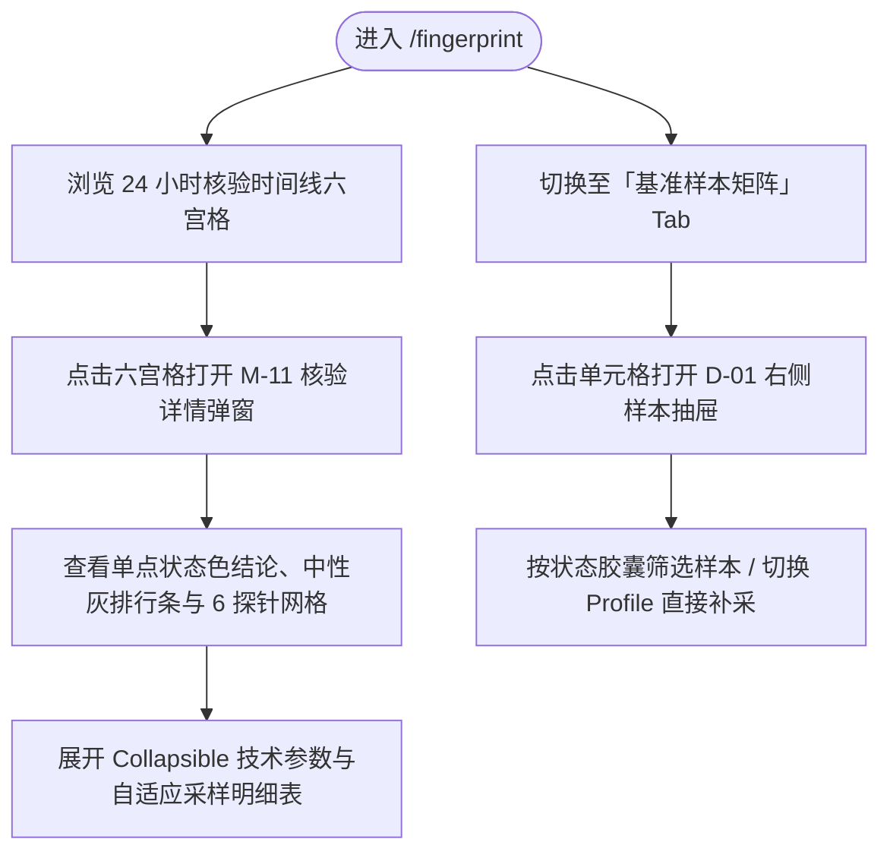

# 鹈鹕基准看板 UX 页面地图与状态矩阵规格说明书 (UX Page & State Map)

> **版本**：v2.0.0  
> **权威性质**：本项目前端全站 UX 操作路径、页面路由、弹窗/浮层/抽屉交互组件与状态机的唯一事实来源（Single Source of Truth），与 [`dashboard/design-system.md`](dashboard/design-system.md) 及 [`scripts/check-ui-hygiene.ts`](../../scripts/check-ui-hygiene.ts) 严格对齐。  
> **适用终端**：全平台响应式（三档标准断点：`640px` Mobile、`900px` Tablet、`1200px` Desktop）。

---

## 目录
1. [设计原则与质量基准](#一-设计原则与质量基准)
2. [页面路由与视图地图 (Page & Route Map)](#二-页面路由与视图地图-page--route-map)
3. [交互浮层 / 弹窗 / 抽屉地图 (Modal & Popover Map)](#三-交互浮层--弹窗--抽屉地图-modal--popover-map)
4. [核心用户操作路径 (User Journey Flows)](#四-核心用户操作路径-user-journey-flows)
5. [组件生命周期状态机 (Lifecycle State Matrix)](#五-组件生命周期状态机-lifecycle-state-matrix)
6. [全设备响应式断点适配规范](#六-全设备响应式断点适配规范)
7. [自动化 UX 状态覆盖与漂移检测机制](#七-自动化-ux-状态覆盖与漂移检测机制)

---

## 一、 设计原则与质量基准

1. **零视口横向溢出（Zero Viewport Overflow）**：任何设备、任何分辨率下，`document.documentElement.scrollWidth <= window.innerWidth`，严禁产生横向意外拖动或晃动。
2. **浮层防裁切与 LIFO 栈管理（Anti-Clipping & Overlay Stack）**：所有下拉菜单、悬浮面板、模态窗与抽屉均处于可视视口安全区域内，统一通过 `useOverlayStack`（LIFO `Escape` 关闭栈）与 `useMenuDismiss` 协同管理，子浮层打开时按下 `Escape` 或点击遮罩绝不误关父级菜单。
3. **人体工学触控目标（Ergonomic Touch Targets）**：移动端（`≤ 640px`）与平板端（`≤ 900px`）所有可点击按钮触控区域清晰独立，危险操作（停止运行、重置样本、删除 Profile、移除设备）统一接入 `ConfirmButton` 行内二次确认。
4. **状态可回溯与状态机闭环（State Completeness）**：每个功能均有完整对应的主态、空态、加载态、进行中态、完成态与异常态，客户端 `localStorage` 读写统一经 `safeLocalStorageGet` / `safeLocalStorageSet` 保护。

---

## 二、 页面路由与视图地图 (Page & Route Map)

| 路由路径 | 页面名称 | 访问权限 | 核心职责 | 挂载组件与源码落点 |
| :--- | :--- | :--- | :--- | :--- |
| `/` | **主看板 (Dashboard)** | 公开访问（所有者有附加写操作；只读模式下隐藏 `AutoRunToggle` 与写操作） | 24 小时矩阵时间线、模型多强度对比、历史轮次切换、多维筛选、执行状态展示与控制 | [`src/app/page.tsx`](../../src/app/page.tsx), [`Dashboard.tsx`](../../src/app/components/Dashboard.tsx) |
| `/fingerprint` | **模型指纹控制台 (Model Fingerprint Console)** | 所有者专有（只读展台模式返回 404，未配对重定向至 `/pair`） | 渠道核验 24 小时时间线、6 探针基准样本矩阵（双列 Sticky）、在线核验/补采发起、样本包导入导出 | [`src/app/fingerprint/page.tsx`](../../src/app/fingerprint/page.tsx), [`FingerprintDashboard.tsx`](../../src/app/fingerprint/FingerprintDashboard.tsx) |
| `/config` | **配置中心 (Config Editor)** | 所有者专有（只读展台模式返回 404，未配对重定向至 `/pair`） | 模型被测矩阵、上游 Profile 与凭据、CLI 能力探测、调度 Cron、分段超时、AI 裁判、模型指纹、数据仓同步、配对设备管理 | [`src/app/config/page.tsx`](../../src/app/config/page.tsx), [`ConfigEditor.tsx`](../../src/app/config/ConfigEditor.tsx) |
| `/pair` | **设备配对 (Device Pairing)** | 本地可写模式开放（只读展台模式返回 HTTP 404） | 未授权浏览器通过配对码认证成为所有者；已登录设备展示状态并支持二次确认注销 | [`src/app/pair/page.tsx`](../../src/app/pair/page.tsx), [`PairCodeForm.tsx`](../../src/app/pair/PairCodeForm.tsx), [`PairSignedInCard.tsx`](../../src/app/pair/PairSignedInCard.tsx) |
| `/view/[runId]/[file]` | **作品沉浸查看器 (Art Viewer)** | 公开访问 | 单张作品高保真查看、同轮多上游兄弟作品切换、提示词抽屉、客观黄金标准抽屉、AI/代码评审抽屉、SVG 下载 | [`src/app/view/[runId]/[file]/page.tsx`](../../src/app/view/[runId]/[file]/page.tsx), [`ArtViewer.tsx`](../../src/app/view/ArtViewer.tsx) |
| `/art/[runId]/[file]` | **原生 SVG 沙箱端点** | 公开访问 | 独立响应端点，带严格 CSP 沙箱响应头隔离外部脚本，输出原生 SVG 矢量内容 | [`src/app/art/[runId]/[file]/route.ts`](../../src/app/art/[runId]/[file]/route.ts) |

---

## 三、 交互浮层 / 弹窗 / 抽屉地图 (Modal & Popover Map)

全站共包含 **14 个标准交互浮层、模态窗与抽屉状态**，统一构建于 Tier 1 原语（`Modal`, `Drawer`, `Collapsible`, `Menu`）之上：

| 编号 | 浮层/弹窗标识 (State ID) | 所属路由 | 触发元素 (Trigger) | 桌面端排布 (`> 900px`) | 平板/移动排布 (`≤ 900px` / `≤ 640px`) | 关闭途径 |
| :--- | :--- | :--- | :--- | :--- | :--- | :--- |
| **M-01** | `STATE_DAY_CALENDAR` | `/`, `/fingerprint` | 顶栏日期月历按钮 | 下拉锚定面板（宽 `252px`） | `≤ 640px` 视口居中模态卡片（宽 `min(320px, 100vw - 20px)`） | 点外部、`Esc`、点击日期 |
| **M-02** | `STATE_FILTER_PANEL` | `/` | 顶栏 `筛选` 按钮 | 下拉锚定面板（双列 `440px`） | `≤ 640px` 视口居中模态卡片（双列紧凑自适应） | 点外部、`Esc`、右上角 `✕` |
| **M-03** | `STATE_RUN_STATUS_POPOVER` | `/`, `/fingerprint` | 顶栏任务状态胶囊 | 下拉靠右浮动面板（宽 `600px`） | `≤ 900px` 视口居中模态卡片（宽 `min(580px, 100vw - 20px)`） | 点外部、`Esc`、右上角 `✕` |
| **M-04** | `STATE_RUN_ONCE_MODAL` | `/`, `/fingerprint` | `▶ 跑一次` / `▶ 在线核验` 按钮 | 视口居中大模态卡片（`850px × 82vh`，左范围右题目/探针） | `≤ 640px` 全屏居中卡片（顶部 Tab 切换左/右列） | 右上角 `✕`、点遮罩、`Esc` |
| **M-05** | `STATE_PROFILE_MODAL` | `/`, `/fingerprint` | `RunOnceModelRows` 内 Profile 芯片 | 独立于 `.run-once-panel` 外的兄弟级二级模态窗（`--z-modal-nested: 250`） | 视口居中模态卡片（宽 `min(420px, 94vw)`） | 右上角 `×`、取消、`Esc`（仅关自身不关父面板） |
| **M-06** | `STATE_TIMEZONE_MENU` | `/`, `/fingerprint` | `LiveClock` 时区按钮 | 下拉靠右单选列表 | `≤ 900px` 随 `.clock` 隐藏以保持顶栏整洁 | 点外部、`Esc`、选择时区 |
| **M-07** | `STATE_EXPORT_MENU` | `/` | 时间线表头或弹窗内 `导出` 按钮 | 下拉靠右菜单（宽 `300px`） | `≤ 640px` 限制最大宽度 `calc(100vw - 20px)` | 点外部、`Esc`、点击导出项 |
| **M-08** | `STATE_MODEL_DETAIL_MODAL` | `/` | 点击时间线格子 (`FolderTile`) | 视口居中大型弹窗（`1240px × 860px`） | `≤ 640px` 视口全宽弹窗（卡片单列排布） | 右上角 `×`、点背景、`Esc` |
| **M-09** | `STATE_PROFILE_POPOVER` | `/`, `/fingerprint`, `/config`, `/view` | 点击 `ProfileName` 标签 | 视口坐标定位浮层 `.profile-popover-card`（`--z-popover: 300`） | 自动视口边界夹紧防溢出 | 点外部、`Esc` |
| **M-10** | `STATE_DATA_REPO_PUSH_DIALOG` | `/config` | 数据仓面板「推送至远端」按钮 | 视口居中确认模态窗（`max-width: 520px`） | 视口居中自适应卡片 | 取消、点背景、`Esc` |
| **M-11** | `STATE_FP_CHECK_MODAL` | `/fingerprint` | 点击核验时间线六宫格卡片 (`FingerprintCheckTile`) | `ui/Modal` 动态列宽对比弹窗（支持多 Profile 并排卡片与顶部摘要条） | `≤ 640px` 单列自适应滚动 | 右上角 `×`、点背景、`Esc` |
| **D-01** | `STATE_FP_SAMPLE_DRAWER` | `/fingerprint` | 点击基准样本矩阵单元格 | `ui/Drawer` 右侧滑出抽屉（含 Profile 选择器、4 档状态筛选胶囊、两行紧凑样本卡） | `≤ 640px` 占满视口宽度 | 右上角 `×`、点遮罩、`Esc` |
| **D-02** | `STATE_VIEWER_PROMPT_DRAWER` / `STANDARD_DRAWER` | `/view/[runId]/[file]` | 底部 `💬 提示词` / `📐 客观参考标准` | 底部原位折叠抽屉（`.viewer-foot` 限高 `55vh` 内部滚动，不挤压画布） | `≤ 640px` 双列标准自动降为单列 | 点击 `
` 折叠 |
| **D-03** | `STATE_VIEWER_JUDGE_DRAWER` | `/view/[runId]/[file]` | 底部评审结论与得分抽屉 | 底部原位折叠抽屉（展示 G1–G5 闸门、C1–C9 评分表与联系表缩略图） | 横向表格自适应滚动 | 点击 `
` 折叠 |

---

## 四、 核心用户操作路径 (User Journey Flows)

### Flow 1: 结果浏览、多维筛选与时间线全轨导出

### Flow 2: 发起一次性评测或模型指纹核验并监控生命周期

### Flow 3: 模型指纹核验对比与基准样本抽屉检视

---

## 五、 组件生命周期状态机 (Lifecycle State Matrix)

### 1. 执行器与调度状态机 (`RunStatus` & `AutoRunToggle`)
| 状态标识 | 触发条件 | 顶栏表现 | 监视面板表现 | 允许的操作 |
| :--- | :--- | :--- | :--- | :--- |
| `idle` | 当前无执行任务 | 灰点 · `空闲` | "暂无运行" 或上一轮历史记录归档 | 可发起新轮次 |
| `running` / `judging` | 后台轮次或评审正在执行 | 蓝点脉冲 · `执行中 D/T` | 动态进度条、每秒用时秒表、分道任务状态高亮 | 查看进度、`ConfirmButton` 停止本轮 |
| `stopping` | 用户发出停止信号 | 黄点脉冲 · `正在停止` | 黄色警告条，提示不再发起排队调用 | 等待在跑任务收尾 |
| `interrupted` | 进程异常中断 | 黄点 · `已中断` | 提示执行进程已离线，保留已产出作品 | 重新发起 |
| `cancelled` | 用户手动停止完成 | 灰点 · `已停止` | 标示未完成调用数且不计入统计 | 关闭面板 |
| `finished` | 轮次顺利完成 | 绿点 · `已完成` | 成果归档入时间线 | 自动刷新快照 |

### 2. 模型指纹四态判决状态机 (`FingerprintVerdict`)
| 判决状态 | 含义 | 单点状态色 (`StatusPill`) | 详情卡内部表现 |
| :--- | :--- | :--- | :--- |
| `consistent` | 综合相似度跨过标定阈值且声明模型排第一 | `tone="ok"`（绿标） | 卡片外框、排行条、六宫格全部保持冷静深色中性面板 |
| `inconsistent` | 综合相似度低于阈值或被其他候选模型反超 | `tone="err"`（红标） | 声明模型进度条采用主题蓝 `--accent-tint`，其余候选采用中性灰 `--surface-bar` |
| `inconclusive` | 有效探针不足或处于标定灰区 | `tone="warn"`（黄标） | 展示原因说明与有效探针计数 |
| `not-comparable` | 基准样本未就绪或无可比参照 | `tone="neutral"`（灰标） | 引导前往基准样本矩阵补齐样本 |

---

## 六、 全设备响应式断点适配规范

全站 CSS `@media` 严格收敛为 **3 档标准断点**（由 `scripts/check-ui-hygiene.ts` 规则 `UI-02` 强制校验）：

1. **Desktop（`@media (max-width: 1200px)` / `(min-width: 1201px)`）**：
   - 主看板工具栏隐藏次要品牌长标题文字（`.brand-title`），保留完整单行控制区；
   - 大屏下完整展示双列布局与多列对比网格。
2. **Tablet（`@media (max-width: 900px)` / `(min-width: 901px)`）**：
   - 主看板 `.toolbar` 转为上下双行自适应布局，`RunStatus` 面板切换为视口居中模态卡片；
   - `/config` 左侧固定导航栏（`.config-side-nav`）切换为顶部吸顶横向滚动胶囊条；
   - 时间线面板（`.board-panel`）紧凑化内边距与行标签字阶。
3. **Mobile（`@media (max-width: 640px)` / `(min-width: 641px)`）**：
   - `PageHeader` 切换为纵向堆叠布局，操作区自动换行；
   - 筛选面板（`.filter-panel`）、日期面板（`.day-panel`）、跑一次面板（`.run-once-panel`）全面切换为视口居中安全模态窗；
   - 对比弹窗与黄金标准双列网格自动折叠为单列布局。

---

## 七、 自动化 UX 状态覆盖与漂移检测机制

本规范由两套自动化机制共同守护：
1. **静态 UI 卫生门禁**：[`scripts/check-ui-hygiene.ts`](../../scripts/check-ui-hygiene.ts)（`pnpm check:ui`，集成于 `lefthook.yml` `pre-commit`），对全仓 `src/app/**` 強制校验零静态内联样式、零裸色值、零非标字号、零非标断点、零裸交互标签污染、零跨目录类名冲突。
2. **物理视口状态爬虫**：[`scripts/diagnostics/ux_state_crawler.py`](../../scripts/diagnostics/ux_state_crawler.py)，在多视口下对主看板、浮层、配置中心、配对页与作品查看器执行无溢出与可见性物理量测，输出脱敏报告 [`docs/ui/ux_coverage_report.json`](ux_coverage_report.json)。
